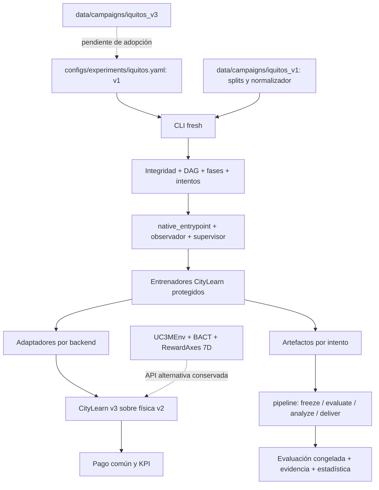

# Auditoría del árbol, la arquitectura y su correspondencia con PT_TAPIA_ZAMBRANO

Fecha del corte: 1 de noviembre de 2026, America/Lima. Repositorio: `D:/MADRLCitytleranflexresdr`. HEAD observado: `cb2d7c7c84b5315acb50b3b8828ef4a90065bdc4`, con cambios locales preexistentes. No es una auditoría del HEAD aislado: se inspeccionó el árbol de trabajo real.

## Dictamen

**La reorganización moderna es real, pero no está completa ni plenamente conciliada con el plan de tesis. No se acredita un proyecto sin vacíos, sin cuellos de botella o con paridad funcional integral respecto del árbol anterior.**

El monolito modular tiene dominio, casos de uso, puertos, adaptadores, CLI, catálogo de resultados, evaluación congelada y entrega. No hace falta imponer `src/`, microservicios ni más carpetas para considerarlo moderno. Sus problemas verificables son la divergencia entre fuentes canónicas, el enlace incompleto del dataset nuevo, los requisitos de recursos, los contratos heredados y la aceptación experimental pendiente.

**Hay además un defecto de aceptación reproducido, H20:** la puerta final puede devolver `scientific_acceptance=true` al releer un caso sintético con cero actualizaciones/pasos, identidad de intento distinta y cobertura incompleta de tratamientos. El resultado no representa un experimento real: demuestra que el verificador no puede utilizarse todavía como garantía de cierre científico.

**El entorno ejecutable no es igual al descrito en `PT_TAPIA_ZAMBRANO_v6_Iquitos_2.docx`.** Coinciden el propósito, los 17 agentes, los tres ejes y el paradigma cooperativo descentralizado. Difieren las dimensiones, controles activos, acciones por backend, recompensa, pesos, tarifa, búsqueda de hiperparámetros, semillas y despliegue. La tupla es una base conceptual aprovechable; su definición operacional necesita corrección antes de afirmar equivalencia con el programa.

Esta entrega diagnostica y deja correcciones y criterios de aceptación trazables. No cambia la implementación, documentos Word, datos, resultados ni dependencias; tampoco lanza la campaña, publica, mueve o borra archivos. Los únicos archivos añadidos por esta auditoría están en esta carpeta. Pytest usa sus temporales y puede ejecutar pruebas de simulación, empaquetado e inferencia locales.

## 1. Alcance y cómo se comprobó

- Inventario propio: **4.951 archivos**, **329 carpetas o fronteras**, **388 módulos Python**, de los que **103** pertenecen a `uc3m/`; **0 errores** de lectura/AST. Tamaño inventariado: 2.912.442.449 bytes. Ver `inventory_summary.json`, `files.csv`, `folders.csv`, `modules.csv`, `imports.csv`, `errors.json`.
- Cada archivo abierto tiene SHA-256 y tamaño. No se afirma que un hash o un AST equivalgan a una revisión semántica exhaustiva de todas sus líneas. Los CSV se inventariaron por bytes; esta pasada no vuelve a certificar numéricamente todas sus filas ni las mediciones originales.
- Se recorrieron todos los niveles del ámbito propio; los límites excluidos se registran. `CityLearn/` y `external/` son dependencias protegidas: se leyeron interfaces y rutas concretas necesarias para seguir el entrenamiento, sin auditarlas integralmente ni editarlas. No se recorrieron `.git`, el entorno virtual, cachés, junctions, estados de conectores ni los paquetes de auditorías previas. `outputs/` se inventarió, sin deserializar modelos.
- Se extrajo y revisó el cuerpo completo del PT: **692 párrafos/celdas**, incluidas las expresiones OMML cuando existen. Ver `PT_TAPIA_ZAMBRANO.extracted.txt` y `thesis.json` para el hash del original. `P0329` significa índice de párrafo del extracto, **no página de Word**. No se editó ni se verificó paginación/render del Word.
- La auditoría anterior `docs/audits/deep_20261101/` sirvió como lista de pistas. Sus 31 registros y su suite interrumpida no se promovieron a resultados actuales. Se consultaron código y comandos nuevamente.
- La comparación con lo anterior se limitó al historial del mismo repositorio. No se accedió a otro proyecto. `migration_paths.json` registra 209 archivos de HEAD ausentes en sus rutas anteriores; **28 conservan exactamente sus bytes en otra ruta actual**. Los restantes pueden haberse retirado o reescrito deliberadamente: no son 181 pérdidas funcionales demostradas.
- El corte no es un snapshot atómico. La verificación final de deriva se registra en `source_drift.json`; toda prueba vale para los archivos y hashes de su corte.

## 2. Árbol completo por responsabilidad

Los dos CSV de inventario son el anexo exhaustivo de rutas y subrutas. Esta tabla explica su función, sin confundir presencia de una carpeta con aceptación.

| Raíz | Archivos propios inventariados | Responsabilidad y estado |
|---|---:|---|
| `uc3m/` | 103 | Núcleo moderno y APIs heredadas. Capas presentes; conviven dos contratos de ejecución. Parcial. |
| `configs/` | 11 | Pesos, escenarios, algoritmo, experimento, dataset y KPI. Centralización real, enlace al dataset v1 y deriva documental pendientes. |
| `data/` | 4.284 | Tres generaciones de dataset, raw, splits, normalizadores y mantenimiento. Identidades distintas: no deduplicar por apariencia o hash. |
| `tests/` | 122 | Contratos, integración, perfil fresh y aceptación. La presencia de pruebas no acredita que todas estén verdes. |
| `tools/` | 201 | Generación, auditoría, evaluación, tesis y skills. Hay herramientas de campañas retiradas y scripts documentales pendientes de conciliar. |
| `docs/` | 96 | Arquitectura, decisiones, capítulos, planes y Word; excluye el contenido de auditorías anteriores. Hay varias fuentes que se contradicen. |
| `specs/` | 40 | SPEC-000–012 e índice STATUS. No reflejan todos los avances actuales; tareas cerradas todavía apuntan a rutas retiradas. |
| `scripts/` | 18 | Guarda de contexto, calidad y fachadas de compatibilidad. Cuatro referencias rotas en los índices principales en conjunto. |
| `examples_madrl_v3/` | 7 | Clientes y material Colab. No son aprendices independientes del backend nativo. Falta aceptación real de ejecución remota. |
| `governance/` | 5 | Layout, nombres, retención, roles y política de dependencias. Registros presentes; la aceptación de layout falla. |
| `deploy/` | 30 | Demo de inferencia, adaptador de planta, contenedores/Kubernetes e infraestructura heredada. No acredita operación física; su README aún enumera entrenamiento AWS retirado. |
| `outputs/` | 6 | Paquete de entrega y caché; no hay manifiesto de campaña productiva nueva en la ruta configurada al hacer el probe. |
| `.claude/` | 5 | Roles y configuración locales; las entradas de descubrimiento de skills no pasan el check actual. |
| `.github/` | 3 | CI portable y gobernanza GitHub. Existe configuración nueva, pero no se ejecutó un runner remoto. |
| `.specify/` | 1 | Constitución local. No es prueba de cierre de las SPEC. |
| `.vscode/` | 6 | Configuración de desarrollo. Inventario; no certificación de todos sus lanzamientos. |
| Archivos de raíz | 13 | Identidad, metadatos, dependencias, Docker, README y PT. README está desactualizado. |
| `CityLearn/`, `external/` | fronteras | Física, adaptadores y aprendices nativos. Dependencias conservadas, sin autorización de modificación en esta tarea. |
| `.git`, `.venv*`, cachés, `build`, `uc3m.egg-info`, `.superpowers`, conectores | fronteras | Historial, entorno, derivados o trabajo temporal. No se usan para declarar limpieza o eliminar archivos. |

### 2.1 Capas internas y enlaces reales

| Capa | Archivos representativos | Evaluación |
|---|---|---|
| Dominio | `domain/{campaigns,experiments,scenarios,objectives,evidence,pareto}.py` | Tipos y decisiones separados de infraestructura. Contratos de importación existentes. |
| Aplicación/dataset | `application/dataset/{provenance,construction,splits}.py` | Procedencia y separación temporal; B01 conserva excepción de retroproyección declarada. |
| Aplicación/entrenamiento | `fresh_campaign.py`, `fresh_policy.py`, `integrity.py`, `phases.py`, `fresh_acceptance.py`, `fresh_tuning.py` | Identidad, intentos desde cero, hashes, fases, selección HPO y rechazo de evidencia inválida. Implementación sustancial. |
| Adaptador de entrenamiento | `adapters/algorithms/native_entrypoint.py`, `learning_observer.py`, `evidence.py` | Ejecuta entrenadores protegidos, observa optimizadores y supervisa recompensa; no reemplaza el algoritmo. |
| Aplicación/evaluación | `evaluation/{frozen_evaluation,kpi_contract,fresh_analysis,results_catalog}.py` | Cálculo físico, inferencia y estadística; falta evidencia de campaña completa. |
| Adaptador de evaluación | `adapters/citylearn/{policy_inference,frozen_adapters,fresh_observations}.py` | Carga políticas y congela normalizador. El contrato físico exige revisión al adoptar precios por edificio de v3. |
| Entrega | `application/pipeline.py`, `tools/eval/report_fresh_campaign.py` | `status/freeze/evaluate/analyze/deliver` ya existen; STATUS sigue anunciando varios de estos pasos como pendientes. |
| Puertos | `ports/{learner,artifact_store,simulator}.py` | Existen. `SimulatorPort` declara integración diferida. La ruta fresh usa un callable de proceso en vez de hacer pasar toda la operación por este puerto. |
| Presentación | `presentation/training_panel.py` | Monitor local. No debe confundirse su estado con aceptación científica o industrial. |
| Compatibilidad | `env/`, `reward/`, `kpis/`, `algorithms/`, `multicriteria/` | Conserva capacidades previas; varias no están en el camino canónico de la campaña. Requieren contrato explícito de soporte, no borrado automático. |

## 3. Conservación del proyecto anterior

No hay evidencia suficiente para declarar «todo lo anterior fue migrado y verificado». Sí se puede distinguir lo siguiente:

| Capacidad anterior | Destino actual | Estado de conservación |
|---|---|---|
| Física energética y edificios | CityLearn v2 protegido | Conservada por dependencia; no reimplementada en `uc3m`. |
| Dec-POMDP y envoltorios de los cuatro backends | `CityLearn/citylearn/dec_pomdp.py`, `v3/`, `scripts/citylearn_v3_training_common.py` | Conservados; ruta canónica los utiliza. |
| Entrenadores HAPPO/MASAC/MATD3/MAAC | Scripts nativos + `native_entrypoint` | Conservados; no se acreditó nuevo aprendizaje anual de los cuatro en esta auditoría. |
| Lanzamiento local y AWS de entrenamiento | Retiro explícito en `governance/repository_layout.yaml` | Cambio deliberado hacia CLI/Colab; ausencia no equivale a pérdida accidental. AWS demo de inferencia aún existe. |
| Reanudación antigua | `runner.py`, `persistence.py`, `resume.py` y checkpoints | Código conservado para otra ruta; la campaña nueva prohíbe reanudar y repite desde cero. No son promesas equivalentes. |
| Construcción de dataset | `tools/dataset/` + aplicación/dataset | Evolucionó a v1/v2/v3. Falta adoptar la versión deseada en el experimento de entrenamiento. |
| BACT, ejes 7D, HPHI | `env/bact.py`, `reward/axes.py`, `reward/hphi.py`, `kpis/evaluator.py` | Archivos conservados. No se prueba que condicionen al aprendiz de la CLI. El PT auditado exige tres ejes, no convierte BACT en requisito por sí mismo. |
| AHP/TOPSIS y baterías estadísticas anteriores | `multicriteria/`, scripts y herramientas de evaluación | Conservados, pero coexisten con selección y estadística fresh. Hace falta una política de uso y unidad de réplica única. |
| Figuras/tablas/Word antiguos | Herramientas bajo `tools/thesis/`, documentos y capítulos | Conservar archivos no prueba vigencia de resultados ni regeneración desde una campaña nueva. |
| Evidencia y entrega modernas | Registro verificado, catálogo, pipeline y reporte fresh | Añadidas; aceptación con una campaña real todavía pendiente. |
| Skills | Once paquetes locales con registro | Fuentes válidas; descubrimiento local falla. |

La auditoría de consolidación encontró **0 grupos clasificados como clon redundante removible**, tres fachadas válidas y un grupo semántico pendiente. Los dos archivos `patch_cap6_conclusiones_desc_inf_docx.py` y `patch_resumen_align_kpi_gains_docx.py` contienen material único bloqueante para una fusión automática. No hay justificación para eliminarlos. Los cientos de grupos de igualdad en datos no equivalen a copias prescindibles.

## 4. Correspondencia exacta con PT_TAPIA_ZAMBRANO

| Numeral / extracto PT | Lo que afirma | Evidencia actual | Dictamen |
|---|---|---|---|
| §3.1.2, P0129–0132 | Capa cooperativa sobre v2; entorno, CTDE y protocolo reproducible | Capas y adaptadores reales | Coincidencia conceptual; falta aceptación integral. |
| §4.3.2, P0329–0330 | Tupla, N=17, estado ≈680, observación ≈40, acción 2–5 | Probe fresh: 17; estado 1.652; observaciones aumentadas 45–357; acciones 5–44 | Incompatibilidad cuantitativa demostrada. |
| §4.3.2/4.3.5 | Actor controla HVAC, BESS y EV | Schema activo: `electrical_storage`, `electric_vehicle_storage`, `washing_machine`; no acción HVAC activa | Incompatibilidad de control, no solo de nomenclatura. |
| §4.3.3, P0332 | Todos los críticos descritos como Q_i(s,a_1,…,a_N) | HAPPO usa valor centralizado; MASAC mezcla QMIX discreta; MAAC atención | CTDE común no significa crítico idéntico. |
| §3.1.4, P0144 y Anexo 3 | MASAC con exploración continua | `CityLearnSMACDiscreteEnv`: 89 alternativas en la configuración medida | Describir la variante implementada y su discretización. MAAC también usa envoltorio discreto. |
| Tabla 2, P0344/0349/0354/0359 | E1 .70/.15/.15; E2 .15/.70/.15; E3 .25/.15/.60; Global .50/.25/.25 | Políticas: E1 .60/.15/.25; E2 .25/.60/.15; E3 .15/.25/.60; solo E1–E3 | Matriz diferente; Global no es tratamiento de la campaña actual. |
| Tabla 3 y P0362–0364 | Mezcla individual/equipo y perfiles por algoritmo | `team_mean`, perfil unificado `thesis_indicators_v7`; `team_reward_ratio` rechazado | El pago común es coherente con cooperación total, pero no implementa esa tabla. |
| §3.1.3.2 y P0325 | Carbono dinámico con modulación solar, 0,672–0,790 | v1 conserva 0,6715–0,79; v2/v3 tienen 0,6669 constante | Depende de versión. El experimento sigue en v1 aunque hay construcción posterior. |
| §3.1.3.3, P0140 y P0363 | TOU .26/.38 USD/kWh y arbitraje temporal | v1 raw tiene otros valores; escenarios canónicos aplican tarifa media constante | No se ejecuta el arbitraje TOU descrito. |
| §4.3.1, Tabla 1 | 50 cargadores, capacidades y 72 archivos | Dataset y espacios crecieron; la observación añade 185 códigos EV en el split medido | Regenerar ficha desde el dataset elegido, sin copiar la tabla vieja. |
| §3.1.2.3/4.3.5, P0132/P0436 | Optuna/TPE | HPO actual: producto cartesiano de tres hiperparámetros, 8 candidatos por algoritmo | Grid search implementada; no evidencia de TPE en la ruta fresh. |
| Tabla 4 | gamma .99, redes 256, replay 1.000.000, parámetros comunes | Grilla gamma .99/.9999 y 128/256; buffers/unidades distintos por backend | Tabla desactualizada; igualdad literal de números no implica igualdad de capacidad. |
| §4.3.6, P0440–0441 | 12 corridas semilla 0, 5/50 episodios, local/Docker/AWS | Colab, 12 semillas confirmatorias, fases y 4 etapas; AWS entrenamiento retirado | Protocolo distinto. |
| §4.7 y Anexo 1 | Pruebas por KPI y significancia; §4.1 dice sin hipótesis inferenciales | `fresh_analysis.py`: semillas como réplicas y familias de contrastes predefinidas; también informes de KPI-gains | Conciliar el nivel de inferencia y distinguir KPI, semilla, episodio, hora y edificio. |
| Anexo 4 | Resultados y p-valores de corrida de referencia | Resultados históricos retirados según decisión registrada | No usarlos como evidencia de la campaña nueva ni garantizar un ganador futuro. |

### 4.1 Medición del entorno ejecutable

`runtime_probe.json` registra una instancia real del adaptador común, con **split train_2023**, semilla 901, normalizador congelado, seis posiciones de episodio y tres llamadas de interacción, sin aprendizaje:

| Variable | Medida |
|---|---:|
| Agentes | 17 |
| Estado del adaptador común (`state_dim`) | 1.652 |
| Observación CityLearn por agente | 42–315 |
| Observación con códigos EV | 45–357 |
| Suma de observaciones aumentadas sin padding | 1.837 |
| Dimensión homogénea con padding | 357 por agente |
| Acción física local | 5–44 |
| Total de componentes de acción física | 219 |
| Acciones discretas del adaptador común | 89 |
| Agregación | `team_mean` |
| Pesos observados | flex .60, carbono .15, costo .25 |
| Pago idéntico para todos | Sí, en los tres pasos observados |

No son 17 políticas entrenadas ni un ensayo de los cuatro aprendices. La prueba mide el contrato fresh del adaptador común. La matriz de simulador de `tests/contract/training/test_real_simulator_matrix.py` usa el dataset antiguo protegido de CityLearn; incluso si pasa, no sustituye cuatro aprendizajes fresh. El BACT de 29 dimensiones de `UC3MEnv` **no se añadió** en esta ruta: el adaptador añade códigos de tipo EV, con significado diferente.

**No hay una única entrada centralizada idéntica para los cuatro backends.** El valor 1.652 es el estado expuesto por el adaptador común, no una afirmación de que todos los críticos reciban exactamente ese tensor. El seguimiento de los wrappers en `CityLearn/scripts/citylearn_v3_training_common.py:8633–8790` establece:

| Backend | Observación del actor en el contrato medido | Entrada centralizada / acción |
|---|---|---|
| HAPPO | Local con padding a 357 | `repeated_ctde_state`, 1.652; acción continua con padding a 44. |
| MASAC | Local con padding a 357 | Estado SMAC 1.652 para el mezclador; 89 alternativas discretas. |
| MATD3 | Local con padding a 357 | `padded_share_observation_space`: 17×357 = **6.069**, además de acciones conjuntas según el crítico nativo; acción continua. |
| MAAC | Local con padding a 357 | Atención sobre información de agentes según su crítico nativo; envoltorio de 89 alternativas discretas, sin un `state_dim=680` común declarado por este wrapper. |

Esta tabla combina la dimensión medida con el cableado estático de los wrappers; no acredita tamaños de todas las activaciones internas de redes. Igualar únicamente `state_dim` en el Word no resolvería la equivalencia entre backends.

## 5. Revisión de la tupla y formulación propuesta para conciliar

En P0329 aparece:

`M = <S, {A_i}, P, R, {O_i}, Omega, gamma, T>`.

Su estructura es compatible con la familia Dec-POMDP, pero omite explicitar agentes y distribución inicial y mezcla el estado del proceso con el vector de entrada del crítico. En P0084, además, `T` nombra transición, mientras en §4.3.2 nombra horizonte. Es corregible; no invalida por sí solo el uso de CityLearn.

La formulación recomendable para este código es una familia de procesos por escenario fijo:

`M_e = <N, S, {A_i}, P, r_e, {O_i}, Z, rho_0, gamma, H>`.

| Elemento | Definición necesaria y enlace con el programa |
|---|---|
| `N={1,…,17}` | Un agente por edificio; los cargadores pertenecen al edificio, no son agentes extra. |
| `S` | Estado latente suficiente del simulador, incluyendo estados energéticos/EV, índice temporal, entradas exógenas y memoria de recompensa cuando sea necesaria. No demostrar Markovianidad solo concatenando observaciones. |
| `z_t=g(s_t)` | Información centralizada para el entrenamiento: el adaptador común expone 1.652 componentes; MATD3 declara además una entrada conjunta con padding de 6.069. Debe distinguirse del estado físico completo y anotarse la representación por backend. No se acreditó suficiencia de Markov. |
| `O_i`, `Z` | Información local observable y ley de observación. En el simulador puede ser una proyección determinista, expresable mediante una distribución puntual. Declarar normalización, códigos EV y padding. |
| `A_i` | Acción física heterogénea. Para comparar implementaciones, definir también `U_i^(b)` y el mapa de decodificación `D_i^(b):U_i^(b)->A_i` de cada backend. La variante discreta restringe las acciones representables. |
| `P(s'|s,a)` | Dinámica del simulador y de las series exógenas. Con datos y semillas fijados puede ser determinista condicionalmente; eso es un caso particular de un núcleo probabilístico. No inventar ruido. |
| `rho_0` | Reset: condiciones iniciales BESS/EV, inicio del split, selección temporal y semilla. Aunque sea un estado inicial fijo debe declararse. |
| `r_e` | Pago escalar común del distrito. Los términos locales se agregan mediante media, con penalizaciones EV/BESS fuera de los tres coeficientes de eje. Usar los términos y límites efectivos de v7, no la mezcla retirada. |
| `gamma` | Parte del tratamiento/hiperparámetros congelados; actualmente se consideran .99 y .9999. No hay un único .99 válido para toda la campaña preparada. |
| `H` | Número de decisiones y convención de extremo temporal: separar número de filas, estados y transiciones; acreditar episodio anual completo y KPI diarios, también en 2024 bisiesto. Esta auditoría corta no certifica esa aceptación anual. |

La política general debe escribirse `pi_i(u_i,t | tau_i,t)`, con `tau_i,t` el historial local o estado recurrente. `pi_i(u_i,t|o_i,t)` es una restricción reactiva válida de implementación, pero no la definición general de una política óptima en observabilidad parcial. El producto de políticas locales fija la descentralización; el crítico centralizado no es una observación extra del actor en ejecución.

Para el pago actual puede escribirse, a nivel de agrupación:

`r_e(t) = (1/N) sum_i scale * [ w_e,flex F_i(t) + w_e,co2 C_i(t) + w_e,cost K_i(t) + p_EV,i(t) + p_BESS,i(t) ]`.

Los términos `F/C/K` de v7 incluyen normalización, subpesos y acotamiento; no son numéricamente idénticos a los KPI físicos acumulados. No debe sustituirse la fórmula efectiva por una suma sin esos elementos. Los términos pendientes tienen peso cero; por ello **no se implementan todavía todos los indicadores posibles como objetivos de entrenamiento**.

Los coeficientes E1–E3 establecen preferencias compensatorias sobre términos normalizados, no una prioridad lexicográfica ni una garantía de cumplimiento físico. Las penalizaciones EV/BESS no sustituyen límites duros del simulador. Los valores .60/.25/.15, los subpesos y la sensibilidad .55/.65 son decisiones metodológicas del proyecto; las fuentes consultadas no prescriben esos números.

El pago común permite describir un juego de interés idéntico. Un óptimo global conjunto, si existe, es un equilibrio de Nash porque ninguna desviación unilateral puede mejorar el máximo. Eso no demuestra que un punto estacionario, convergencia numérica o recompensa estabilizada sea un óptimo global; tampoco prueba que todo equilibrio sea eficiente.

El sustento de la distribución inicial, observaciones e historias está en Oliehoek et al. (2008) y Oliehoek y Amato (2016). La extensión a espacios continuos se expresa mediante núcleos probabilísticos; el artículo de 2008 no demuestra por sí mismo la suficiencia de las observaciones de este simulador. Ver fuentes al final.

## 6. Hallazgos y aceptación necesaria

P0: bloquea una afirmación de experimento completo o comparable. P1: brecha alta de contrato, integración o trazabilidad. P2: mantenimiento o aceptación acotada. La prioridad no significa que todos sean errores de programación.

| ID | Nivel / tipo | Evidencia e impacto | Corrección verificable |
|---|---|---|---|
| H01 | P0 / divergencia científica | PT §§3.1.4,4.3.2–4.3.5 vs `runtime_probe.json`, schema y políticas. Dimensiones, controles, acciones, recompensa y pesos no coinciden. | Elegir y congelar contrato experimental; actualizar sus tablas desde el contrato real y probar observación/acción/recompensa por backend. No corregir solo etiquetas. |
| H02 | P0 / integración de dataset | `configs/experiments/iquitos.yaml:3–5` selecciona v1; v2/v3 tienen nuevas aceptaciones, emisiones y tarifas. | Decidir la identidad de campaña que corresponde al dataset aprobado; crear una identidad nueva y verificar fuentes, splits, normalizador, tamaños y todos los consumidores. No cambiar únicamente el alias. |
| H03 | P0 / viabilidad computacional | `native.yaml:47` pide MASAC RAM≥72 y VRAM≥82 GiB; la grilla incluye hidden=256, cuya estimación declarada llega a 103,3 GiB. Los recursos medidos rechazan ambas fases. | Acreditar recursos que permitan completar todos los candidatos o aprobar una reformulación comparable de capacidad/presupuesto. Mantener los rechazos explícitos; no reducir silenciosamente. |
| H04 | P1 / cuello de planificación | `phases.py:worker_limit/phase_budget` reserva el máximo de todos los algoritmos de la fase. HAPPO comparte fase con MASAC. | Si se quiere aprovechar hardware menor, planificar por tratamiento y registrar recursos efectivos sin alterar el requisito científico; probar que un algoritmo inviable no inmovilice los demás sin una razón de protocolo. La barrera de fases es actualmente deliberada. |
| H05 | P1 / KPI de costo y tarifa | Escenarios `mode: flat`; `scenario_manager.py` reemplaza precios por su media. El PT promete arbitraje TOU. | Definir si se estudia energía a tarifa plana, TOU o facturación completa. Mantener el mismo contrato en recompensa, baselines y KPI, con pruebas de una factura analítica. |
| H06 | P1 / divergencia interna net billing | `configs/evaluation/kpis.yaml:27–32` declara venta al precio de compra; schema v1 habilita mercado comunitario y `grid_export_price=0`. | Elegir liquidación e implementar trazas de importación/exportación/transacciones con reconciliación de la misma factura en recompensa y evaluación. No equiparar costo firmado y factura del mercado. |
| H07 | P1 / adopción v3 condicionada | `policy_inference.py:133–134` toma precio del primer edificio para todo el distrito; v3 tiene `pricing_i.csv`. | Admitir precio por edificio en trazas y cálculo. Caso analítico: 1 kWh a .10 + 1 kWh a .20 debe costar .30, no .20. Es un riesgo al migrar, no un error demostrado de precio heterogéneo en la campaña v1 actual. |
| H08 | P1 / términos incompletos | `CityLearn/citylearn/v3/reward.py:157,163–176`: DSO, cargo por potencia y desviación de precio tienen `pending_owner` o peso cero. | Documentar exclusión del alcance o completar fórmula, datos, ventana y parámetros antes de activar términos. El propio skill exige no inventarlos; no rellenar con constantes arbitrarias. |
| H09 | P1 / conflicto documental | README declara v4 definitiva y resultados retirados; `workflow_manifest.json` exige campaña vieja; `local.md` muestra CLI antigua con `--resume`; `entrenamiento.md` conserva lanzador anterior. | Una guía operativa canónica que delegue en runbook/configuración actual; retirar afirmaciones vigentes de resultados retirados y probar los comandos publicados. |
| H10 | P1 / desalineación de SPEC | STATUS conserva MASAC clamp/252 HPO/v5 y funciones pendientes; código actual tiene 288 HPO, perfil v7, selección y pipeline. SPEC-011 tiene tareas cerradas sobre lanzadores retirados. | Conciliar requisito→archivo actual→prueba→resultado; preservar historia como historia. No cerrar con solo existencia de código. |
| H11 | P1 / API heredada CTDE | `env/wrappers.py:47–48,67`: `share_obs=obs`; repetir una observación no es construir estado global. Reset repite n_threads, step extrae solo el primer hilo. | Declarar API no soportada para entrenamiento o corregir y comprobar con estado y hilos reales. No afecta automáticamente a HAPPO canónico, que usa otro wrapper nativo. |
| H12 | P1 / aceptación experimental | No hay `outputs/campaigns/iquitos_v1/campaign_manifest.json` productivo en el probe; `authorized_stages=[]`; no campaña nueva completa. | Piloto anual, HPO/validación, congelado, confirmación multisemilla, sensibilidad, prueba 2025, estadística y entrega verificadas. Una negativa por falta de autorización es un control correcto, no un defecto. |
| H13 | P1 / diseño temporal | Las aceptaciones v1/v3 declaran B01 2023 retroproyectado desde 2024. No puede llamarse una separación temporal totalmente libre de información futura. | Mantener excepción visible y ejecutar sensibilidad sin edificios/periodos modelados, o reconstruir con fuente disponible al corte temporal. |
| H14 | P1 / respaldo experimental | Drive copia intentos terminados; una desconexión dentro de un intento obliga a repetirlo. La política nueva rechaza resume. | Medir duración anual y pérdida máxima por intento; probar sincronización/restauración real en Colab según el protocolo desde cero. No prometer continuidad de optimizador/RNG/replay en esta campaña. |
| H15 | P2 / layout no aceptado | `layout/repository_layout_acceptance.json`: cuatro referencias rotas; un grupo pendiente; dos scripts con contenido único. | Reparar enlaces y conciliar los dos scripts mediante equivalencia de capacidades y prueba de regeneración; aceptar layout de nuevo. Sin borrado automático. |
| H16 | P2 / controles de mantenimiento | `workflow.log`: FileNotFoundError antes del informe; descubrimiento skills: 11 entradas ausentes; Ruff: tres incidencias en el ámbito de CI. | Reconectar el verificador al notebook actual, registrar descubrimiento local y resolver lint. Repetir comandos y guardar sus códigos por separado. |
| H17 | P2 / vigencia bibliográfica | PT contiene autores/años incorrectos comprobados y referencias incompletas. | Corregir APA contra fuentes primarias y verificar los porcentajes citados antes de reutilizarlos. No se auditó exhaustivamente la matriz completa de antecedentes. |
| H18 | P1 / vía heredada con relleno | `multicriteria/pipeline.py:57,136` permite relleno y curvas sintéticas por defecto; el script usa `allow_illustrative_fill=not args.real_only`. La API de carga, en un repositorio temporal vacío, devolvió `source=illustrative` y cuatro alternativas. Sí etiqueta su procedencia, pero el usuario no necesita pedir expresamente el modo ilustrativo. | Exigir modo ilustrativo explícito y prohibir su promoción a tesis. Conservar su utilidad didáctica y las etiquetas de procedencia. Esta ruta es distinta del pipeline fresh; no se afirma que la campaña nueva haya usado esos valores. |
| H19 | P1 / reproducibilidad de pruebas | `test_frozen_evaluation.py:23–27`, `test_three_level_game.py:24` y `test_frozen_evaluation_writer.py:21` buscan checkpoints en una ruta fija de `.superpowers/sdd/…`. `test_real_learning.py` genera sus intentos en `tmp_path`, sin enlazarlos como fixture común a esas pruebas. | Proveer fixture de microentrenamiento real o entrada de artefactos explícita, con identidad y hashes. Probar desde clon/entorno limpio, sin checkpoints de una sesión previa; no sustituirlos con mocks ni convertir su ausencia en skip. Una aprobación en este workspace no acredita esa reproducción. |
| H20 | P0 / defecto reproducido de promoción | `fresh_acceptance.py:167–246`: la relectura `treatment_trust_reasons` no llama al contrato estricto `attempt_evidence_reasons`; la puerta no compara el conjunto planificado con el completado y acepta un `scientific_report.json` de solo ID/estado. `promotion_probe.json` muestra aceptación científica verdadera con evidencia inválida y dos tratamientos planificados frente a uno informado. | Una única validación estricta al crear, reutilizar, descubrir, evaluar y promover; comprobar propietarios, cambios de parámetros, intento/semilla/tratamiento, episodios/pasos y hashes; exigir cobertura exacta de etapas/tratamientos y análisis enlazado a tablas/KPI verificados. Las cuatro variantes del probe deben dejar de promover. |
| H21 | P1 / cierre desconectado del pipeline | `pipeline.deliver()` no admite ni transmite `gate_report`, así que su aceptación software resulta falsa. `analyze_stage()` escribe `analysis/<etapa>_<split>/scientific_report.json`, mientras `verify_fresh_acceptance()` busca `reports/scientific_report.json`; el manifiesto de análisis no se consume en esa puerta. | Conectar por referencia explícita la puerta de software y el manifiesto del análisis con sus hashes, campaña, etapa y split. Probar `analyze → deliver` con un caso completo válido y con datos alterados. Generar un paquete no equivale a entregar una campaña aceptada. |

### 6.0 Reproducción de la promoción incorrecta (H20)

`promotion_probe.py` reutiliza la fixture mínima de `tests/fresh_training/test_security_and_acceptance.py` en un directorio temporal nuevo. No hay entrenamiento, llamadas al motor ni deserialización de checkpoints; se verifica la lógica de custodia y promoción. Los bytes opacos del checkpoint son exactamente los de esa fixture existente.

| Caso | Resultado observado |
|---|---|
| Fixture base: un tratamiento y checkpoint con hash | `trained_not_evaluated`, aceptación software verdadera. |
| Cambiar actualizaciones a 0, pasos a 0, episodios a 0 e ID de intento a otro | Sigue `trained_not_evaluated`, aceptación software verdadera. |
| Añadir informe con solo campaña correcta y `status=scientifically_complete`, sin tablas ni estadística | **Aceptación científica verdadera**. |
| Manifest/etapa planifican dos tratamientos, resultado conserva uno | **Aceptación científica verdadera**. |

El contrato estricto de creación de intentos ya existe y se utiliza en `fresh_campaign.attempt_completion`. La corrección está incompletamente conectada a la relectura y a la promoción final; no se trata de afirmar que nunca se implementó el control. También pueden verse afectados consumidores que confían en `treatment_trust_reasons`, como el catálogo y la reutilización de intentos. La prueba no demuestra una intrusión ni que alguna campaña real haya sido promovida de esta manera.

### 6.1 Dos advertencias de interpretación de la arquitectura

1. `UC3MEnv` almacena `lambdas` y actualiza `RewardAxes` para diagnóstico, pero `step()` devuelve la recompensa de `_dec`. No basta cambiar los siete lambdas de esa API para afirmar que cambia la señal de entrenamiento nativa. Además, su `state()` delega al estado base sin incluir el BACT que antepone a la observación. Se necesita un contrato explícito de esta API alternativa si se mantiene publicada.
2. El archivo común protegido de CityLearn sigue concentrando creación de entornos, adaptadores, métricas y reporte; el núcleo propio lo envuelve, no lo ha sustituido por completo. También hay módulos propios largos (p. ej. `tools/thesis/generate_borrador_tesis_docx.py`, con una función de 1.096 líneas en el corte). Esto es una señal de mantenibilidad; el tamaño no demuestra por sí solo un cuello de tiempo de ejecución. No se hizo un perfil de CPU/GPU de la campaña anual y no se promete ausencia de cuellos por conteo de archivos.

## 7. Verificación y alcance de la evidencia

`commands.json` conserva comandos, códigos de salida y logs. Códigos de comandos encadenados no se interpretaron como éxito conjunto; el capturador ejecuta y registra cada uno por separado.

| Comprobación actual | Resultado |
|---|---|
| Guarda de contexto | Raíz/origin correctos; repetida antes de escrituras y operaciones Git. |
| Inventario/AST | 4.951 archivos, 388 módulos, 0 errores. No certifica toda la semántica. |
| Layout C-software | **Rechazado**, aunque el comando generador `accept` devuelve 0: el booleano del informe es falso. |
| Duplicados | 0 grupos removibles; 1 grupo pendiente; 2 archivos bloqueados por contenido único. |
| Skills básico | Código 0. |
| Skills descubrimiento | Código 1, 11 entradas ausentes. No se instalaron skills globales. |
| Verificador de workflow | Código 1, notebook antiguo ausente; no llega a generar el informe solicitado. |
| Ruff, mismo ámbito que CI | Código 1: F841 en `test_citylearn_net_emissions.py:37`; F401 en `test_learning_observer.py:8` y `drive_sync.py:31`. |
| Dependencias instaladas | `pip check`: código 0, sin requisitos rotos. No demuestra instalación limpia ni ausencia de vulnerabilidades. |
| Simulador fresh | Construcción real y tres pasos; dimensiones, pesos y pago común registrados. Sin aprendizaje. |
| Puerta de promoción | Defecto H20 reproducido en temporales: acepta evidencia inválida y un informe científico mínimo. Ver `promotion_probe.json`. |
| Presupuesto actual | Piloto: 4 tratamientos/105.120 pasos; HPO: 288/25.228.800; confirmación: 144/63.072.000; sensibilidad: 72/31.536.000. **119.941.920 pasos planificados**, no ejecutados. |
| Recursos | Dos fases rechazadas en el probe local por recursos disponibles. Las cifras de RAM/VRAM son instantáneas bajo carga, no capacidad nominal de la máquina. |
| Pruebas generales propias | Resultado final y limitaciones en `validation.md` y `pytest.xml`, si se produjo. Cuatro microentrenamientos de `test_real_learning.py` se excluyen explícitamente del comando de auditoría. |
| Colab real, entrenamiento anual, multisemilla, sensibilidad empírica | No ejecutados en esta auditoría. |
| Docker, servicios/OT, runner CI remoto, medición de rendimiento anual | No ejecutados. La demo separa readiness de aceptación operacional; no se presume control de planta. |

Una primera versión de `probe.py` usó `reset(seed=...)` en el adaptador común, cuya API recibe la semilla en construcción y tiene `reset()` sin ese argumento. Ese error era del helper de auditoría, se corrigió y se repitió el probe. No se clasificó como defecto del proyecto. El resultado válido está en el JSON final, sin entradas `error`.

## 8. Fundamentación académica consultada en la web

Las fuentes justifican criterios de formulación, comparación, coordinación y reproducibilidad. **Ninguna acredita los pesos numéricos exactos, demuestra que este repositorio está completo o sustituye el experimento pendiente.** Las tesis se identifican como tesis; no se les atribuye indexación de revista.

| Fuente primaria | Tipo / verificación | Aplicación y límite |
|---|---|---|
| Costea (2026), Politecnico di Torino | Tesis de maestría; ficha universitaria y resumen consultados | Compara enfoques PPO en CityLearn con baselines y KPI de costo/carbono/distrito. Sustenta separar protocolo y evaluación. No es una réplica de los cuatro backends de esta tesis ni prescribe su tupla exacta. |
| Charbonnier (2023), Oxford | Tesis doctoral; ficha universitaria localizada en búsqueda, con tipo DPhil, título y autor; apertura directa devolvió 403 | Sustenta pertinencia de coordinación de flexibilidad residencial con MARL. No se afirma lectura integral del PDF ni validación de datos de Iquitos. |
| Nweye et al. (online 2024; volumen 2025) | Artículo editorial JBPS, DOI comprobado; página editorial declara indexación en Scopus | Respalda CityLearn como entorno para comunidades y KPI. No valida automáticamente el fork o los escenarios privados. El año debe elegirse de manera consistente con la versión bibliográfica citada. |
| Oliehoek, Spaan y Vlassis (2008); Oliehoek y Amato (2016) | Artículo JAIR, PDF primario alojado por autor; libro Springer | Distribución inicial, observaciones y política basada en historias. No prueba que el vector global del código sea Markoviano. |
| Iqbal y Sha (2019) | Artículo de conferencia ICML/PMLR, página primaria | Críticos con atención y políticas descentralizadas. No permite atribuir a MASAC continuo la implementación discreta usada aquí. |
| Zhong et al. (2024) | Artículo JMLR, página editorial y volumen consultados | Marco heterogéneo y garantías bajo sus supuestos. No implica convergencia global observada en los microensayos del proyecto. |
| Pineau et al. (2021) | Artículo JMLR, ficha editorial consultada | Reproducibilidad mediante código, datos y protocolo. Motiva hashes, comandos y límites de evidencia; no exige este árbol concreto. |

### 8.1 Referencias y correcciones concretas del PT

- Costea, C. C. (2026). *Multi-Agent Reinforcement Learning Building Energy Optimization: Taxonomy and Experimental Evaluation in CityLearn* [Tesis de maestría, Politecnico di Torino]. https://webthesis.biblio.polito.it/40396/
- Charbonnier, F. V. J. (2023). *Multi-agent reinforcement learning for the coordination of residential energy flexibility* [Tesis doctoral, University of Oxford]. https://ora.ox.ac.uk/objects/uuid%3A4acf19ee-76b3-4e71-a424-259cd9e2d6f5
- Nweye, K., et al. (2025; publicación online 2024). *CityLearn v2: Energy-flexible, resilient, occupant-centric, and carbon-aware management of grid-interactive communities*. Journal of Building Performance Simulation, 18(1), 17–38. https://doi.org/10.1080/19401493.2024.2418813 . Ficha de indexación editorial: https://www.tandfonline.com/action/journalInformation?journalCode=tbps20&show=aimsScope . La abreviación de autores aquí es descriptiva; la bibliografía final del PT debe incluir la lista APA completa.
- Oliehoek, F. A., Spaan, M. T. J., & Vlassis, N. (2008). Optimal and approximate Q-value functions for decentralized POMDPs. *Journal of Artificial Intelligence Research, 32*, 289–353. https://people.csail.mit.edu/fao/docs/Oliehoek08JAIR.pdf
- Oliehoek, F. A., & Amato, C. (2016). *A concise introduction to decentralized POMDPs*. Springer. https://doi.org/10.1007/978-3-319-28929-8
- Iqbal, S., & Sha, F. (2019). Actor-attention-critic for multi-agent reinforcement learning. *Proceedings of Machine Learning Research, 97*, 2961–2970. https://proceedings.mlr.press/v97/iqbal19a.html
- Zhong, Y., Kuba, J. G., Feng, X., Hu, S., Ji, J., & Yang, Y. (2024). Heterogeneous-agent reinforcement learning. *Journal of Machine Learning Research, 25*(32), 1–67. https://www.jmlr.org/papers/v25/23-0488.html
- Pineau, J., et al. (2021). Improving reproducibility in machine learning research (A report from the NeurIPS 2019 reproducibility program). *Journal of Machine Learning Research, 22*(164), 1–20. https://www.jmlr.org/papers/v22/20-303.html

Correcciones bibliográficas confirmadas en el PT:

1. P0574 atribuye DOI `10.3390/en17205211` a Yao et al. (2023). La editorial identifica **Wilk, P., Wang, N., & Li, J. (2024)**. https://www.mdpi.com/1996-1073/17/20/5211/notes
2. P0558 atribuye `10.1145/3600100.3626276` a Nweye et al. como primer autor. La ficha universitaria identifica **Wu, A., Nweye, K., & Nagy, Z. (2023)**, pp. 314–315, y describe una prueba de concepto pequeña. No se acredita con esa ficha el salto a una demostración en 17 edificios que afirma P0054/P0143. https://research.tue.nl/nl/publications/heterogeneous-multi-agent-reinforcement-learning-for-grid-interac/
3. P0578 pone Zhong et al. (2023) en JMLR 25. La versión editorial es **2024**, 25(32), 1–67; distinguirla del preprint 2023.
4. P0561 pone 2025 para arXiv `2604.02728`; la ficha arXiv registra **3 de abril de 2026**. https://arxiv.org/abs/2604.02728 . No se validó aquí una versión editorial alternativa.

Estas comprobaciones no certifican los 50 antecedentes ni sus porcentajes de mejora. La nota del propio PT P0580 todavía declara metadatos pendientes; debe conciliarse con P0047, que llama «verificadas» a todas las investigaciones.

## 9. Orden de cierre recomendado y verificable

1. **Puerta de promoción y contrato del experimento:** cerrar H20 antes de usar estados de aceptación; fijar documento de referencia, dataset v1/v3, pago neto/mercado, tarifa, control de HVAC y variantes de acciones. Registrar decisiones metodológicas; conservar los objetivos del PT y explicar los cambios de implementación.
2. **Viabilidad antes de campaña:** probar los cuatro backends con su horizonte, replay y candidatos efectivos, y resolver la imposibilidad de MASAC en los recursos elegidos. No iniciar una HPO cuyo conjunto completo no pueda terminar bajo su regla de selección.
3. **Integración del dataset elegido:** identidad nueva, fuentes/splits/normalizador, precios por edificio, controles y dimensiones. Probar factura física y liquidación, observación/acción por backend, ausencia de filtración y trazabilidad del reward.
4. **Conservación funcional:** matriz por capacidad anterior con consumidor dinámico, sustituto, prueba, archivo y decisión de retiro; resolver el wrapper heredado y los dos scripts únicos. Los 28 traslados exactos no bastan para demostrar paridad.
5. **Coherencia documental y herramientas:** actualizar README, workflow, arquitectura, SPEC y luego el PT mediante el flujo Word autorizado, con revisión estructural y visual de una copia nueva. Reparar enlaces, descubrimiento y lint.
6. **Aceptación de software:** suite y puerta fresh sin omisiones, instalación limpia y paquete Colab. El éxito de pruebas puras no es aprendizaje ni reproducibilidad remota.
7. **Aceptación científica:** campaña completa, evaluación congelada y baselines, semilla como réplica, sensibilidad, prueba temporal y entrega con hashes; aceptar también un resultado sin diferencias o sin ganador inferencial.

El cierre debe registrarse por hallazgo/requisito con estados `implementado`, `verificado`, `parcial`, `bloqueado` o `pendiente`. El diagnóstico actual no habilita marcar toda la arquitectura o la tesis como completas.
