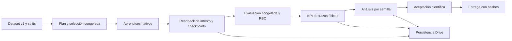

# Ejecución de la remediación integrada

Estado: correcciones implementadas; verificación final en curso. Rige [el contrato v1 acordado](../../decisions/contrato_v1_pt.md); [fundamento científico y límites](fundamento.md). El [plan integrado](../../plans/remediacion_integrada.md) y su paquete de auditoría conservan su corte documental original. Este informe registra la ejecución posterior; el `implementation_executed=false` de aquel corte no describe la ejecución actual.

Los resultados del último corte se incorporarán junto con los JUnit originales de `data/maintenance/integracion/c20261101i01/`. No existe aceptación científica u operacional; `authorized_stages=[]` en la configuración canónica.

## Cambios y trazabilidad

| Frente | Implementación y evidencia verificable | Límite |
|---|---|---|
| Identidad y promoción | Un solo lector estricto contrasta campaña, plan, entradas, propietarios de optimizadores, parámetros congelados, argumentos nativos, pasos, episodios y checkpoints. Gate JUnit vinculado al corte de código/pruebas. | Una marca `complete` o un código 0 no bastan. |
| Marco conceptual | Tupla Dec-POMDP, estado físico frente a entrada del crítico, historias locales, decodificación de acciones y diferencias PT–v1 documentados en el contrato. | Diferencias entre espacios continuos/discretos y capacidad siguen siendo confusores declarados. No se cambió el documento Word. |
| Simulador y KPI | Parche autorizado en los dos archivos de CityLearn: se procesa el último intervalo. Regresiones nativas de 24 y 48 intervalos pasan. Costo y huella exógena usan precios por edificio. | No equivale a validar 8760 horas ni una factura comercial real. |
| Evaluación y estadística | Acceso test ligado a campaña y selección congelada; lectura final exige horizonte completo. Candidatos HPO se verifican individualmente antes de agregarlos por semilla. Inaplicabilidad estructural de respuesta a precio se congela con la tarifa efectiva. Valores ilustrativos requieren opción explícita. | Las pruebas sintéticas no son resultados científicos. El backcast B01-2023 y las demás amenazas temporales v1 siguen declarados. |
| Presupuesto y recuperación | Prueba inmutable por intento, escrita antes del aprendiz; sincronización con hashes por streaming, publicación atómica y recuperación contenida. Postprocesamiento se añade sin copiar nuevamente los pesos. | Restauración local verificada; falta desconexión real en Colab y continuidad optimizer/RNG/replay. |
| Pipeline y entrega | Análisis registrado, entrega preparada y releída, errores con salida no nula; núcleo instalado desde wheel probado. | Entrega declarada como manifiestos/estadísticas; checkpoints permanecen en el almacén de intentos. No hay exportador ONNX ni ganador certificado. |
| Seguridad y calidad | Recorrido de instrucciones excluye estado privado del navegador; inferencia valida metadatos/salidas y devuelve diagnóstico de clipping por petición. Ruff, habilidades locales y flujo estático pasan. | Sin aceptación OT; la configuración de CI no demuestra ejecución en GitHub. |

[El acta por tarea](evidencia.md) y [el registro JSON](estado_ejecucion.json) relacionan requisitos del plan, archivos implementados con SHA-256, comandos/pruebas previstos, JUnit originales y brechas. Los registros históricos fallidos o cancelados se conservan; sus contadores no se suman con ejecuciones superpuestas.

## Verificación observada

- Suite general sin los cuatro archivos que requieren aprendices nuevos: **1121 casos, 1119 aprobados, 2 fallos, 0 omisiones**, 3322.761 s. Empezó antes de las últimas correcciones; su nombre `general_stable.xml` no acredita corte estable.
- Los dos fallos eran de restauración Drive con módulos/fixtures anteriores. Repetición actual de `test_drive_sync.py`: **4/4 aprobados**, 0 omisiones (`I09/general_failures_current.xml`).
- Corte y restauración con presupuesto por intento: **27/27 aprobados** (`budget_cut_final.xml`). Usa planificador y archivos reales con evidencia de optimizador sintética: reutiliza tres completos y ejecuta solo el cuarto.
- Cadena científica de contratos: **1/1 aprobada** (`scientific_chain_final.xml`). Datos/evidencia sintéticos: 24 candidatos HPO temporales, selección congelada, 144 tratamientos confirmatorios, análisis held-out y rechazo de manipulación. La grilla de producción conserva 288 HPO.
- Paquete instalado: **6/6**; inferencia: **20/20**; frontera física de CityLearn: **2/2**. Son ejecuciones focalizadas anteriores al corte final, no totales adicionales de pruebas independientes.
- Perfil estricto actual: en curso; incluye cuatro aprendices nuevos de **2 × 168 pasos por backend** mediante una configuración micro independiente. El YAML anual conserva `authorized_stages=[]`.

La prueba nativa inicial encontró `WinError 1455` al cargar CUDA; otra fue cancelada para fijar el nuevo corte tras la revisión. No se contabilizan como aprendices aprobados. El perfil final se ejecuta en serie, después de terminar la suite general, y verifica estabilidad de hashes antes/después.

El perfil completo anterior terminó con **627 casos: 592 aprobados, 1 fallo de conexión HTTP y 34 errores de preparación nativa, sin omisiones**, sobre un corte estable. HAPPO actualizó sus 18 propietarios diez veces y recorrió 336 interacciones/dos episodios, pero su normalizador GPU se guardó vacío y se rechazó. MASAC pasó la lectura estricta con 336 interacciones/dos episodios; la barrera de fases impidió iniciar MATD3/MAAC. Su evaluación directa de 24 horas detectó además un índice de precio fuera de rango en la liquidación terminal CityLearn. Ese perfil rechazado no acredita aceptación de software ni cuatro modelos aprobados.

El usuario autorizó expresamente los dos [parches adicionales de dependencias](PARCHES_DEPENDENCIAS.md). Se aplicaron tras verificar los hashes revisados y preservar los originales; pasan las cinco regresiones antes fallidas, incluida evaluación nativa de 24/48 acciones. El normalizador aplicado pasa CPU/dtype/CUDA reales. El panel consume cuerpos hasta 4 KiB antes de responder 405; su plazo total de lectura es de dos segundos, verificado con envío lento real. Las tres pruebas del panel pasan. Está en curso un perfil integral nuevo con otra microcampaña y checkpoints nuevos; los modelos del corte anterior no se reutilizan bajo el nuevo hash.

La revisión independiente identificó, entre otros, horizonte corto aceptable como final, parámetros no completamente ligados a la selección y permiso test ausente en Drive. Las regresiones reprodujeron los defectos antes de corregirlos. La revisión del presupuesto encontró además dependencia de un resultado de etapa que todavía no existía después de un corte; la prueba por intento corrige esa dependencia.

## Árbol y rendimiento

El [inventario de metadatos](arbol_actual.json), generado por [inventariar_arbol.py](inventariar_arbol.py), contiene **12702 archivos, 1684 directorios, 138 subárboles excluidos y 0 errores de metadatos** en el corte indicado en su cabecera. [Vista de directorios](arbol_actual.txt). Explicita entornos, VCS/cachés, enlaces y estado privado que no se recorrieron. No lee el contenido de modelos ni credenciales. Este inventario no acredita revisión semántica de todos los archivos: I13 permanece parcial.

Bootstrap se procesa en lotes acotados a un millón de celdas, con paridad frente a la referencia escalar en media, mediana e IQM fraccional a tolerancia `1e-14`. Un benchmark local de 12 semillas/10000 remuestreos observó razones de tiempo escalar/lotes de 41.2, 57.3 y 38.0, respectivamente; es una medición local bajo carga concurrente, sin SLA. El guard de contexto pasó de un recorrido costoso a una medición de 0.533 s excluyendo el navegador antes de descender. No se afirma que hayan desaparecido todos los cuellos de botella.

La validación integral reveló otro cuello concreto: `round_pv` reducía un panel por iteración, y el test existente con petición de 1 GW y techo de 4 kWp ejecutaba unos 2500 millones de decrementos (**636.644 s** en el JUnit general). Se sustituyó por búsqueda binaria del mismo predicado de multiplicación y tolerancia. Pasan **12/12 pruebas** (`I12/pv_binary_final.xml`) y **4121 comparaciones** con la referencia previa (`I12/pv_parity.json`), incluido el extremo de conteo superior a `2**53` detectado en revisión. Una primera aproximación por división falló ese extremo y se conserva su RED. No se regeneró dataset ni se cambiaron capacidades instaladas o el contrato v1; es una corrección de una herramienta propia del constructor v2. Los dos perfiles interrumpidos durante esta investigación quedan rechazados y separados del perfil final.

## Pendientes y bloqueos

Quedan parciales la revisión semántica completa por archivo y consumidores, la paridad integral con todas las capacidades anteriores, la deuda arquitectónica del plan y la aceptación real Colab/paquete nativo. El inventario conserva propietarios por resolver; no se eliminaron archivos por nombre, tamaño o aparente duplicación.

I16 sigue bloqueada por ausencia de autorización para la campaña anual y necesita capacidad de cómputo acorde al presupuesto. I17 requiere resultados válidos y validación Word; I18 requiere piloto físico/SIL/HIL/OT. Se mantienen `implementation_ready_for_training=false`, `scientific_acceptance=false` y `operational_acceptance=false`. Las tesis de maestría/doctorado y artículos citados sustentan la metodología; no sustituyen esas evidencias.

El diagrama describe dependencias implementadas; no certifica que una campaña haya recorrido el flujo ni que se haya ejecutado en Colab.
