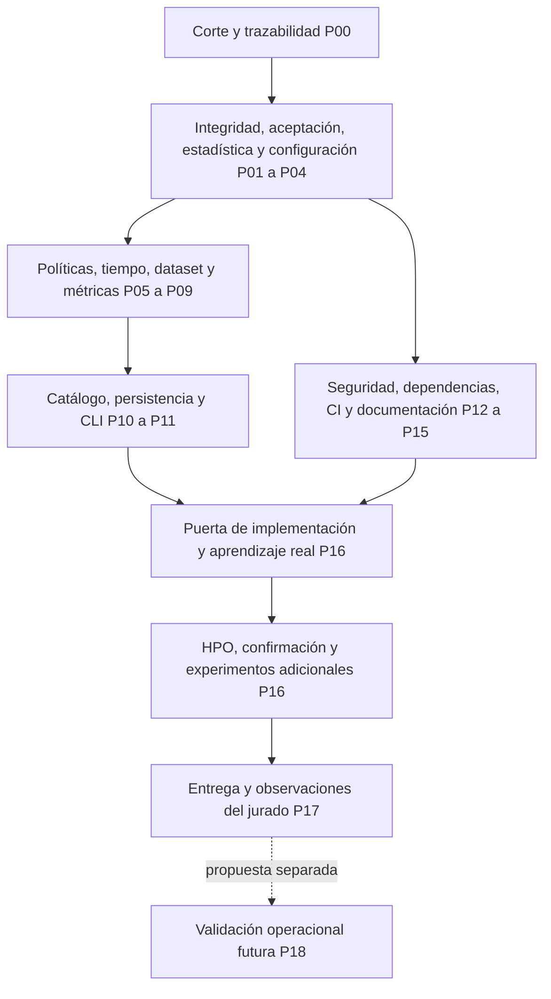

# Remediación de auditoría MADRL — Implementation Plan

> **For agentic workers:** REQUIRED SUB-SKILL: Use `superpowers:executing-plans` para ejecutar este plan tarea por tarea. Las listas `- [ ]` representan trabajo pendiente. Este documento no autoriza delegación automática, publicación, entrenamiento de pago ni modificaciones de dependencias.

**Goal:** Cerrar los hallazgos A01–A31 con evidencia trazable, completar el flujo dataset → aprendices nativos → evaluación → entrega y acreditar por separado las observaciones J-01–J-17.

**Architecture:** Mantener el monolito modular, sus contratos de dominio y la CLI canónica. Incorporar verificaciones en los puntos donde realmente se leen datos, ejecutan aprendices y promueven artefactos; conservar las correcciones concurrentes que superen regresión. Los backends, CityLearn y formatos nativos permanecen detrás de adaptadores del repositorio principal.

**Tech Stack:** Python 3.9, entorno `.venv39-citylearn-v3`, PyTorch y backends ya declarados, CityLearn instalado, pytest, Ruff, YAML, PowerShell y notebook Colab existente. No migrar a otro framework ni crear microservicios para ejecutar este plan.

**Spec:** [Diseño de campaña nueva](../design/entrenamiento.md), [plan existente T0–T14](entrenamiento.md), [SPEC-000–012 y estado](../../specs/STATUS.md), [auditoría](../audits/deep_20261101/report.md), [hallazgos y seguimiento](../audits/deep_20261101/findings.json).

**Fecha:** 2026-11-01, America/Lima. **Estado:** plan redactado; tareas sin ejecutar por este documento. La creación del plan no cambia `implementation_ready_for_training=false`, `scientific_acceptance=false` ni acredita cierre del jurado.

## 1. Restricciones globales

- Raíz: `D:/MADRLCitytleranflexresdr`; origin: `https://github.com/Mac-Tapia/MADRLCitytleranflexresdr.git`. Rige [AGENTS.md](../../AGENTS.md), incluido el proyecto excluido: no leerlo, editarlo ni mezclar sus resultados.
- Antes de cada lote de ediciones u operación Git: `powershell -ExecutionPolicy Bypass -File scripts/verify_project_context.ps1`. Si falla, detener ese trabajo y consultar al usuario; no desactivar el guard.
- `CityLearn/` y `external/`: solo lectura. No copiar un entrenador completo ni cambiar algoritmos para hacer pasar pruebas. Una interfaz externa insuficiente se registra como `blocked_dependency_interface`, con propuesta concreta; su modificación requiere instrucción explícita del usuario.
- Preservar parches, datos, Word y evidencias existentes. No hacer `git clean`, stage global, commit/push automático, reescritura de historia o borrado por nombre/tamaño. Una auditoría de duplicados no autoriza eliminación.
- La ejecución nueva comienza desde episodio 0: `--no-resume`. Cada interrupción origina otro intento; nunca sumar episodios de intentos diferentes. La paridad de reanudación de perfiles legados no es requisito del perfil nuevo que prohíbe reanudar.
- No leer resultados históricos retirados como entradas, fixtures o criterio de selección. Los ejemplos sintéticos pequeños sirven para verificar contratos matemáticos y de seguridad; no sustituyen aprendizaje, evaluación o pruebas de infraestructura nativos.
- No sobrescribir el dataset, los splits ni una campaña preparada. Cambios de contenido o protocolo exigen una identidad nueva, compatible con `governance/repository_layout.yaml` y `governance/naming.yaml`.
- Skills del proyecto: `tools/skills/`. Validar el registro; no instalar duplicados globales ni modificar instrucciones protegidas como efecto secundario.
- Recursos largos: respetar `resource_authorization.authorized_stages`; en la lectura para este plan estaba vacío. No contratar infraestructura, abrir servicios públicos ni habilitar etapas silenciosamente.
- Las recomendaciones de `correcciones.md` que permiten editar/pushear submódulos no son aplicables aquí. Prevalecen AGENTS.md y el diseño nuevo; P15 conciliará las referencias sin borrar historia.
- Cada cierre conserva requisito, archivo, prueba, comando, exit code, duración, contadores, hashes y limitaciones. `implemented`, `verified_contract`, `verified_native`, `pending_experiment` y `blocked` son estados diferentes.

## 2. Punto de partida conciliado

La auditoría registró 31 entradas: cuatro críticas al detectarlas, 19 altas y ocho medias. No representan 31 defectos idénticos todavía abiertos: hubo cambios concurrentes y 23 contratos posteriores aprobados. A01 tiene un rechazo de etapa alterada ya verificado; A02/A03 incorporaron catálogos derivados y freezes tipados. P04 preserva esos avances y comprueba su integración nativa.

Permanecieron reproducidos A04 —completitud con otra campaña, cero actualizaciones y checkpoint inexistente— y A05 —filas NaN aceptadas como estudio completo—. También se documentaron cargadores nativos pendientes, horizonte anual incompatible con KPI diarios, HPHI incorrecto, referencias rotas, persistencia Colab por etapa y versiones con avisos OSV. Estos son antecedentes del corte auditado: P00 los revalida antes de editar.

Lectura **sin entrenamiento** realizada para este plan con `load_campaign_config` y `build_dag`:

| Etapa | Tratamientos | Episodios | Pasos de entrenamiento |
|---|---:|---:|---:|
| pilot | 4 | 8 | 1 344 |
| hpo | 252 | 2 520 | 22 075 200 |
| confirm | 144 | 7 200 | 63 072 000 |
| sensitivity | 72 | 3 600 | 31 536 000 |
| Total sin piloto | 468 | 13 320 | 116 683 200 |

El diseño inicial decía 288 HPO y 119 836 800 pasos sin piloto. La deduplicación de configuraciones efectivas cambió ese presupuesto. P04 debe documentar la enmienda antes de entrenar: no volver a introducir candidatos duplicados para igualar un conteo ni reutilizar manifiestos de otra identidad. Evaluaciones, baselines, sensibilidad de procedencia, estrés y escalabilidad se presupuestan aparte. No se estiman días, costo o capacidad de GPU sin medir el piloto.

El dataset auditado tenía 23 fuentes revalidadas, 222 CSV activos sin NaN/Inf y 1 836 cierres mensuales sin fallos. B01 conserva 12 meses de 2023 reconstruidos desde 2024 y declarados como excepción. Esto no acredita ausencia incondicional de fuga, realismo horario, aceptación eléctrica anual ni aceptación científica.

## 3. Secuencia y puertas

| Puerta | Condición de salida | Lo que permite afirmar |
|---|---|---|
| G0 | Corte identificado, lectura actual conciliada, alcance de escritura definido | Se conoce qué se va a modificar; no equivale a software aceptado |
| G1 | Contratos adversariales y matemáticos, procedencia, protocolo/presupuesto conciliados, calidad/seguridad aplicable y CLI en verde | Contratos verificados, sin aprendizaje demostrado |
| G2 | G1 + cuatro aprendices nativos, parámetros cambiados, recarga y evaluación congelada verificadas; perfil estricto sin omisiones | `implementation_ready_for_training=true` para el protocolo identificado |
| G3 | Configuraciones elegidas solo en validación y freezes aceptados; presupuesto/enmiendas prerregistrados | Se puede ejecutar confirmación autorizada; no existe aún estudio completo |
| G4 | Cobertura confirmatoria, baselines, sensibilidad, evaluación final e inferencia completas, finitas y hash-verificadas | `scientific_acceptance=true` solo para el alcance experimental declarado; puede no haber ganador inferencial |
| G5 | G4 + entrega reproducible y evidencia específica de cada J-ID, incluidos experimentos adicionales requeridos | Cierre documental/experimental del jurado según matriz; ningún J-ID se cierra por un checkbox genérico |
| G6 | Validación de integración física y seguridad operacional independiente | Aceptación operacional; no se obtiene ejecutando este plan de investigación |

No ejecutar tareas dependientes antes de su puerta. Este DAG expresa dependencias técnicas, no autorización para crear agentes. Un único escritor por archivo; con trabajo concurrente se registra deriva y se invalida el resultado integral de la revisión mezclada.

## 4. Review Focus

1. Archivo correcto con contenido alterado, ruta absoluta Windows o junction ancestral: rechazo antes de leer o deserializar. P01/P12.
2. Evidencia finita y aparentemente completa, pero de otra semilla/campaña, con dueño de optimizador ausente o cero actualizaciones: rechazo antes de promover. P02.
3. NaN/Inf/booleanos, hash válido de un reporte ajeno, réplica duplicada o todos los gains cero: distinguir datos inválidos de ausencia legítima de diferencia. P03/P09.
4. Último intervalo anual, año bisiesto, SOC terminal y días incompletos: conservar mediciones y acciones alineadas sin relleno. P06.
5. Desconexión después de terminar un intento, dataset con backcast declarado y candidato HPO equivalente a otro: conservar evidencia y población/protocolo explícitos. P07/P04/P11.

## 5. Convenciones de ejecución y evidencia

En comandos `PY` significa exclusivamente `.venv39-citylearn-v3/Scripts/python.exe`; es abreviatura documental, no un segundo entorno. Ejecutar los comandos desde la raíz autorizada. Las rutas de tests propuestas son entregables futuros, no archivos cuya existencia se afirme hoy.

Cada tarea de código sigue RED → corrección mínima → GREEN → revisión del diff y evidencia. Si el test ya pasa, conservar el avance y verificar que cubra el comportamiento; no fabricar una fase RED histórica. Guardar evidencia en `data/maintenance/remediacion/<cut_id>/<Pxx>/`, con `cut_id` explícito y corto, nunca `latest`.

La revisión de cada tarea incluye `PY -B -m ruff check <archivos_tocados>` y sus pruebas focales. Solo después se ejecuta la puerta completa. Preparar un diff acotado; registrar commits únicamente si existe autorización aplicable, nunca añadir todo el árbol sucio ni publicar por un hook.

Los tipos nuevos se ubican junto al contrato que representan y se documentan en esa tarea. Reutilizar `TreatmentKey`, `AttemptIdentity`, `ConfigurationFreeze`, `PhysicalTrace`, `SeedTable`, `FrozenProtocol` y `ArtifactStore`; no crear otro modelo paralelo de campaña.

## 6. Tareas de implementación

### P00. Fijar el corte y conciliar lo ya corregido

**Dependencias:** ninguna. **Hallazgos:** todos como línea base. **Fundamento:** L3.

**Archivos:** extender `tools/ops/capture_modernization_baseline.py`; revisar `docs/audits/deep_20261101/{findings,source_drift,summary}.json`; prueba `tests/ops/test_capture_modernization_baseline.py`.

**Interfaz:** reutilizar `capture_baseline(project_root: Path) -> dict`; agregar hashes de fuentes/configuración/tests, estado sucio, dependencias y timestamps antes/después. No copiar secretos, entornos, perfiles de navegador ni carpetas ajenas.

- [ ] Añadir `test_source_change_invalidates_acceptance_cut`: una mutación entre inicio/fin marca `source_state_stable=false`; nunca informa suite integral aceptada.
- [ ] Ejecutar `PY -B -m pytest tests/ops/test_capture_modernization_baseline.py -q` y registrar el resultado inicial.
- [ ] Capturar el corte actual y clasificar cada A-ID: reproducido, corregido por contrato, pendiente nativo/experimental o requiere nueva revisión. Revisar especialmente A01–A05 y el presupuesto HPO.
- [ ] Repetir la prueba, guardar hashes y diff del inventario. Salida G0: un manifiesto que identifica exactamente la revisión a implementar; la auditoría previa no se usa como suite actual.

### P01. Imponer identidad completa y contención de rutas

**Depende de:** P00. **Hallazgos:** A01/A09. **Fundamento:** L3/L4.

**Archivos:** crear `uc3m/application/training/integrity.py`; modificar `fresh_campaign.py`, `cli.py`, `preflight.py` y `application/dataset/provenance.py`; extender `fresh_policy.py` solo donde falte un consumidor. Crear `tests/fresh_training/test_campaign_integrity.py` y extender `test_dataset_provenance.py`.

**Interfaz nueva:** `verify_campaign_inputs(manifest_path: Path, project_root: Path) -> IntegrityResult`, con `accepted: bool`, `checks: tuple[str, ...]`, `reasons: tuple[str, ...]`, `verified_hashes: dict[str, str]`. Verificar config, algoritmo, catálogo y políticas referenciadas, fuentes, dataset, cada split, normalizador y fuentes de código. Usar normalización LF definida para identidades de texto; no mezclarla con hashes de bytes de checkpoints.

- [ ] Escribir `test_tampered_input_blocks_before_learner` parametrizado por cada entrada y `test_windows_absolute_unc_and_parent_junction_rejected`; contador de llamadas al aprendiz debe quedar en 0.
- [ ] Añadir caso de manifiesto ya preparado y YAML cambiado: la CLI no reutiliza identidad antigua. Añadir ruta de unidad distinta y archivo que cambia durante la lectura.
- [ ] Ejecutar `PY -B -m pytest tests/fresh_training/test_campaign_integrity.py tests/fresh_training/test_dataset_provenance.py -q` y confirmar el fallo relevante.
- [ ] Invocar la verificación antes de preparar/ejectuar una etapa y antes de aceptar entradas de evaluación. Resolver contención y enlaces por todos los ancestros; no bastan prefijos de texto o comprobar solo el archivo final.
- [ ] Repetir tests y verificar G1 parcial: ningún intento/directorio ni carga de modelo ocurre tras un rechazo; razones y hashes quedan registrados.

### P02. Verificar aprendizaje e identidad antes de completar un intento

**Depende de:** P01. **Hallazgos:** A04/A15; incluye prevención de recaída HAPPO. **Fundamento:** L2/L3.

**Archivos:** crear `uc3m/application/training/acceptance.py`; modificar `fresh_campaign.py`, `adapters/algorithms/{learning_observer,native_entrypoint,evidence}.py` y `algorithms/factory.py`; extender `test_learning_observer.py`, `test_campaign_contract.py` y `test_real_learning.py`; crear `test_attempt_acceptance.py` en `tests/fresh_training/`.

**Interfaz nueva:** `verify_attempt(attempt_root: Path, treatment: TreatmentKey, attempt: AttemptIdentity, *, target_episodes: int, episode_time_steps: int, expected_weights: Sequence[float], max_constraint_dominance_ratio: float) -> AttemptAcceptance`. Tipo con `training_complete`, `checks`, `reasons` y `verified_hashes`. `attempt_completion` puede conservar la comprobación de metadatos, pero `run_stage` promueve exclusivamente con `verify_attempt`.

- [ ] Reproducir `test_foreign_attempt_zero_updates_missing_checkpoint_rejected`, incluyendo pesos y supervisión aparentemente válidos; debe devolver `training_complete=false`.
- [ ] Añadir dueño faltante, contadores booleanos/negativos/cero, pasos falsos, salvage, checkpoint modificado y parámetros sin cambio. Los propietarios esperados se derivan del backend/configuración, no de los que casualmente aparezcan.
- [ ] Ejecutar `PY -B -m pytest tests/fresh_training/test_attempt_acceptance.py tests/fresh_training/test_learning_observer.py -q` y registrar RED.
- [ ] Enlazar `attempt.json`, tratamiento, campaña, seed, configuración efectiva, cobertura, tensores y checkpoint. Verificar hash y raíz confiables antes de cualquier `torch.load`; no cargar modelos desconocidos en pruebas de rechazo.
- [ ] Cerrar rutas públicas de `AlgorithmFactory` que devuelven acciones aleatorias como aprendizaje: backend ausente falla; un modo smoke explícito jamás es elegible para promoción ni puede anunciar un modelo guardado inexistente.
- [ ] Repetir contratos. La verificación nativa de cuatro backends y de reporte/recarga/cierre HAPPO corresponde a P16, sin mocks ni omisiones.

### P03. Rechazar entradas estadísticas inválidas sin forzar diferencias

**Depende de:** P01. **Hallazgo:** A05. **Fundamento:** L3/L5.

**Archivos:** modificar `application/evaluation/fresh_analysis.py`; extender `tests/fresh_training/test_seed_statistics.py` y crear `test_statistical_input_gate.py`.

**Interfaces:** mantener `SeedTable.from_rows` y `analyze_campaign(table, protocol)`. La tabla exige identidad, dominios y valores numéricos finitos; el agregador de P10 verifica además la existencia, hash y contexto del reporte que originó cada fila.

- [ ] Añadir `test_nan_inf_bool_never_complete`, `test_duplicate_or_foreign_seed_rejected` y `test_valid_all_zero_gains_no_difference_complete`. Para el último caso: estudio completo, p válidas, ninguna superioridad obligatoria.
- [ ] Añadir matriz rectangular incompleta, algoritmo/split no permitido y tipos de semilla incompatibles. No convertir horas, episodios o KPI diferentes en semillas adicionales.
- [ ] Ejecutar `PY -B -m pytest tests/fresh_training/test_seed_statistics.py tests/fresh_training/test_statistical_input_gate.py -q` y registrar RED.
- [ ] Separar degeneración válida de error de SciPy: NaN o error no identificado no se convierten en p=1. Retener familias y correcciones Holm del protocolo congelado.
- [ ] Repetir tests y comprobar que `scientifically_complete` requiere cobertura y validez de entradas; una campaña legítima sin diferencia puede completarse.

### P04. Consolidar configuración efectiva, HPO y sensibilidad existentes

**Depende de:** P01/P02. **Hallazgos:** A02/A03, avances concurrentes ya verificados por contrato. **Fundamento:** L1/L3/L5.

**Archivos:** modificar solo si falla la regresión: `fresh_campaign.py`, `cli.py`, `domain/campaigns.py`, `configs/algorithms/native.yaml`, `configs/experiments/iquitos.yaml`, `native_entrypoint.py`, `reward/term_telemetry.py`; extender `tests/fresh_training/test_campaign_contract.py`.

**Interfaces existentes a preservar:** `freeze_configuration`, `write_configuration_freezes`, `load_configuration_freezes`, `write_derived_scenario_catalog`, `_materialize` y el catálogo resuelto por tratamiento. La recompensa observada debe informar pesos efectivos y supervisión; una variable de entorno, por sí sola, no es aceptación de esos valores.

- [ ] Ejecutar los contratos actuales como regresión. Si pasan, conservarlos; añadir `test_runtime_reward_weights_match_resolved_catalog` y `test_native_resolved_config_matches_freeze` en integración real.
- [ ] Cubrir freeze falsificado, candidato no perteneciente al HPO, catálogo/coeficientes cambiados, parámetros ignorados por el backend y extremos con orden de ejes incorrecto.
- [ ] El diseño §5 exige igual presupuesto HPO por algoritmo y el DAG deduplicado actual tiene 252 tratamientos: registrar `blocked_protocol_mismatch` mientras no exista conciliación explícita. Emitir propuesta de enmienda que compare el diseño 288 con el DAG 252, sus configuraciones efectivas y presupuesto por algoritmo; no aprobarla automáticamente, duplicar candidatos equivalentes o cambiar semillas/episodios para aparentar igualdad. El código debe rechazar el inicio de HPO y G3 si manifiesto, protocolo y presupuesto no coinciden; autorizar recursos no subsana ese conflicto científico.
- [ ] Implementar la selección HPO fijada en el diseño: primero factibilidad en validación; después media de ganancias normalizadas de los tres ejes con pesos de selección 1/3, comunes a escenarios/semillas de desarrollo; desempatar por menor varianza entre semillas y luego ID lexicográfico. Congelar una configuración por algoritmo común a E1/E2/E3; todas inviables significa bloqueo. No sustituir esta regla por hipervolumen ni por pesos de entrenamiento.
- [ ] Guardar por intento configuración nativa resuelta, pesos observados y sumas de términos. El umbral de dominancia 1.0 es criterio del proyecto: documentarlo y reportar sensibilidad; no atribuirlo a una tesis/artículo.
- [ ] Repetir `PY -B -m pytest tests/fresh_training/test_campaign_contract.py -q`; P16 verifica los cuatro backends. Cambio de protocolo/configuración crea identidad nueva y no modifica campañas preparadas.

### P05. Implementar las cuatro políticas congeladas y el desbloqueo de prueba

**Depende de:** P01/P02/P04. **Hallazgos:** A06/A08. **Fundamento:** L1/L2/L3/L4.

**Archivos:** extender `adapters/citylearn/policy_inference.py`; crear `uc3m/ports/policy.py` y adaptadores `uc3m/adapters/algorithms/{happo_policy,masac_policy,matd3_policy,maac_policy}.py`; ampliar `tests/fresh_training/test_frozen_evaluation.py` y crear `test_native_policy_reload.py`.

**Interfaz:** `FrozenPolicyPort` define `bind(context: object)`, `reset_episode()` y `act(observations)`. `load_native_policy(algorithm: str, attempt_root: Path) -> FrozenPolicyPort` carga únicamente un paquete aceptado por P02. Cada adaptador conserva orden de agentes, dimensiones heterogéneas, normalizador, estado recurrente y mapeo de acciones del entrenamiento.

- [ ] Escribir `test_native_reload_matches_action_sequence` para los cuatro backends: comparar una secuencia después de reset recurrente, `atol=1e-6`, `rtol=1e-5`; registrar tolerancias de proyecto y dispositivo.
- [ ] Escribir `test_frozen_evaluation_has_no_updates_or_exploration`: `eval`/inferencia sin gradientes, sin replay nuevo, sin actualización ni mutación de pesos.
- [ ] Añadir `test_empty_foreign_or_tampered_unlock_rejected`. El desbloqueo enlaza campaña, freeze, políticas/checkpoints, normalizador y split por hashes; existir `test_unlock.json` no basta. Un hash no se denomina firma criptográfica.
- [ ] Implementar cada cargador usando interfaces nativas existentes; sin checkpoint intercambiable por ONNX ficticio, política aleatoria o copia de un runner. Ausencia de interfaz externa queda bloqueada con evidencia.
- [ ] Ejecutar `PY -B -m pytest tests/fresh_training/test_frozen_evaluation.py tests/fresh_training/test_native_policy_reload.py -q` con modelos locales propios nuevos. No abrir prueba 2025 para seleccionar/configurar políticas; hasta G3 su rechazo es el comportamiento correcto.

### P06. Corregir horizonte, trazas y aceptación física de KPI

**Depende de:** P01; integración con políticas después de P05. **Hallazgo:** A31; contrato físico de FR-N04. **Fundamento:** L1/L3/L6.

**Archivos:** modificar `policy_inference.py`, `application/evaluation/kpi_contract.py`, `configs/evaluation/kpis.yaml`; extender `test_kpi_physical_contract.py`, `test_frozen_evaluation.py`; crear `test_full_horizon_contract.py`.

**Interfaces:** mantener `PhysicalTrace`, `compute_fresh_kpis` y `validate_kpi_report`; añadir `validate_trace_window(trace: PhysicalTrace, *, expected_start: str, expected_steps: int) -> ValidationResult`. El evaluador distingue estado inicial, intervalo de energía y estado terminal, sin suponer que número de transiciones y de mediciones son idénticos.

- [ ] Añadir `test_annual_horizon_has_complete_days` para 8760/8784/8760 muestras, `test_first_last_action_energy_and_soc_aligned` y timestamp repetido, hueco, orden inverso o zona incorrecta.
- [ ] Reproducir el rechazo actual de 8759 muestras; comprobar pico coincidente, rampa con dt, importación/exportación, moneda, unidades de señales de distrito y ganancia indefinida ante baseline cero.
- [ ] Ejecutar `PY -B -m pytest tests/fresh_training/test_kpi_physical_contract.py tests/fresh_training/test_full_horizon_contract.py -q` y registrar RED.
- [ ] Corregir extracción sin interpolar la última hora ni descartar días para aparentar aceptación. Diferenciar identidad importación−exportación=neto de cierre independiente de carga/PV/EV/BESS; si faltan componentes, marcar cierre físico como no verificable.
- [ ] Repetir casos analíticos y después evaluación nativa anual autorizada. Exigir primarias disponibles, exógenas pareadas, condiciones inicial/final de almacenamiento y diagnóstico de servicio EV; conexiones iguales no demuestran igual SOC servido.

### P07. Cerrar procedencia temporal y sensibilidad a datos modelados

**Depende de:** P01/P06; experimento real después de G2. **Hallazgo:** A16. **Fundamento:** L1/L4/L6.

**Archivos:** `application/dataset/{construction,splits,provenance}.py`, `tools/dataset/{build_fresh_campaign_dataset,split_campaign,size_bess_optimal}.py`, `adapters/citylearn/fresh_observations.py`; extender `test_dataset_provenance.py`, `test_temporal_contract.py`, `test_der_sizing_inputs.py`; protocolo variante en `configs/experiments/` con nombre corto y manifiesto propio.

- [ ] Añadir `test_heldout_perturbation_cannot_change_train_design`: perturbar 2024/2025 no modifica normalizador, parámetros ajustados ni tamaños estimados desde train. Separar dimensiones físicas conocidas del inventario y parámetros inferidos de las series.
- [ ] Conservar la excepción B01 autorizada y sus 12 flags; añadir `test_modeled_building_exclusion_removes_training_influence`. Excluirlo solo de la tabla final no elimina su influencia en CTDE, recompensas y entrenamiento.
- [ ] Ejecutar `PY -B -m pytest tests/fresh_training/test_dataset_provenance.py tests/fresh_training/test_temporal_contract.py tests/fresh_training/test_der_sizing_inputs.py -q` y registrar el alcance.
- [x] Cerrado sin construir (el propietario decidió el 2026-11-08 que los 17 edificios, incluido B01, entrenan en todas las etapas; no hay campaña sin B01 y la sensibilidad sin B01 queda solo en la evaluación (D-M2-4)). Texto original: construir una variante nueva de 16 edificios, con normalizador, baselines y aprendices propios, para sensibilidad sin B01; no reutilizar un checkpoint de 17 agentes ni sobrescribir el dataset auditado. Mantener comparaciones dentro de cada población y explicar el cambio de población entre variantes.
- [ ] Dimensionar desde train/inventario o declarar y versionar un diseño exógeno conocido. Publicar tabla por variable: fuente, measured/modeled, disponibilidad, imputación, fit_scope, unidad, incertidumbre y exclusiones. Revalidar hashes y cierres; la sensibilidad experimental debe ejecutarse en P16 para su cierre.

### P08. Unificar IQM e hipervolumen con referencias comparables

**Depende de:** P03/P06. **Hallazgos:** A12/A13. **Fundamento:** L3/L5/L6.

**Archivos:** `reward/hphi.py`, `domain/pareto.py`, `application/evaluation/{fresh_analysis,scientific_evaluation}.py`; pruebas `tests/uc3m/test_hphi.py`, `tests/fresh_training/test_seed_statistics.py` y tests de Pareto existentes.

- [ ] Añadir casos analíticos: HPHI 2D con punto (−1,−1), nadir (−10,−10), ideal (0,0) → 0.81; ideal 7D → 1; monotonía, orden de puntos y reset con referencia fija.
- [ ] Añadir IQM fraccional `[0,1,100] → 17.3333333333333`, además de n=5/6/12 y empates. Esta convención fraccional es el contrato del proyecto, no una cifra prescrita por la literatura.
- [ ] Ejecutar `PY -B -m pytest tests/uc3m/test_hphi.py tests/fresh_training/test_seed_statistics.py -q` y registrar RED.
- [ ] Reutilizar una implementación canónica por métrica; corregir orientación maximizar/minimizar. Congelar referencia y normalización comunes antes de comparar algoritmos. Si se usa Monte Carlo 7D, registrar método, semilla, muestras y error, sin cambiarlo por disponibilidad local de bibliotecas.
- [ ] Repetir pruebas y migrar consumidores. Mantener HPHI 7D como extensión arquitectónica; el experimento principal conserva tres ejes. Preservar valores crudos y flags de saturación del HV de gains; no ocultar pérdidas mediante clipping.

### P09. Separar selección, inferencia y registro de evidencia aceptada

**Depende de:** P01/P03/P06/P08. **Hallazgos:** A10/A14. **Fundamento:** L3/L5.

**Archivos:** `application/evaluation/{model_selection,fresh_analysis}.py`, `multicriteria/stats_tests.py`, `application/thesis/evidence_registry.py`; ampliar sus tests de `tests/unit/` y crear `tests/fresh_training/test_evidence_promotion.py`.

**Interfaz nueva:** `register_verified_evidence(path: Path, *, expected_sha256: str, campaign_id: str, phase: str, observation_id: str) -> EvidenceRef`. Mantener referencias editoriales no aceptadas separadas; un argumento `accepted=True` no verifica un archivo.

- [ ] Escribir `test_nonexistent_changed_or_foreign_evidence_not_accepted`, `test_no_significance_no_inferential_winner`, `test_descriptive_candidate_requires_verified_runs` y caso completo sin diferencia.
- [ ] Exigir finitud, cobertura y procedencia antes de rankear. Regla de selección fijada en validación; el test final no vuelve a seleccionar hiperparámetros ni checkpoints.
- [ ] Registrar RED con `PY -B -m pytest tests/fresh_training/test_evidence_promotion.py tests/unit/application/test_scientific_evaluation.py -q`; ajustar rutas de pruebas existentes solo después de inventariarlas en P00.
- [ ] Descomponer salida en candidato descriptivo/operativo y decisión inferencial. `decide_oe_winner` no infiere superioridad sin omnibus/post hoc requeridos. No exigir significancia para que un estudio metodológicamente completo pueda terminar sin ganador.
- [ ] Repetir contratos y comprobar que tablas, figuras y tesis solo consumen referencias verificadas con readback de hash/contexto.

### P10. Conectar intentos nuevos, reportes, panel y CLI

**Depende de:** P01/P02/P05/P06/P09. **Hallazgo:** A11; entrega de A27. **Fundamento:** L3.

**Archivos:** `application/evaluation/{results_catalog,training_report}.py`, `application/training/{monitor,cli}.py`, `presentation/training_panel.py`; crear `uc3m/application/pipeline.py`; ampliar `tests/unit/evaluation/test_tools_use_results_catalog.py` y `tests/integration/test_training_panel.py`; crear `tests/fresh_training/test_delivery_contract.py`.

**Interfaces:** `discover_attempts(manifest_path: Path, *, accepted_only: bool = True)` usa la campaña explícita y sus intentos; `build_seed_table(manifest_path: Path) -> SeedTable` abre reportes KPI aceptados y verifica SHA/contexto. `run_pipeline_stage(manifest_path: Path, stage: str, *, execute: bool = False) -> dict` compone casos de uso mediante adaptadores inyectados.

- [ ] Añadir `test_fresh_attempt_is_visible_in_catalog_and_panel`, hash roto, manifest inválido, múltiples campañas y seeds distintas. El lector no elige la carpeta más reciente ni confunde train/HPO/sensibilidad.
- [ ] Añadir `test_seed_row_binds_kpi_hash_campaign_policy_and_split` y `test_report_requires_explicit_campaign`. Conservar adaptador histórico como perfil separado, inelegible para aceptar la campaña nueva.
- [ ] Ejecutar `PY -B -m pytest tests/unit/evaluation/test_tools_use_results_catalog.py tests/integration/test_training_panel.py tests/fresh_training/test_delivery_contract.py -q` y confirmar RED.
- [ ] Extender la CLI canónica con casos explícitos dataset/split/freeze/evaluate/analyze/report, reutilizando los casos de uso existentes; `--execute` distingue efecto de preparación. `freeze` consume únicamente la selección de validación aceptada por P04/P09. No crear otro lanzador nativo. Mantener panel de lectura en loopback y columnas de fase, seed y aceptación.
- [ ] Repetir contratos. Reportar falta de evidencia como estado visible, no lista vacía ni éxito. Validar manifiesto de entrega con configuraciones, versiones, trazas, KPI, política candidata o ausencia justificada de ganador, y hashes.

### P11. Persistir intentos completos y aislar cachés

**Depende de:** P01/P02/P10. **Hallazgos:** A07/A28. **Fundamento:** L3.

**Archivos:** `application/artifacts/{backup,retention}.py`, `adapters/local_artifacts.py`, `fresh_campaign.py`, `native_entrypoint.py`, `tools/colab/build_modular_colab_notebook.py`, notebook modular existente; crear `tests/fresh_training/test_attempt_persistence.py` y extender tests de backup/Colab.

**Interfaz:** `persist_attempt(attempt_root: Path, store: ArtifactStore, *, expected_manifest_sha256: str) -> dict`. Adaptar el backup existente al contrato nuevo en vez de crear otro almacén; la marca de completitud se publica tras verificar archivos y readback del destino.

- [ ] Escribir `test_completed_attempt_survives_stage_interruption`, copia parcial/corrupta, destino ocupado por otra identidad y caché confinada al intento.
- [ ] Ejecutar `PY -B -m pytest tests/fresh_training/test_attempt_persistence.py tests/fresh_training/test_colab_client.py -q`; verificar contratos locales con almacén real temporal.
- [ ] Copiar cada intento terminado sin esperar el retorno de toda la etapa; registrar la persistencia fallida. Asegurar sincronización idempotente/atómica y snapshot de código propio con hash reproducible.
- [ ] Eliminar consumidores activos de R-06 antes de proponer retiro: redirigir cachés a `attempt_root/native_cache`; no borrar `outputs/dataset_cache` como efecto de una prueba. Inventario/decisión de conservación o retiro quedan en P15.
- [ ] Ensayar desconexión real en Colab con recursos autorizados: recuperar hashes de un intento ya terminado y crear otro intento desde cero para el interrumpido. Una prueba local no acredita este ensayo real.

### P12. Endurecer entradas remotas y cercar el demo

**Depende de:** P01/P02. **Hallazgos:** A25/A26. **Fundamento:** L3/L4; requisitos de seguridad del capítulo 7 y del diseño local.

**Archivos:** `data/adapters/{local_csv,remote_http}.py`, `deploy/inference/{app,model_loader}.py`, `deploy/docker-compose.yml`, `deploy/mosquitto.conf`; revisar `deploy/plant_adapter/modbus_adapter.py` sin conectar hardware. Extender `tests/uc3m/test_data_adapters_remote.py`; crear `tests/fresh_training/test_security_and_acceptance.py`.

- [ ] Añadir cambio de CSV con mismo schema, caché por nombre con contenido distinto, raíz escapada, timeout, archivo truncado, descarga/expansión excesiva y enlace malicioso. No afirmar Zip Slip por ver `extractall` sin reproducirlo.
- [ ] Añadir `test_no_model_is_not_ready`, `test_stub_cannot_send_plant_actions`, formas/NaN/Inf/acciones fuera de límites y `test_panel_loopback_read_only`. Usar dependencias HTTP reales en proceso, sin publicar puertos ni llamar a una planta.
- [ ] Ejecutar `PY -B -m pytest tests/uc3m/test_data_adapters_remote.py tests/fresh_training/test_security_and_acceptance.py -q` y registrar RED.
- [ ] Hash completo de archivos del dataset, caché por digest, límites explícitos de bytes/expansión/tiempo y rechazo de entradas no confiables. Sin modelo aceptado, readiness operacional es falsa; el modo demo requiere opt-in y es inelegible para control real.
- [ ] Configurar aislamiento local y autenticación según modo documentado; un broker anónimo no es aceptable como configuración operacional. Ninguna de estas pruebas acredita seguridad OT o piloto físico: P18 conserva esa frontera.

### P13. Resolver dependencias, avisos OSV y gobernanza del paquete

**Depende de:** P00; regresiones de P02/P05 antes de promover cambios de entorno. **Hallazgos:** A24/A29/A30. **Fundamento:** L3; fuentes primarias de avisos fijadas en la auditoría.

**Archivos:** `pyproject.toml`, `requirements.txt`, `uv.lock`, `governance/{dependency_roles,open_source_policy}.yaml`, `tools/ops/generate_sbom.py`, builder Colab y notices; crear `tests/fresh_training/test_dependency_acceptance.py`. No editar código de dependencias.

- [ ] Añadir `test_runtime_imports_are_declared`, `test_bundle_permissions_match_inventory`, `test_expired_exception_blocks_promotion` y `test_pip_check_does_not_imply_no_vulnerabilities`.
- [ ] Reconsultar versiones instaladas y avisos: los 34 paquetes señalados por OSV en la auditoría son un antecedente, no 34 explotaciones demostradas ni un inventario eternamente actual. Deduplicar alias y clasificar por API/exposición/versión aplicable.
- [ ] Ejecutar `PY -B -m pytest tests/fresh_training/test_dependency_acceptance.py -q`, `PY -B -m pip check` y el generador SBOM con salida de remediación explícita.
- [ ] Conciliar PyYAML y extras/importaciones, URLs, lock y plataforma de instalación. Proponer cambios de versión compatibles y su regresión; si requieren cambiar una dependencia protegida, registrar la propuesta para autorización específica. No actualizar el stack entero por conveniencia.
- [ ] Conciliar distribución del overlay y excepciones de HARL/MARL/MATD3implementation; no inventar licencias. Crear LICENSE/notices propios solo con derechos identificados. Registrar riesgos aplicables resueltos o excepciones razonadas y vigentes, sin que una excepción de licencia acepte automáticamente un riesgo de seguridad.
- [ ] Verificar instalación limpia/build en temporal o entorno externo autorizado, sin otro venv en la raíz. Repetir regresión nativa tras cualquier cambio científico de dependencia antes de G2.

### P14. Calidad de programación, skills y CI reproducible

**Depende de:** P00/P13; cierre tras las tareas de código. **Hallazgos:** A21/A22/A23. **Fundamento:** L3.

**Archivos:** `.github/workflows/ci.yml`, `pyrightconfig.json`, `scripts/quality/run_fresh_training_gates.ps1`, `scripts/quality/verify_ci_checkout.py` —nuevo— y `tools/ops/audit_github_readiness.py` —nuevo—; crear `tests/fresh_training/test_github_readiness.py`; reutilizar registro/validador local de skills.

- [ ] Añadir pruebas de checkout CPU portable con identidad/remoto/commit esperados y de conservación del guard local exacto. No hacer que `windows-latest` simule estar en D: ni relajar la frontera para obtener verde.
- [ ] Añadir veto probado de skip/xfail/xpass y suite ausente/interrumpida. Archivos/resultados históricos se informan como perfil archivístico, nunca se convierten en PASS por estar ausentes.
- [ ] Ejecutar `PY -B -m ruff check uc3m tests`; corregir las incidencias realmente actuales. Activar tipos gradualmente en código nuevo con diagnósticos concretos, sin silenciar NameError/llamadas/asignaciones para bajar el contador.
- [ ] Ejecutar `PY -B tools/skills/validate_skills.py`, el helper local `scripts/skills/register_local_skills.ps1`, su `-CheckOnly` y `validate_skills.py --check-discovery`; documentar alcance. No copiar skills a ubicaciones globales.
- [ ] CI: contratos frescos puros, permisos de lectura, acciones fijadas a SHA verificadas, timeouts y sin secretos/publicación en PR no confiable. Separar CPU hospedado de integración nativa local. Ejecutar `PY -B -m pytest tests/fresh_training/test_github_readiness.py tests/skills tests/contract -q`.
- [ ] Registrar `remote_verified=false` mientras no exista Actions del mismo commit. Preparar contenido del paquete/importación y los checks locales de T13; este plan no autoriza push, merge ni cambios de settings.

### P15. Reconciliar árbol, canónicas, índices y evidencia histórica

**Depende de:** P00/P10; cierre de calidad después de P14. **Hallazgos:** A17/A18/A20/A28; FR-N19/N20. **Fundamento:** L3.

**Archivos:** `README.md`, `docs/00_INDEX.md`, `docs/architecture/{dataset_construction_pipeline,AGENT_HARNESS,runbook}.md`, planes antiguos pertinentes, `specs/STATUS.md`, `docs/workflow_manifest.json`, `tools/ops/verify_workflow_integrity.py`, registros de naming/layout. Crear proyección vigente del jurado en `docs/jury_status.json`, preservando `data/audits/jury_observations_manifest.json` histórico; test nuevo `tests/fresh_training/test_current_references.py`.

- [ ] Añadir `test_all_current_references_resolve`, `test_old_paths_are_only_explicit_history`, `test_workflow_checker_reports_missing_inputs` y `test_jury_status_requires_verified_evidence`.
- [ ] Ejecutar `PY -B -m pytest tests/fresh_training/test_current_references.py tests/fresh_training/test_names.py tests/contract/test_spec_kit_consistency.py -q` y registrar fallos concretos.
- [ ] Unificar entrada operativa al flujo fresco, presupuesto vigente, alcance de resultados y estado del hook. Rotular resúmenes y generadores históricos, sin convertir sus números en resultados nuevos.
- [ ] Resolver las 17 rutas del jurado mediante mapa old→new/proyección vigente; conciliar mínimo de semillas con el protocolo de 12 y no mezclar SPEC legado 4×3×3 con confirmación nueva 4×3×12. Quitar del plan vigente las instrucciones de editar/pushear submódulos.
- [ ] Inventariar R-06 y duplicados por consumidores/recuperabilidad. No inferir pérdida de datos de 209 rutas tracked ausentes ni borrar un duplicado legítimo de un split. Un retiro posterior debe cumplir lista cerrada y autorización aplicable; no es requisito de borrar todo para pasar tests.
- [ ] Repetir validadores de nombres/referencias/flujo; emitir JSON estructurado aun ante archivos ausentes. Registrar una sola canónica actual por responsabilidad sin renombrar identidades científicas congeladas.

### P16. Aceptación nativa, campaña y experimentos del jurado

**Depende de:** P01–P15. **Hallazgos:** A27 y aceptación integral de A01–A16/A31. **Fundamento:** L1/L2/L3/L4/L5/L6.

**Archivos:** completar `tests/fresh_training/{test_real_learning,test_native_policy_reload,test_security_and_acceptance,test_delivery_contract}.py`, el gate nuevo, `configs/experiments/iquitos.yaml` y protocolos de variantes/estrés/escalabilidad bajo esa carpeta. Reutilizar CLI, reportes y adaptadores; no tocar entrenadores externos.

- [ ] Antes de entrenar, verificar G0/G1 y producir plan de recursos desde DAG actual, con versión de protocolo y todas las etapas aún no autorizadas bloqueadas. `blocked_protocol_mismatch` impide HPO aunque sus recursos estén autorizados. Tiempos de piloto son mediciones, no promesas.
- [ ] Ejecutar `PY -B -m pytest tests/fresh_training/test_real_learning.py tests/fresh_training/test_native_policy_reload.py -q`: cuatro backends reales, warmup superado, actualizaciones útiles de todos los dueños, parámetros cambiados, tensores finitos, paquete recargado y acciones equivalentes. HAPPO debe reportar y cerrar sin NameError ni salvage. Sin skip/xfail/xpass y sin mocks sustitutivos.
- [ ] Ejecutar `powershell -ExecutionPolicy Bypass -File scripts/quality/run_fresh_training_gates.ps1` y después la suite general sobre el mismo corte. Documentar perfiles y resultados por separado; exclusiones impiden afirmar suite integral sin omisiones. Si cambia una fuente, invalidar aceptación de ese corte y repetir lo afectado antes de la puerta global.
- [ ] G2 permite marcar implementación lista, pero no aceptación científica. Medir piloto y autorizar recursos mediante el mecanismo vigente; no habilitar flags en secreto. Ejemplo existente: `PY -B -m uc3m.application.training.cli --config configs/experiments/iquitos.yaml --stage prepare` prepara y no entrena.
- [ ] Ejecutar HPO autorizado con configuración efectiva única, evaluar solo en 2024, seleccionar configuración, guardar freezes y validar G3. Después ejecutar 144 confirmatorios nuevos de 50 episodios × 8760 pasos, con semillas 1001–1012, y los 72 extremos declarados; no sumar salvages o intentos interrumpidos.
- [ ] Ejecutar evaluación final 2025 solo tras desbloqueo vinculado; baselines nuevos, misma población/exógenas/condiciones y cero aprendizaje en evaluación. Completar variante sin B01 con entrenamiento independiente; su presupuesto se añade explícitamente y no altera los 144 confirmatorios principales.
- [ ] Para J-11/J-13 prerregistrar experimentos adicionales: estrés 0/10/20 % del catálogo del proyecto y escalabilidad con subconjuntos reales factibles 5/10/17, selección de población fija y semillas declaradas. Medir KPI, servicio/restricciones, tiempo, memoria y latencia. No fabricar edificios ni reportar 34 agentes reales por duplicar registros. Sin ejecución, esos J-ID siguen pendientes aunque G4 principal pueda ser evaluado.
- [ ] Calcular por semilla IQM/mediana/IC, familias estadísticas y decisiones; construir informe completo incluso si no hay diferencias. Si faltan celdas o primarias válidas, G4 no pasa. Registrar límites de potencia con 12 semillas y de generalización de un solo distrito modelado.

### P17. Entrega científica y levantamiento documental del jurado

**Depende de:** G4 y evidencia adicional de cada J-ID; preparación de plantillas después de P09/P10/P15. **Hallazgos:** A18/A19/A27. **Fundamento:** L1/L2/L3/L5/L6.

**Archivos:** reportes en `tools/eval/` mediante catálogo único; crear `tools/eval/report_fresh_campaign.py` y `economic_report.py` si no existe función equivalente; `docs/chapters/{cap1,cap3,cap5,cap6,cap7,indice,referencias}.md`, anexo reproducible y proyección `docs/jury_status.json`. Generadores `tools/thesis/` se conectan al manifiesto nuevo; Word canónicos solo con encargo documental explícito y revisión separada.

- [ ] Añadir `test_report_values_match_seed_table`, `test_no_retired_run_as_current_result`, `test_word_generator_requires_verified_manifest`, `test_no_economic_claim_without_source` y cobertura de las 17 observaciones.
- [ ] Ejecutar `PY -B -m pytest tests/fresh_training/test_delivery_contract.py tests/fresh_training/test_evidence_promotion.py tests/fresh_training/test_current_references.py -q`; no insertar cifras sintéticas para obtener PASS.
- [ ] Entregar configuraciones, código propio/versiones, procedencia, trazas, baselines, checkpoints aceptados, tablas/figuras, incertidumbre, decisiones y guía de reproducción con hashes. Documentar visibilidad/acceso del repositorio y excepciones de licencia; no publicar datos o pesos automáticamente.
- [ ] J-14: separar costo energético simulado, tiempo/recursos medidos y CAPEX/OPEX hipotético con fuentes fechadas; sin inventar tarifas, ROI ni beneficios operacionales. J-05: formular aporte consistente; J-03: tres ejes experimentales frente a extensión UC3M; J-08: introducción general; J-06/J-15: propuesta de amenazas/privacidad/operación y límites; J-17: síntesis y anexos.
- [ ] En revisión Word autorizada: snapshot si el maestro está abierto, conservar literalmente texto aprobado, producir nombre nuevo y verificar estructura, referencias y render/paginación de ambos documentos. No usar generadores ligados a RUN_ID retirado.
- [ ] Cerrar cada J-ID solo con contenido/evidencia vigente. J-13 y otros experimentales no se cierran por mencionarlos como trabajo futuro. Mantener separados `scientific_acceptance`, `jury_closed` y `operational_acceptance`; un estudio sin superioridad puede ser una entrega científica completa.

### P18. Frontera operacional futura y cierre de riesgos condicionados

**Depende de:** P12 para la propuesta documental; G5 para una eventual ejecución operacional. El despliegue físico está fuera del alcance ejecutable actual. La propuesta puede redactarse antes de P17; su ejecución no es requisito para cerrar una observación que exige únicamente una propuesta futura. **Hallazgo:** riesgo operacional A25; J-06/J-11/J-15/J-16. **Fundamento:** L2/L3/L6 y propuesta de seguridad de cap7.

**Archivos de propuesta:** `deploy/edge/deploy.md`, `deploy/plant_adapter/modbus_adapter.py` como interfaz revisada, y documentación de amenazas/validación. Ninguna conexión, escritura Modbus, apertura pública o compra se realiza por este plan.

- [ ] Especificar límites físicos, fallback RBC, operación manual, integridad de observaciones/modelos, autorización, privacidad, deriva, rollback y registro.
- [ ] Definir aceptación SIL/HIL y piloto real con responsables, mediciones y criterios de parada; verificar mapa de registros y servicios EV/BESS antes de autorizar setpoints.
- [ ] Mantener `operational_acceptance=false` mientras falten esas pruebas. Un `/health` HTTP 200, simulación, ONNX exportado o propuesta redactada no acredita planta, TRL superior o seguridad OT.
- [ ] Si se solicita ejecutar esta fase, elaborar alcance operacional específico con autorizaciones y evidencia independientes. Para la entrega de tesis, documentar la frontera como propuesta y el TRL sustentado, sin inventar validación.

## 7. Matriz de hallazgos A01–A31

La prioridad corresponde al hallazgo al detectarlo. La tarea incluye conciliación del seguimiento; no deshacer correcciones concurrentes válidas. El JSON compañero fija los mismos vínculos para verificación automática.

| Hallazgo | Tareas responsables | Cierre principal |
|---|---|---|
| A01 | P01 | Identidad completa verificada antes del efecto |
| A02 | P04 | Pesos efectivos, catálogo y recompensa nativa coherentes |
| A03 | P04 | Freeze aceptado determina hiperparámetros reales |
| A04 | P02 | Intento, actualizaciones y checkpoint verificados |
| A05 | P03 | Datos inválidos nunca producen estudio completo |
| A06 | P05 | Cuatro políticas congeladas recargables |
| A07 | P11 | Persistencia por intento y desconexión real |
| A08 | P05 | Test desbloqueado por identidad/freeze válidos |
| A09 | P01 | Rutas Windows/enlaces contenidos |
| A10 | P09 | Evidencia existente, íntegra y de la campaña correcta |
| A11 | P10 | Catálogo y panel consumen intentos nuevos |
| A12 | P08 | HPHI correcto y comparable |
| A13 | P08 | IQM canónico y consumidores coherentes |
| A14 | P09 | Selección descriptiva separada de inferencia |
| A15 | P02 | Ningún placeholder acredita aprendizaje/modelo |
| A16 | P07/P16 | Procedencia temporal y sensibilidad ejecutada |
| A17 | P15 | Una ruta operativa vigente y material histórico rotulado |
| A18 | P15/P17 | Proyección actual de J-ID con referencias verificadas |
| A19 | P17 | Tesis/generadores alineados con evidencia nueva |
| A20 | P15 | Verificador actual y errores estructurados |
| A21 | P14 | Lint/tipos y alcance documentados |
| A22 | P14 | Registro y descubrimiento local comprobados |
| A23 | P14 | CI CPU portable separado del guard local |
| A24 | P13/P14 | Dependencias, metadatos e instalación limpia |
| A25 | P12/P18 | Demo cercado; operación solo con aceptación independiente |
| A26 | P12 | Identidad de contenido, cuotas y caché remota segura |
| A27 | P16/P17 | Aceptación nueva y entrega verificables |
| A28 | P11/P15 | Consumidores de caché aislados y retiro conciliado |
| A29 | P13 | Overlay compatible con permisos/licencias |
| A30 | P13 | Triage y remediación/excepciones vigentes por aplicabilidad |
| A31 | P06 | Horizonte anual y KPI diarios completos |

## 8. Matriz FR-N01–N20

| Requisito | Tareas | Puerta/evidencia |
|---|---|---|
| FR-N01 | P01/P11 | G1: entradas y cachés aisladas |
| FR-N02 | P01/P07 | G1: hashes, fuentes y calidad por variable |
| FR-N03 | P06/P07 | G1/G4: temporalidad y sensibilidad |
| FR-N04 | P06 | G2/G4: trazas y KPI con unidades/tiempo válidos |
| FR-N05 | P02/P05/P16 | G2: cuatro aprendices nativos reales |
| FR-N06 | P04 | G2/G3: configuración efectiva y freeze |
| FR-N07 | P02/P11 | G2: intento fallido preservado y reinicio desde cero |
| FR-N08 | P05/P06 | G2/G4: evaluación congelada y baseline pareado |
| FR-N09 | P04/P07/P16 | G3/G4: HPO/sensibilidades nuevas |
| FR-N10 | P03/P08/P09 | G4: réplica por semilla y decisión válida |
| FR-N11 | P01/P02/P03/P12/P13/P14/P16 | G1/G2: rechazo adversarial y gate estricto |
| FR-N12 | P10/P11/P17 | G5: manifiesto y entrega reproducibles |
| FR-N13 | P11/P15 | G1: retiro/consumidores con custodia; no borrado implícito |
| FR-N14 | P02/P16 | G2: HAPPO aprende, reporta, recarga y cierra |
| FR-N15 | P10/P15 | G1: árbol y consumidores actuales |
| FR-N16 | P02/P08/P10/P15 | G1: una canónica por responsabilidad |
| FR-N17 | P13/P14 | G1/G2: calidad y paquete portable |
| FR-N18 | P13/P14/P16 | G2: checks locales; remoto acreditado aparte |
| FR-N19 | P15 | G1: nombres y excepciones justificadas |
| FR-N20 | P01/P15 | G1: mapa de rutas e identidades verificables |

## 9. Matriz de observaciones del jurado

| Observación | Tareas | Evidencia específica para cerrar |
|---|---|---|
| J-01 | P03/P09/P15/P17 | Una decisión inferencial consistente en tablas, texto y Word |
| J-02 | P16 | Semillas independientes reales y cobertura registrada |
| J-03 | P08/P15/P17 | Tres ejes evaluados; siete ejes rotulados como extensión |
| J-04 | P02/P05/P16/P17 | HAPPO nuevo homogéneo; historia 49/50 no acredita campaña actual |
| J-05 | P17 | Aporte, alcance y tipo de documento consistentes |
| J-06 | P12/P13/P17/P18 | Propuesta sustantiva de amenazas/privacidad y límites de implementación |
| J-07 | P13/P14/P17 | Anexo con URL/revisión, instalación, licencias y evidencia accesible |
| J-08 | P17 | Introducción general y estructura/índice verificados |
| J-09 | P06/P07/P17 | Tabla por variable y tratamiento reproducible de faltantes/modelado |
| J-10 | P01/P04/P05/P07 | Matriz de leakage, fit_scope y separación de selección/prueba |
| J-11 | P07/P16/P17/P18 | Amenazas a validez, estrés y frontera de transferencia/piloto |
| J-12 | P03/P08/P09/P16 | IC/IQM y contrastes entre entrenamientos independientes |
| J-13 | P16 | Curvas de tamaños factibles con tiempo, memoria, latencia y KPI |
| J-14 | P17 | Costos medidos/modelados/hipotéticos separados y con fuentes |
| J-15 | P10/P11/P17/P18 | Persistencia, versionado, deriva, fallback y recuperación con alcance |
| J-16 | P17/P18 | TRL sustentado y ruta a piloto; ninguna elevación por código/demo |
| J-17 | P17 | Síntesis por capítulo, anexos y revisión visual de documentos |

## 10. Fundamento científico y límites

Se consultaron nuevamente fuentes primarias en la web para este plan. La matriz completa de autoría, APA, acceso e indexación está en [fuentes de la auditoría](../audits/deep_20261101/sources.md). No se atribuyen a la literatura las rutas de archivos, coeficientes exactos, umbrales de supervisión, 50 episodios, 12 semillas, tolerancias de pruebas o niveles 10/20 %: son decisiones del proyecto que se registran y someten a sensibilidad.

| ID | Fuente primaria | Aplicación al plan | Límite |
|---|---|---|---|
| L1 | Costea, C. C. (2026). *Multi-Agent Reinforcement Learning Building Energy Optimization: Taxonomy and Experimental Evaluation in CityLearn* [Maestría, Politecnico di Torino]. [Ficha](https://webthesis.biblio.polito.it/40396/) | Baselines/RBC, evaluación edificio/distrito e hiperparámetros; P04–P07/P16/P17 | Ficha y resumen consultados; no valida datos de Iquitos ni pesos concretos |
| L2 | Charbonnier, F. V. J. (2023). *Multi-agent reinforcement learning for the coordination of residential energy flexibility* [Doctorado, Oxford]. [ORA](https://ora.ox.ac.uk/objects/uuid%3A4acf19ee-76b3-4e71-a424-259cd9e2d6f5) | Contexto de coordinación y límites de aplicación; P02/P05/P16–P18 | Metadatos del repositorio mediante índice; apertura directa limitada, sin atribuir resultados no leídos |
| L3 | Pineau et al. (2021). Improving reproducibility in machine learning research. *JMLR, 22*(164), 1–20. [PDF editorial](https://www.jmlr.org/papers/volume22/20-303/20-303.pdf) | Código/datos/procedimiento, incertidumbre, custodia y límites de afirmaciones; todas las puertas | Apoya el método; no certifica este software ni prescribe una arquitectura de carpetas |
| L4 | Kapoor y Narayanan (2023). Leakage and the reproducibility crisis in machine-learning-based science. *Patterns, 4*(9), 100804. [PubMed PMID 37720327](https://pubmed.ncbi.nlm.nih.gov/37720327/) | Transformaciones, separación temporal/selección y sensibilidad; P01/P05/P07/P12/P16 | Indexación PubMed comprobada; no se infiere MEDLINE, Scopus o WoS de ello |
| L5 | Agarwal et al. (2021). Deep reinforcement learning at the edge of the statistical precipice. *NeurIPS 34*. [Actas](https://proceedings.neurips.cc/paper/2021/hash/f514cec81cb148559cf475e7426eed5e-Abstract.html) | Incertidumbre, IQM y cautela con rankings de pocas corridas; P03/P04/P08/P09/P16/P17 | Artículo de congreso; no establece suficiencia universal de n=12 |
| L6 | Nweye et al. (2025). CityLearn v2: Energy-flexible, resilient, occupant-centric, and carbon-aware management of grid-interactive communities. *Journal of Building Performance Simulation, 18*(1), 17–38. [DOI](https://doi.org/10.1080/19401493.2024.2418813) | Modelo de simulación, DER y evaluación por tareas; P06–P08/P16–P18 | Ficha y enlace Scopus documentados en auditoría; no equivale a validación física local ni certificación de cuartil |

Las tesis se identifican como repositorios universitarios, sin afirmar que estén indexadas como artículos. OSV y documentación técnica de APIs complementan el análisis de ingeniería; no sustituyen este fundamento científico.

## 11. Autorrevisión y entrega al implementador

- Todas las entradas A01–A31 tienen tareas y criterios de aceptación; FR-N01–N20 y J-01–J-17 tienen trazabilidad explícita en el documento y en `remediacion_cobertura.json`.
- Las cinco clases de Review Focus tienen pruebas asignadas. Las interfaces nuevas tienen ubicación, productor/consumidor y resultado definido; el implementador no debe introducir un segundo flujo de entrenamiento.
- P00 concilia el código actual; P04 conserva avances concurrentes. Los pasos de este plan siguen sin marcar: su redacción no constituye ejecución ni evidencia de RED→GREEN.
- Orden inicial: P00 → P01/P02/P03 → regresión P04 → P05/P06/P07/P08/P09 → P10/P11, con calidad/seguridad P12–P15 antes de G2. Ejecutar según dependencias, no según una lista de prioridades aislada.
- Resultados esperados de esta entrega de planificación: este documento, matriz de cobertura completa y validación de consistencia documental. No incluye cambios funcionales, entrenamiento, instalación, migración de dependencias, publicación ni modificación de tesis.
- En ejecución futura, registrar cada fase por su puerta y mantener visibles los bloqueos. No declarar finalizado el proyecto por aprobar contratos focales, preparar el DAG o terminar una campaña sin evaluar/entregar sus resultados.
