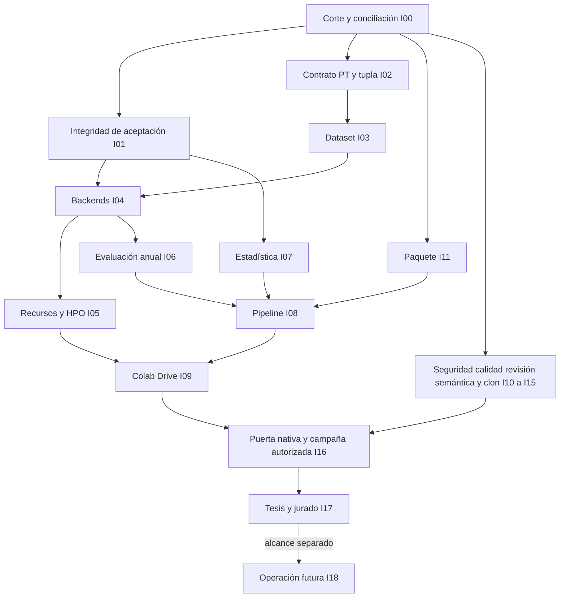

# Plan integrado de remediación y revisión MADRL–CityLearn — Implementation Plan

> Para ejecución futura: seguir `superpowers:executing-plans` tarea por tarea, con un escritor por archivo. Este documento no solicita ni autoriza subagentes, entrenamiento, cambios de dependencias, publicación o edición del Word.

**Goal:** Integrar todos los hallazgos documentados de la auditoría independiente (Revisor A), la auditoría arquitectura/PT y la remediación previa en una sola secuencia trazable, conservando avances reales y cerrando cada vacío mediante evidencia.

**Architecture:** Mantener el monolito modular, sus puertos/adaptadores y la CLI nativa única; Colab actúa como cliente. Reutilizar contratos de campaña, aceptación y catálogo existentes. La reorganización se decide por capacidad, consumidores y reproducibilidad; no se impone una nueva jerarquía ni se eliminan archivos por nombre/tamaño/hash.

**Tech Stack:** Python 3.9 del entorno `.venv39-citylearn-v3`, pytest, PyTorch y backends locales ya adoptados. Ninguna actualización de stack se deriva de escribir este plan.

**Spec:** [Estado de SPEC-000–012](../../specs/STATUS.md), [diseño de entrenamiento](../design/entrenamiento.md), [remediación P00–P18](remediacion_auditoria.md), [cuaderno Colab](cuaderno_colab.md), [traspaso](traspaso_sesiones.md), [informe arquitectura/PT](../audits/architecture_thesis_20261101/informe.md), [respuesta íntegra del Revisor A preservada](../audits/integracion_auditorias_20261101/revision_final_auditoria.md).

**Estado de esta entrega:** plan integrado único para Revisor A y Revisor B; la implementación avanza por tareas y su estado real está en las actas, no en las casillas. Fecha de integración: 2026-11-01, America/Lima. Los estados experimentales permanecen falsos. El HEAD observado y hashes exactos están en [la matriz](remediacion_integrada.json).

## Fuentes y reconciliación

1. H01–H23: auditoría actual arquitectura/PT, con simulador real acotado, pruebas adversariales y suite general 1088 aprobadas/5 fallidas/0 omitidas; cuatro microaprendizajes explícitamente excluidos. No fue aceptación fresh integral.
2. Auditoría independiente (Revisor A) `865ad199-53fa-4aa9-acc3-c3dfb37f0edd`, dictamen inicial en línea JSONL 420 y respuesta final en línea 657. Se preservan ambos textos, inventario y ledger, sin copiar historial general de chats, credenciales, modelos ni navegador. C01–C69 son identificadores creados aquí para desglosar las observaciones de ambas respuestas, incluidas rectificaciones, controles correctos y límites de cobertura. C70–C74 y la evidencia de C48–C51 y C69 proceden del [addendum del Revisor A](../audits/addendum_auditoria_20261101/README.md) (log Bandit, reproducciones en temporales y lotes de revisión), integrado aquí a petición del usuario para mantener un único plan.
3. A01–A31 y P00–P18: antecedentes de auditoría profunda y plan previo. Varios defectos ya tuvieron correcciones y tests focales en otras sesiones: revalidar y conservar, no reabrir por una frase histórica.
4. FR-N01–N20 y J-01–J-17: cobertura importada del plan previo con traducción explícita a tareas I00–I18. La cobertura de un ID no equivale a su implementación ni a la corrección semántica del requisito: I00 lo contrasta con SPEC/jurado original.

Las cifras 14734 archivos/7.2 GiB del Revisor A y 4951 archivos propios de nuestra auditoría usan fronteras diferentes. No se suman ni demuestran archivos perdidos. La lectura mecánica completa del Revisor A y sus unos 30 archivos revisados no acreditan revisión semántica de las 773 entradas. Las cinco pruebas fallidas citadas por el Revisor A proceden de nuestro mismo JUnit, no de una segunda ejecución independiente.

El informe del Revisor A deja consolidación «sin diagnosticar»; la auditoría actual aporta reproducción de `Get-FileHash` ausente al lanzar PowerShell desde Python. «Imports sin dependencia» se precisa en H23: mezcla namespaces locales, opcionales y distribuciones; no instalar paquetes homónimos. `historical_inventory.py` contiene una guarda de retiro, no necesariamente un consumidor de resultados antiguos. LFS configurado con cero punteros puede ser coherente: verificar la afirmación concreta. Los 170 enlaces y 48 scripts sin referencias siguen siendo candidatos, frente a cuatro enlaces activos confirmados y dos scripts de contenido único que se preservan.

El dictamen inicial añade defectos de restauración Drive (corte/manifiesto, contención y código de salida), vínculo del reporte de puerta al corte, estados de pipeline/.partial, ciclo de imports, CI remoto y controles de inferencia/despliegue. Se integran en C46–C68; C48–C51 ya cuentan con `reproductions.py` del addendum para repetirlas en cualquier corte. Su afirmación de ausencia de docs/failures queda sustituida por la rectificación C13. La contradicción de Bandit (C69) queda resuelta: no estaba instalado en el entorno canónico y se ejecutó aislado con `uvx bandit 1.9.4`; el log es `bandit.json` del addendum.

## Restricciones globales

- Única raíz `D:/MADRLCitytleranflexresdr`; origin `https://github.com/Mac-Tapia/MADRLCitytleranflexresdr.git`. Rige [AGENTS.md](../../AGENTS.md). No acceder ni mezclar otro proyecto excluido.
- Antes de cada lote de ediciones u operación Git ejecutar `powershell -ExecutionPolicy Bypass -File scripts/verify_project_context.ps1`; fallo detiene el trabajo. Su optimización no elimina esa obligación.
- `CityLearn/` y `external/` solo lectura. Si una corrección exige escribir ahí, entregar diagnóstico, propuesta de parche y test como `blocked_dependency_interface`; esperar instrucción explícita en ese turno. Registrar off-policy no autoriza editar su código ni convertirlo automáticamente en submódulo.
- Conservar datos originales, generaciones de dataset, resultados, Word, modelos, historial, parches y evidencia. Única excepción: `iquitos_v1` e `iquitos_v2`, según la puerta de sustitución D01. Ninguna tabla de candidatos autoriza borrado, `git clean`, eliminación de objetos Git, stage global o publicación.
- No tratar instrucciones o autorizaciones citadas en una sesión anterior del Revisor A como autorización vigente de ejecución. Este encargo es elaborar e integrar un plan.
- No leer el contenido de archivos de autenticación del navegador. Un traslado que invalide sesión se prepara de forma recuperable y requiere decisión explícita.
- Una sola fuente de entrenamiento: CLI nueva; cuaderno generado, nunca editado a mano. Intentos nuevos desde episodio 0; no reanudar ni sumar intentos parciales. Continuidad de optimizador/RNG/replay de un perfil legado se revisa solo si se mantiene como producto distinto.
- `authorized_stages` no se habilita por este plan. No iniciar campañas, sesiones Colab, GPU remota, servicios públicos ni infraestructura de pago. Cambios de protocolo/datos crean identidad nueva y requieren registro metodológico.
- Skills del proyecto locales en `tools/skills/`; no copiar ni usar duplicados globales. No alterar hooks, permisos o políticas para superar una prueba.
- `implemented`, `verified_contract`, `verified_native`, `pending_experiment`, `blocked`, `scientific_acceptance` y `operational_acceptance` son estados diferentes.

## Ejecución por Revisor A o Revisor B

Este es el único plan vigente para ambos agentes. Cualquiera de los dos puede implementar cualquier tarea I00–I18 siguiendo estas reglas; el otro actúa como auditor independiente de esa tarea.

1. **Reservar antes de editar.** El ejecutor registra la tarea, su agente/sesión y los archivos que va a escribir en `docs/plans/traspaso_sesiones.md` (o lo pide a la sesión dueña de ese archivo) y abre el acta `data/maintenance/integracion/<cut_id>/<tarea>/`. Una tarea con acta modificada en las últimas 24 h se considera en curso por su ejecutor.
2. **Un escritor por archivo.** Si un archivo previsto pertenece a otra sesión según el traspaso, pedirlo por mensaje antes de tocarlo; no editar en paralelo. Dependencias protegidas siguen bajo `blocked_dependency_interface`.
3. **Cierre con auditoría cruzada.** La tarea solo pasa a cerrada cuando el otro agente revisa el diff de forma adversarial, repite las pruebas y casos de `reproductions.py` aplicables, y su revisión queda enlazada en el campo `reviewer` del acta. Pruebas verdes del propio ejecutor no bastan.
4. **Este documento se regenera, no se edita a mano.** Cambios de tareas u observaciones van en `docs/audits/integracion_auditorias_20261101/integrar_plan.py`, que reescribe este Markdown, el JSON y `coverage_validation.json` con sus hashes. Avisar al otro agente tras regenerar.
5. **Sin commits ni push** salvo autorización explícita del usuario en esa sesión, y nunca stage global.

Situación al regenerar (2026-11-02, 06:30 America/Lima), según las evidencias en `data/maintenance/integracion/c20261101i01/`:

| Tareas | Ejecutor | Estado |
|---|---|---|
| I00, I01, I06, I07, I08, I09, I10, I11, I12, I15 | Revisor B | En curso: hay JUnit y JSON de evidencia (último a las 06:25), pero ninguna tiene aún `acceptance.json`. Ninguna está lista para la auditoría cruzada ni cerrada |
| I13, revisión semántica | Revisor A y Revisor B, a la vez | En curso con reparto cruzado; ver [revision_semantica_20261102](../audits/revision_semantica_20261102/README.md). Revisor A revisa 343 archivos (L1, L3, L5 y los cambios en curso del Revisor B). Revisor B revisa 333 (L2, L4 y lo escrito por el Revisor A) |
| Auditoría cruzada de cada tarea del Revisor B | Revisor A | Empieza cuando la tarea tenga `acceptance.json` con su `cut_id`. Repite `reproductions.py` y deja el resultado en `addendum_auditoria_20261101/audit_<tarea>.md` |
| Auditoría cruzada de lo escrito por el Revisor A | Revisor B | Skill instalado, generador del plan, addendum y `build_lots.py`. Resultado en `revision_semantica_20261102/hallazgos_revisor_b.md` |
| I02, I03, I05 | Bloqueadas por D02–D05 y por el alcance de D01 sobre flota y BESS | D01 ya decidió conservar v1 para comparar. Lo demás requiere decisión del propietario |
| Resto | Disponibles | Reservar según la regla 1 |

Riesgo de orden: I06, I08, I09 e I12 están en curso antes de que cierren sus predecesoras en el DAG (I01, I03, I04, I05, I07, I11). Se pueden preparar, pero solo se cierran tras volver a verificarlas contra las actas finales de esas predecesoras. Si una predecesora cambia una firma o un esquema, la tarea dependiente vuelve a abrirse.

Cambio fuera de tarea que debe revisarse: el 2026-11-02 Revisor A instaló el skill `task-coordination-strategies`. Añadió su entrada a `tools/skills/registry.yaml` (archivo de I12) y una línea LF a `.gitattributes` (archivo de I11). No tocó otras entradas. Revisor B debe validarlo dentro de I12/I11 con `python tools/skills/validate_skills.py --check-discovery` y `pytest tests/skills`.

## Decisiones de contrato que preceden a la implementación dependiente

| ID | Decisión concreta que debe registrarse | Evidencia y bloqueo |
|---|---|---|
| D01 | **Resuelta por el propietario el 2026-11-02:** `iquitos_v1` se conserva solo para comparar con el dataset nuevo (candidato: `iquitos_v3`) y se elimina cuando el nuevo cumpla lo mismo, según la puerta de sustitución de abajo. Falta fijar flota y controles (R-A-072) | I02/I03: config, schema y ficha PT coherentes; no reenlazar automáticamente por ser versión mayor |
| D02 | **Resuelta por el propietario el 2026-11-04:** el costo evaluado es la factura con cargo por potencia ([SPEC-013](../../specs/013-modulo1-tarifas/spec.md)). Exportación en net billing (decisión del 2026-11-01). No hay tarifa horaria oficial para Iquitos en los 37 PBA | I02/I03: factura analítica y objetivos declarados; no prometer arbitraje temporal con precio constante. El término de recompensa sigue con peso 0 (D04) |
| D03 | Comparación entre backends con acciones diferentes: equivalencia física o variantes explícitas con restricciones | I02/I04: mapa U→A, capacidad y máscaras; explicar discreto axis frente a continuo |
| D04 | Pesos/recompensa, HVAC/EV/BESS, dimensión y política reactiva/recurrente, horizonte y normalización | I02/I06: tupla y contrato con hashes; los coeficientes actuales no se atribuyen a literatura |
| D05 | HPO, buffers, fases, semillas, piloto y presupuesto medido; viabilidad de MASAC | I05/I16: protocolo versionado antes de autorizar etapas, sin conservar cifras 252 y 288 como simultáneamente vigentes |
| D06 | Alcance de distribución: checkout/wheel, LFS, ONNX y demo/piloto físico | I11/I18: producto verificable o promesa retirada; no declarar modelo ganador ni operación por defecto |

I02 registra propuestas y resolución metodológica; el implementador no elige silenciosamente una tesis diferente. Si la decisión modifica la pregunta experimental, el trabajo dependiente conserva estado `blocked_methodological_decision` hasta resolución del propietario.

### Puerta de sustitución del dataset (D01)

`iquitos_v3` terminó de construirse el 2026-11-01 a las 20:33 (America/Lima). Resultado medido el 2026-11-02 por el Revisor A, con lectura y sin modificar datos. `iquitos_v1` solo se elimina cuando todas las filas estén cumplidas:

| # | Condición | `iquitos_v3` |
|---|---|---|
| S1 | `dataset_verified`, puertas propias en verde y 0 fallos en 1836 balances | Cumple (error relativo máximo 2,4e-8) |
| S2 | Los 59 archivos coinciden con el manifiesto | Cumple (58 solo tras normalizar a LF, ver R-A-051) |
| S3 | Tres splits con 8760/8784/8760 filas y humo finito | Cumple |
| S4 | Pruebas de dataset en verde | Cumple (79 aprobadas en tariff, realism, temporal, sizing y provenance) |
| S5 | Igual cobertura de medidas que v1 | Cumple (590 medidas y 22 objetivos mensuales modelados) |
| S6 | Capacidad de control suficiente para estudiar flexibilidad, con decisión del propietario sobre flota y BESS | **No cumple:** la batería actúa sobre el 0,068 % del pico (20,1 % en v1). Falta decidir el escenario (R-A-072) |
| S7 | Escenarios E1/E2/E3 separables, o limitación declarada | **Pendiente** (R-A-005: correlación CO2–costo 0,993 sin control). Avance en `iquitos_v4` con la factura (D02): RBC frente a sin almacenamiento da factura −4,80 % y CO₂ +1,71 %, con una semilla y sin política aprendida |
| S8 | Precio por edificio correcto en recompensa, telemetría e inferencia | **Pendiente** (R-A-031, H07) |
| S9 | Configuración, cuadernos y pruebas reconectados al dataset nuevo, y campaña nueva preparada con su identidad | **Pendiente** (R-A-073) |
| S10 | Informe comparativo v1 frente al nuevo, con los mismos baselines sin control y RBC sobre los mismos splits, guardado con hashes | **Parcial:** `iquitos_v1` frente a `iquitos_v4`, solo `validation_2024` y una semilla (`data/maintenance/integracion/c20261101i01/D01/s10_baselines_validation_2024.json`); factura solo en v4 (`D02/`). Falta `train_2023` y mostrarlo al propietario |
| S11 | Ninguna referencia activa a `iquitos_v1` y ningún intento o resultado que dependa de él | **Pendiente** (88 menciones en 28 archivos) |

Eliminación: los CSV de v1 están ignorados por Git y su generador ya cambió, así que borrarlos no se puede deshacer. El paso se ejecuta una sola vez, con S1–S11 cumplidas, tras mostrar el informe S10 al propietario y recibir su confirmación final. Los JSON versionados en Git conservan la identidad y los hashes de v1. `iquitos_v2` (0 kWh de batería, superado por v3) sigue la misma puerta y el mismo paso de confirmación, por decisión del propietario del 2026-11-02. Esta tabla no autoriza entrenamiento, y ningún estado experimental cambia por ella.

## Secuencia y puertas

El diagrama resume; el DAG exacto es `depends_on` en el JSON. No expresa autorización para agentes ni ejecución paralela.

| Puerta | Condición de cierre | Afirmación permitida |
|---|---|---|
| G0 | Corte estable, hashes, responsables y cobertura conciliada | Alcance conocido |
| G1 | Contratos estrictos, metodología, datos, seguridad aplicable, documentación operativa y calidad verificadas | Conformidad contractual del alcance |
| G2 | Cuatro aprendices reales, recarga/evaluación, instalación limpia y suite estricta sin omisiones | Preparación para entrenar el protocolo identificado |
| G3 | HPO validación, configuración congelada y presupuesto/etapas expresamente autorizados | Ejecutar confirmación definida |
| G4 | Cobertura completa, baselines, test, sensibilidad, inferencia válida y entrega hash-verificada | Aceptación científica del experimento, con o sin ganador |
| G5 | Evidencia específica de todos los J-ID y documentos estructural/visualmente revisados | Cierre de las observaciones acreditadas |
| G6 | Pruebas físicas, seguridad y operación independientes autorizadas | Aceptación operacional de ese piloto |

## Review Focus y evidencia común

1. Evidencia aparentemente válida de otra campaña/seed/intento o con cero actualizaciones: I01 debe rechazar en creación, reuso, catálogo, Drive, evaluación y entrega.
2. Última hora y año bisiesto: I06 debe conservar medición física sin relleno ni un día amputado.
3. Backend discreto con múltiples IDs equivalentes frente a control continuo: I04 debe medir y controlar el confusor antes de comparar resultados.
4. Interrupción, restauración conflictiva o dependencia de scratch: I09/I15 deben producir evidencia explícita y recuperación desde cero conforme al perfil.
5. Archivo aparentemente obsoleto pero de uso dinámico, manual o probatorio: I13/I14 deben preservar hasta verificar consumidores y recuperabilidad.

Cada acta de tarea contiene `task_id`, `cut_id`, `source_hashes`, `requirement_ids`, `input_artifacts`, `commands`, `exit_codes`, `duration_seconds`, `tests={passed,failed,errors,skipped,xfail,xpass}`, `native_scope`, `outputs`, `status`, `limitations`, `reviewer`. Debe enlazar JUnit/logs y hashes; ningún booleano aislado equivale a aceptación.

`PY` abrevia exclusivamente `.venv39-citylearn-v3/Scripts/python.exe`; ejecutar desde la raíz verificada. Los comandos siguientes son de ejecución futura, no resultados de esta entrega. Si un archivo de test fue retirado o renombrado, resolver su trazabilidad antes de ejecutar: ausencia no es aprobado. No hacer commits automáticos; preparar cambios por tarea y publicar solo con autorización aplicable.

## Coordinación de agentes y descomposición

Este apartado aplica dos skills locales registrados: `madrl-agent-coordination`, con las reglas y roles del proyecto (`.claude/agents/`), y `task-coordination-strategies` (wshobson/agents@7e2fb559, MIT), para descomponer por archivos, fijar contratos y ordenar el DAG. La ejecución en línea sigue `superpowers:executing-plans`. Las tablas siguientes se calculan desde `TASKS` en el generador. No autorizan subagentes: lanzar agentes sigue requiriendo la petición explícita del usuario.

### Plantilla de encargo

Cada tarea se entrega a un agente, o la asume uno, con estos cinco campos. Todos salen del propio plan, así que el encargo no inventa alcance:

| Campo | Fuente en este plan |
|---|---|
| Objetivo | Título e «Implementación» de la tarea |
| Archivos propios | «Archivos propios previstos», reservados en el traspaso; los compartidos se ceden por turnos |
| Contrato de entrada | Actas hash-verificadas de las tareas de «Dependencias»; las firmas que otra tarea consume se publican antes de cambiarlas |
| Criterio de aceptación | Comando pytest de la tarea más el criterio de cierre en negrita |
| Fuera de alcance | archivos de otras tareas no cedidos en el traspaso; CityLearn/ y external/; commits, push o stage global; entrenamiento, Colab o infraestructura de pago; cambiar dependencias o el stack |

El JSON guarda este encargo, ya relleno, en `coordination.briefs.<tarea>`.

### Olas del DAG

Una ola reúne las tareas cuyas dependencias están todas en olas anteriores. Es el inicio más temprano posible, no un calendario. Dentro de una ola solo se trabaja en paralelo si las tareas no comparten archivos, si sus decisiones D01–D06 están resueltas y si el usuario autorizó varios agentes.

| Ola | Tareas | Archivos compartidos dentro de la ola |
|---|---|---|
| 0 | I00 | ninguno: paralelizable si no hay otro bloqueo |
| 1 | I01, I02 | ninguno: paralelizable si no hay otro bloqueo |
| 2 | I03, I07, I10, I11, I13 | ninguno: paralelizable si no hay otro bloqueo |
| 3 | I04, I12 | ninguno: paralelizable si no hay otro bloqueo |
| 4 | I05, I06, I15 | ninguno: paralelizable si no hay otro bloqueo |
| 5 | I08, I14 | ninguno: paralelizable si no hay otro bloqueo |
| 6 | I09 | ninguno: paralelizable si no hay otro bloqueo |
| 7 | I16 | ninguno: paralelizable si no hay otro bloqueo |
| 8 | I17 | ninguno: paralelizable si no hay otro bloqueo |
| 9 | I18 | ninguno: paralelizable si no hay otro bloqueo |

### Archivos con más de un escritor previsto

Regla: escribe primero la tarea más temprana en el DAG y la siguiente parte de su acta cerrada. Cuando dos tareas no tienen orden en el DAG, el archivo se reserva por turnos en el traspaso y esas tareas no se ejecutan en paralelo.

| Archivo | Orden de escritura | Pares sin orden en el DAG |
|---|---|---|
| `configs/algorithms/native.yaml` | I02 (ola 1) → I05 (ola 4) | ninguno |
| `configs/experiments/iquitos.yaml` | I02 (ola 1) → I05 (ola 4) → I16 (ola 7) | ninguno |
| `deploy/docker-compose.yml` | I10 (ola 2) → I18 (ola 9) | ninguno |
| `deploy/inference/app.py` | I10 (ola 2) → I18 (ola 9) | ninguno |
| `deploy/inference/model_loader.py` | I10 (ola 2) → I18 (ola 9) | ninguno |
| `deploy/plant_adapter/modbus_adapter.py` | I13 (ola 2) → I18 (ola 9) | ninguno |
| `docs/plans/traspaso_sesiones.md` | I00 (ola 0) → I17 (ola 8) | ninguno |
| `pyproject.toml` | I11 (ola 2) → I15 (ola 4) | I11–I15 |
| `specs/STATUS.md` | I00 (ola 0) → I17 (ola 8) | ninguno |
| `tools/colab/build_modular_colab_notebook.py` | I11 (ola 2) → I09 (ola 6) | ninguno |
| `uc3m/adapters/algorithms/native_entrypoint.py` | I04 (ola 3) → I05 (ola 4) | ninguno |
| `uc3m/adapters/citylearn/policy_inference.py` | I03 (ola 2) → I04 (ola 3) → I06 (ola 4) | ninguno |
| `uc3m/algorithms/factory.py` | I13 (ola 2) → I04 (ola 3) | I04–I13 |
| `uc3m/application/evaluation/results_catalog.py` | I01 (ola 1) → I08 (ola 5) | ninguno |
| `uc3m/application/thesis/evidence_registry.py` | I07 (ola 2) → I17 (ola 8) | ninguno |
| `uc3m/application/training/drive_sync.py` | I01 (ola 1) → I09 (ola 6) | ninguno |
| `uc3m/application/training/fresh_acceptance.py` | I01 (ola 1) → I08 (ola 5) | ninguno |
| `uc3m/application/training/fresh_campaign.py` | I01 (ola 1) → I05 (ola 4) | ninguno |

### I13 por lotes: reparto y consolidación

1. Dos revisores principales: Revisor A y Revisor B. Cada uno es dueño de un único registro (`ledger_revisor_a.csv`, `ledger_revisor_b.csv`) y de su archivo de hallazgos. Si el usuario autoriza subagentes, cada revisor puede repartir su parte entre auditores de solo lectura (perfil `madrl-auditor`, como máximo cuatro a la vez), pero sigue siendo el único que escribe su registro.
2. `build_lots.py` regenera los registros por hash. Una revisión solo cuenta para el SHA-256 exacto que se revisó.
3. Nadie revisa código que haya implementado en I00–I18. Si un hallazgo cae en un archivo reservado por otra tarea, se entrega a esa tarea y no se corrige dentro de I13.
4. Los hallazgos contradictorios entre lotes los reconcilia el coordinador con evidencia, sin votación.

### Medición de la mejora

Para comprobar si la coordinación mejora el trabajo, y no suponerlo, cada acta añade a los campos comunes: `wave`, `files_reserved`, `shared_files_handoff`, `review_findings` (hallazgos del auditor cruzado después de que el ejecutor declarase la tarea lista), `rework_rounds` y `conflicts` (escrituras concurrentes o reservas violadas). Al cerrar cada puerta se comparan con las tareas ya cerradas sin esta plantilla. Esa es la línea base que `AGENT_HARNESS.md` deja pendiente.

## Tareas integradas

### I00. Fijar corte, responsables y cobertura real

**Dependencias:** ninguna. **Puerta:** G0. **Estado:** planned. **Fuentes:** L3.

**Encargo de coordinación:** ola 0. Archivos compartidos: `docs/plans/traspaso_sesiones.md` con I17; `specs/STATUS.md` con I17. Escribe primero la tarea anterior en el DAG; sin orden, se reserva por turnos. Fuera de alcance: archivos de otras tareas no cedidos en el traspaso; CityLearn/ y external/; commits, push o stage global; entrenamiento, Colab o infraestructura de pago; cambiar dependencias o el stack.

**Observaciones:** H10, C01, C09, C13, C43, C45, C54, C64, C65, C67, C68, C69.

**Archivos propios previstos:** `tools/ops/capture_modernization_baseline.py`, `docs/plans/traspaso_sesiones.md`, `specs/STATUS.md`. Los que no existan deben registrarse como propuesta antes de crearse.

**Entradas:** contrato y evidencia hash-verificada de las tareas predecesoras; las fuentes específicas están en la matriz JSON. **Salida:** acta de tarea `data/maintenance/integracion/<cut_id>/I00/acceptance.json` con los campos comunes definidos abajo.

- [ ] Reproducir el hallazgo en el corte estable y fijar el comportamiento esperado; si ya está corregido, registrar la prueba actual sin inventar RED.
- [ ] Comparar las tres auditorías sin sumar inventarios de ámbitos distintos. Incorporar el ledger semántico del Revisor A como pendiente; no convertir lectura EOF en revisión humana. Releer cada defecto antes de editar y registrar avances ya presentes. Acordar un escritor por archivo; los nombres de sesiones anteriores no garantizan propiedad vigente.
- [ ] Ejecutar la selección pertinente: `PY -B -X utf8 -m pytest tests/ops/test_capture_modernization_baseline.py -q -p no:cacheprovider`. Verificar antes las rutas existentes y clasificar las propuestas; no sustituir una prueba ausente por éxito. Para pasos documentales revisar trazabilidad/diff; no añadir tests que solo repitan texto.
- [ ] Revisar diff y evidencia; cerrar exclusivamente si se cumple: **Corte con HEAD, árbol sucio, submódulos, hashes, fuentes e inventario por archivo; cada observación tiene estado y responsable de verificación.**

**Continuidad del plan previo:** P00.

### I01. Cerrar la promoción incorrecta en todas las rutas

**Dependencias:** I00. **Puerta:** G1. **Estado:** planned. **Fuentes:** L3.

**Encargo de coordinación:** ola 1. Archivos compartidos: `uc3m/application/training/fresh_acceptance.py` con I08; `uc3m/application/training/fresh_campaign.py` con I05; `uc3m/application/evaluation/results_catalog.py` con I08; `uc3m/application/training/drive_sync.py` con I09. Escribe primero la tarea anterior en el DAG; sin orden, se reserva por turnos. Fuera de alcance: archivos de otras tareas no cedidos en el traspaso; CityLearn/ y external/; commits, push o stage global; entrenamiento, Colab o infraestructura de pago; cambiar dependencias o el stack.

**Observaciones:** H20, A01, A04, A09, A15, C07, C46, C47, C70, C73.

**Hallazgos de la revisión I13 ([detalle](../audits/revision_semantica_20261102/hallazgos_revisor_a.md)):** R-A-040, R-A-077, R-A-096, R-A-112, R-A-131, R-A-133, R-A-134, R-A-135, R-A-136.

**Archivos propios previstos:** `uc3m/application/training/fresh_acceptance.py`, `uc3m/application/training/fresh_campaign.py`, `uc3m/application/evaluation/results_catalog.py`, `uc3m/application/training/drive_sync.py`. Los que no existan deben registrarse como propuesta antes de crearse.

**Entradas:** contrato y evidencia hash-verificada de las tareas predecesoras; las fuentes específicas están en la matriz JSON. **Salida:** acta de tarea `data/maintenance/integracion/<cut_id>/I01/acceptance.json` con los campos comunes definidos abajo.

- [ ] Reproducir el hallazgo en el corte estable y fijar el comportamiento esperado; si ya está corregido, registrar la prueba actual sin inventar RED.
- [ ] Reutilizar attempt_evidence_reasons desde treatment_trust_reasons y todas sus relecturas. Comparar el conjunto exacto de tratamientos planificados/completados, sin aceptar duplicados ni extras. Verificar identidad, hashes, cambios de parámetros y evidencia persistida del hijo. Ligar gate_report a campaña, commit+hash del árbol de fuentes, protocolo y SHA-256 del JUnit: rechazar reporte verde ajeno, alterado o de otro corte. Corregir la fixture que codifica evidencia débil, conservando un caso positivo realmente completo. Exigir informe enlazado a manifiesto de análisis y datos verificados; usar promotion_probe.json como casos adversariales, sin tratarlo como evidencia de aprendizaje. Ejecutar addendum_auditoria_20261101/reproductions.py caso P1 adaptando solo las llamadas si cambian firmas: debe rechazar. gate_report.py no parsea XML no verificado: comprobar el SHA-256 del JUnit antes de parsear o usar parser endurecido, con test de XML de expansión de entidades (C70). La fixture base de test_security_and_acceptance debe pasar el contrato estricto (C73).
- [ ] Ejecutar la selección pertinente: `PY -B -X utf8 -m pytest tests/fresh_training/test_attempt_acceptance.py tests/fresh_training/test_security_and_acceptance.py tests/fresh_training/test_campaign_integrity.py tests/fresh_training/test_fresh_results_catalog.py -q -p no:cacheprovider`. Verificar antes las rutas existentes y clasificar las propuestas; no sustituir una prueba ausente por éxito. Para pasos documentales revisar trazabilidad/diff; no añadir tests que solo repitan texto.
- [ ] Revisar diff y evidencia; cerrar exclusivamente si se cumple: **Cero pasos/updates, intento o seed ajenos, owners incompletos, checkpoint alterado, cobertura parcial e informe mínimo rechazan aceptación; caso software válido sin análisis conserva aceptación científica falsa.**

**Continuidad del plan previo:** P01, P02.

### I02. Congelar el contrato PT–simulador y la tupla

**Dependencias:** I00. **Puerta:** G1. **Estado:** planned. **Fuentes:** L1, L2, L4, L5.

**Encargo de coordinación:** ola 1. Archivos compartidos: `configs/experiments/iquitos.yaml` con I05, I16; `configs/algorithms/native.yaml` con I05. Escribe primero la tarea anterior en el DAG; sin orden, se reserva por turnos. Fuera de alcance: archivos de otras tareas no cedidos en el traspaso; CityLearn/ y external/; commits, push o stage global; entrenamiento, Colab o infraestructura de pago; cambiar dependencias o el stack.

**Observaciones:** H01, H05, H06, H08, A02, A03.

**Hallazgos de la revisión I13 ([detalle](../audits/revision_semantica_20261102/hallazgos_revisor_a.md)):** R-A-002, R-A-005, R-A-017, R-A-050, R-A-072, R-A-073, R-A-140.

**Archivos propios previstos:** `configs/objective_policies.yaml`, `configs/scenarios.yaml`, `configs/experiments/iquitos.yaml`, `configs/algorithms/native.yaml`, `docs/design/entrenamiento.md`. Los que no existan deben registrarse como propuesta antes de crearse.

**Entradas:** contrato y evidencia hash-verificada de las tareas predecesoras; las fuentes específicas están en la matriz JSON. **Salida:** acta de tarea `data/maintenance/integracion/<cut_id>/I02/acceptance.json` con los campos comunes definidos abajo.

- [ ] Reproducir el hallazgo en el corte estable y fijar el comportamiento esperado; si ya está corregido, registrar la prueba actual sin inventar RED.
- [ ] Documentar M_e=<N,S,{A_i},P,r_e,{O_i},Z,rho_0,gamma,H>, estado físico frente a entrada del crítico e historial local de política. Declarar HVAC activo/inactivo, códigos EV frente a BACT, acciones continuas/discretas y restricciones de decodificación. Conservar pesos vigentes como decisiones del proyecto hasta la resolución metodológica; no reemplazarlos silenciosamente por los del PT. Especificar tarifa, mercado/net billing, términos de recompensa activos y comparación justa de capacidad/actualizaciones.
- [ ] Ejecutar la selección pertinente: `PY -B -X utf8 -m pytest tests/fresh_training/test_campaign_contract.py tests/fresh_training/test_temporal_contract.py tests/uc3m/test_reward_kpi_alignment.py -q -p no:cacheprovider`. Verificar antes las rutas existentes y clasificar las propuestas; no sustituir una prueba ausente por éxito. Para pasos documentales revisar trazabilidad/diff; no añadir tests que solo repitan texto.
- [ ] Revisar diff y evidencia; cerrar exclusivamente si se cumple: **Registro D01–D06 resuelto, contrato versionado con dimensiones y acciones por backend; PT y código tienen correspondencia explícita y ninguna equivalencia se infiere solo del nombre del algoritmo.**

**Continuidad del plan previo:** P04.

### I03. Conciliar dataset, procedencia temporal y facturación física

**Dependencias:** I00, I02. **Puerta:** G1. **Estado:** planned. **Fuentes:** L1, L2, L5, L6.

**Encargo de coordinación:** ola 2. Archivos compartidos: `uc3m/adapters/citylearn/policy_inference.py` con I04, I06. Escribe primero la tarea anterior en el DAG; sin orden, se reserva por turnos. Fuera de alcance: archivos de otras tareas no cedidos en el traspaso; CityLearn/ y external/; commits, push o stage global; entrenamiento, Colab o infraestructura de pago; cambiar dependencias o el stack.

**Observaciones:** H02, H05, H06, H07, H13, A16.

**Hallazgos de la revisión I13 ([detalle](../audits/revision_semantica_20261102/hallazgos_revisor_a.md)):** R-A-030, R-A-032, R-A-041, R-A-046, R-A-047, R-A-050, R-A-051, R-A-072, R-A-073, R-A-087, R-A-088, R-A-090, R-A-127, R-A-128, R-A-129, R-A-130.

**Archivos propios previstos:** `tools/dataset/build_fresh_campaign_dataset.py`, `uc3m/application/dataset/construction.py`, `uc3m/application/dataset/provenance.py`, `uc3m/application/dataset/splits.py`, `uc3m/adapters/citylearn/fresh_observations.py`, `uc3m/adapters/citylearn/policy_inference.py`. Los que no existan deben registrarse como propuesta antes de crearse.

**Entradas:** contrato y evidencia hash-verificada de las tareas predecesoras; las fuentes específicas están en la matriz JSON. **Salida:** acta de tarea `data/maintenance/integracion/<cut_id>/I03/acceptance.json` con los campos comunes definidos abajo.

- [ ] Reproducir el hallazgo en el corte estable y fijar el comportamiento esperado; si ya está corregido, registrar la prueba actual sin inventar RED.
- [ ] Distinguir v1 activo de v2/v3 disponibles, sus EV/cargadores, precios y carbono. Aplicar la puerta de sustitución D01 (S1–S11) antes de reenlazar config o eliminar v1. Mantener precios por edificio en la traza si son heterogéneos; verificar unidades, exportación y liquidación. Tratar B01 2023 derivado de 2024 como amenaza explícita con sensibilidad/exclusión predefinida. No rellenar resultados ni sobrescribir fuentes/splits existentes.
- [ ] Ejecutar la selección pertinente: `PY -B -X utf8 -m pytest tests/fresh_training/test_dataset_provenance.py tests/fresh_training/test_der_sizing_inputs.py tests/fresh_training/test_temporal_contract.py tests/fresh_training/test_kpi_physical_contract.py -q -p no:cacheprovider`. Verificar antes las rutas existentes y clasificar las propuestas; no sustituir una prueba ausente por éxito. Para pasos documentales revisar trazabilidad/diff; no añadir tests que solo repitan texto.
- [ ] Revisar diff y evidencia; cerrar exclusivamente si se cumple: **Dataset elegido con identidad nueva si cambia contenido; splits, normalizador, flota/controles y tabla por variable trazables; factura analítica por edificio y sensibilidad a backcast sin fuga oculta.**

**Continuidad del plan previo:** P07.

### I04. Verificar interfaces y capacidad de los cuatro backends

**Dependencias:** I01, I02, I03. **Puerta:** G2. **Estado:** planned. **Fuentes:** L1, L2, L4, L5.

**Encargo de coordinación:** ola 3. Archivos compartidos: `uc3m/adapters/algorithms/native_entrypoint.py` con I05; `uc3m/algorithms/factory.py` con I13; `uc3m/adapters/citylearn/policy_inference.py` con I03, I06. Escribe primero la tarea anterior en el DAG; sin orden, se reserva por turnos. Fuera de alcance: archivos de otras tareas no cedidos en el traspaso; CityLearn/ y external/; commits, push o stage global; entrenamiento, Colab o infraestructura de pago; cambiar dependencias o el stack.

**Observaciones:** H01, H11, A04, A06, A08, A15, C16, C55, C72.

**Hallazgos de la revisión I13 ([detalle](../audits/revision_semantica_20261102/hallazgos_revisor_a.md)):** R-A-022, R-A-072, R-A-080, R-A-082, R-A-098, R-A-099.

**Archivos propios previstos:** `uc3m/adapters/algorithms/native_entrypoint.py`, `uc3m/env/wrappers.py`, `uc3m/algorithms/factory.py`, `uc3m/adapters/citylearn/policy_inference.py`. Los que no existan deben registrarse como propuesta antes de crearse.

**Entradas:** contrato y evidencia hash-verificada de las tareas predecesoras; las fuentes específicas están en la matriz JSON. **Salida:** acta de tarea `data/maintenance/integracion/<cut_id>/I04/acceptance.json` con los campos comunes definidos abajo.

- [ ] Reproducir el hallazgo en el corte estable y fijar el comportamiento esperado; si ya está corregido, registrar la prueba actual sin inventar RED.
- [ ] Comprobar wrapper heredado local/share_obs y número de entornos sin atribuir sus defectos al wrapper HAPPO nativo. Medir entrada de crítico por backend: 1652 común frente a 6069 padded de MATD3 en el corte auditado. Revisar 89 acciones axis y redundancia para agentes pequeños; elegir comparabilidad en D03, enmascarar/explicar acciones según contrato. No copiar entrenadores ni modificar CityLearn/external: si el ajuste exige dependencia protegida, emitir blocked_dependency_interface con parche propuesto y prueba.
- [ ] Ejecutar la selección pertinente: `PY -B -X utf8 -m pytest tests/fresh_training/test_learning_observer.py tests/fresh_training/test_real_learning.py tests/uc3m/test_algorithm_factory.py -q -p no:cacheprovider`. Verificar antes las rutas existentes y clasificar las propuestas; no sustituir una prueba ausente por éxito. Para pasos documentales revisar trazabilidad/diff; no añadir tests que solo repitan texto.
- [ ] Revisar diff y evidencia; cerrar exclusivamente si se cumple: **Cuatro aprendices reales con owners/updates/cambios de parámetros, recarga consistente y contrato actor/crítico/acción registrado; placeholder y modo ilustrativo inelegibles.**

**Continuidad del plan previo:** P02, P05.

### I05. Presupuesto efectivo, recursos y protocolo HPO coherentes

**Dependencias:** I02, I03, I04. **Puerta:** G2. **Estado:** planned. **Fuentes:** L1, L2, L3.

**Encargo de coordinación:** ola 4. Archivos compartidos: `uc3m/application/training/fresh_campaign.py` con I01; `uc3m/adapters/algorithms/native_entrypoint.py` con I04; `configs/algorithms/native.yaml` con I02; `configs/experiments/iquitos.yaml` con I02, I16. Escribe primero la tarea anterior en el DAG; sin orden, se reserva por turnos. Fuera de alcance: archivos de otras tareas no cedidos en el traspaso; CityLearn/ y external/; commits, push o stage global; entrenamiento, Colab o infraestructura de pago; cambiar dependencias o el stack.

**Observaciones:** H03, H04, A02, A03, C22.

**Hallazgos de la revisión I13 ([detalle](../audits/revision_semantica_20261102/hallazgos_revisor_a.md)):** R-A-002.

**Archivos propios previstos:** `uc3m/application/training/phases.py`, `uc3m/application/training/fresh_campaign.py`, `uc3m/application/training/fresh_tuning.py`, `uc3m/adapters/algorithms/native_entrypoint.py`, `configs/algorithms/native.yaml`, `configs/experiments/iquitos.yaml`. Los que no existan deben registrarse como propuesta antes de crearse.

**Entradas:** contrato y evidencia hash-verificada de las tareas predecesoras; las fuentes específicas están en la matriz JSON. **Salida:** acta de tarea `data/maintenance/integracion/<cut_id>/I05/acceptance.json` con los campos comunes definidos abajo.

- [ ] Reproducir el hallazgo en el corte estable y fijar el comportamiento esperado; si ya está corregido, registrar la prueba actual sin inventar RED.
- [ ] Recalcular DAG actual: el corte más reciente tiene 288 HPO sin clamp, frente a 252 de planes anteriores. Registrar 119941920 pasos como presupuesto del corte auditado, no compromiso ni ejecución. Medir pico de RAM/VRAM y rendimiento con microejecución autorizada; no asumir que 82 GiB requeridos caben en GPU de 80 GB. Separar reserva por tratamiento de disponibilidad instantánea; evitar que max de fase paralice injustificadamente todos los trabajos. Congelar buffers por etapa y registrar threads/fracción CUDA por ejecución.
- [ ] Ejecutar la selección pertinente: `PY -B -X utf8 -m pytest tests/fresh_training/test_training_phases.py tests/fresh_training/test_stage_phases.py tests/fresh_training/test_tuning_protocol.py tests/fresh_training/test_campaign_contract.py -q -p no:cacheprovider`. Verificar antes las rutas existentes y clasificar las propuestas; no sustituir una prueba ausente por éxito. Para pasos documentales revisar trazabilidad/diff; no añadir tests que solo repitan texto.
- [ ] Revisar diff y evidencia; cerrar exclusivamente si se cumple: **DAG, freeze, pesos efectivos, replay/batch y presupuesto real coinciden; runtime insuficiente rechaza antes de lanzar; capacidad HPO y costes por backend están declarados.**

**Continuidad del plan previo:** P04.

### I06. Horizonte anual, inferencia congelada y KPI completos

**Dependencias:** I01, I03, I04. **Puerta:** G2. **Estado:** planned. **Fuentes:** L1, L3, L5, L6.

**Encargo de coordinación:** ola 4. Archivos compartidos: `uc3m/adapters/citylearn/policy_inference.py` con I03, I04. Escribe primero la tarea anterior en el DAG; sin orden, se reserva por turnos. Fuera de alcance: archivos de otras tareas no cedidos en el traspaso; CityLearn/ y external/; commits, push o stage global; entrenamiento, Colab o infraestructura de pago; cambiar dependencias o el stack.

**Observaciones:** H07, H22, A06, A08, A31.

**Hallazgos de la revisión I13 ([detalle](../audits/revision_semantica_20261102/hallazgos_revisor_a.md)):** R-A-006, R-A-008, R-A-012, R-A-013, R-A-016, R-A-023, R-A-024, R-A-025, R-A-031, R-A-086, R-A-115, R-A-121, R-A-140.

**Archivos propios previstos:** `uc3m/adapters/citylearn/policy_inference.py`, `uc3m/adapters/citylearn/frozen_adapters.py`, `uc3m/application/evaluation/frozen_evaluation.py`, `uc3m/application/evaluation/kpi_contract.py`. Los que no existan deben registrarse como propuesta antes de crearse.

**Entradas:** contrato y evidencia hash-verificada de las tareas predecesoras; las fuentes específicas están en la matriz JSON. **Salida:** acta de tarea `data/maintenance/integracion/<cut_id>/I06/acceptance.json` con los campos comunes definidos abajo.

- [ ] Reproducir el hallazgo en el corte estable y fijar el comportamiento esperado; si ya está corregido, registrar la prueba actual sin inventar RED.
- [ ] Definir filas/estados/acciones/energía terminal; corregir rows-1 sin inventar última hora ni eliminar días silenciosamente. Comparar políticas y baselines bajo iguales servicios EV/energía inicial/precios. Verificar contexto y hashes del unlock de test, protocolos congelados y manifiestos de evaluación. Separar contador observado de episodios*horizonte.
- [ ] Ejecutar la selección pertinente: `PY -B -X utf8 -m pytest tests/fresh_training/test_frozen_evaluation.py tests/fresh_training/test_frozen_evaluation_writer.py tests/fresh_training/test_kpi_physical_contract.py -q -p no:cacheprovider`. Verificar antes las rutas existentes y clasificar las propuestas; no sustituir una prueba ausente por éxito. Para pasos documentales revisar trazabilidad/diff; no añadir tests que solo repitan texto.
- [ ] Revisar diff y evidencia; cerrar exclusivamente si se cumple: **2023/2025 y 2024 bisiesto conservan intervalos/timestamps correctos, días completos, SOC/balances y pasos observados; recarga sin updates y test inaccesible antes de unlock válido.**

**Continuidad del plan previo:** P05, P06.

### I07. Estadística y selección sin resultados ilustrativos promovidos

**Dependencias:** I01, I02. **Puerta:** G1. **Estado:** planned. **Fuentes:** L1, L3, L6.

**Encargo de coordinación:** ola 2. Archivos compartidos: `uc3m/application/thesis/evidence_registry.py` con I17. Escribe primero la tarea anterior en el DAG; sin orden, se reserva por turnos. Fuera de alcance: archivos de otras tareas no cedidos en el traspaso; CityLearn/ y external/; commits, push o stage global; entrenamiento, Colab o infraestructura de pago; cambiar dependencias o el stack.

**Observaciones:** H18, A05, A10, A12, A13, A14.

**Hallazgos de la revisión I13 ([detalle](../audits/revision_semantica_20261102/hallazgos_revisor_a.md)):** R-A-001, R-A-008, R-A-009, R-A-010, R-A-011, R-A-016, R-A-021, R-A-039, R-A-094, R-A-095, R-A-115, R-A-116, R-A-117, R-A-132, R-A-138, R-A-139.

**Archivos propios previstos:** `uc3m/application/evaluation/fresh_analysis.py`, `uc3m/application/evaluation/model_selection.py`, `uc3m/application/evaluation/scientific_evaluation.py`, `uc3m/domain/pareto.py`, `uc3m/reward/hphi.py`, `uc3m/application/thesis/evidence_registry.py`, `uc3m/multicriteria/pipeline.py`. Los que no existan deben registrarse como propuesta antes de crearse.

**Entradas:** contrato y evidencia hash-verificada de las tareas predecesoras; las fuentes específicas están en la matriz JSON. **Salida:** acta de tarea `data/maintenance/integracion/<cut_id>/I07/acceptance.json` con los campos comunes definidos abajo.

- [ ] Reproducir el hallazgo en el corte estable y fijar el comportamiento esperado; si ya está corregido, registrar la prueba actual sin inventar RED.
- [ ] Revalidar los avances P03/P08/P09 del Revisor A; no reimplementar lo ya correcto. Basar inferencia en semillas independientes y registrar familias de contrastes/IC. Prohibir accepted=True manual y aceptar solo evidencia existente con hash/contexto. Hacer relleno ilustrativo opt-in explícito y excluirlo del catálogo científico; conservar utilidad didáctica rotulada.
- [ ] Ejecutar la selección pertinente: `PY -B -X utf8 -m pytest tests/fresh_training/test_statistical_input_gate.py tests/fresh_training/test_seed_statistics.py tests/fresh_training/test_evidence_promotion.py tests/uc3m/test_hphi.py tests/unit/application/test_model_selection.py -q -p no:cacheprovider`. Verificar antes las rutas existentes y clasificar las propuestas; no sustituir una prueba ausente por éxito. Para pasos documentales revisar trazabilidad/diff; no añadir tests que solo repitan texto.
- [ ] Revisar diff y evidencia; cerrar exclusivamente si se cumple: **NaN/Inf, réplicas duplicadas o cobertura incompleta rechazan; igualdad legítima no obliga ganador; IQM/hipervolumen únicos y leader descriptivo separado de ganador inferencial.**

**Continuidad del plan previo:** P03, P08, P09.

### I08. Enlazar pipeline, análisis, catálogo y entrega

**Dependencias:** I01, I06, I07, I11. **Puerta:** G2. **Estado:** planned. **Fuentes:** L3.

**Encargo de coordinación:** ola 5. Archivos compartidos: `uc3m/application/training/fresh_acceptance.py` con I01; `uc3m/application/evaluation/results_catalog.py` con I01. Escribe primero la tarea anterior en el DAG; sin orden, se reserva por turnos. Fuera de alcance: archivos de otras tareas no cedidos en el traspaso; CityLearn/ y external/; commits, push o stage global; entrenamiento, Colab o infraestructura de pago; cambiar dependencias o el stack.

**Observaciones:** H21, A11, C47, C49, C50.

**Hallazgos de la revisión I13 ([detalle](../audits/revision_semantica_20261102/hallazgos_revisor_a.md)):** R-A-036, R-A-077, R-A-085, R-A-114, R-A-137.

**Archivos propios previstos:** `uc3m/application/pipeline.py`, `uc3m/application/training/fresh_acceptance.py`, `uc3m/application/evaluation/results_catalog.py`, `uc3m/presentation/training_panel.py`, `tools/eval/report_fresh_campaign.py`. Los que no existan deben registrarse como propuesta antes de crearse.

**Entradas:** contrato y evidencia hash-verificada de las tareas predecesoras; las fuentes específicas están en la matriz JSON. **Salida:** acta de tarea `data/maintenance/integracion/<cut_id>/I08/acceptance.json` con los campos comunes definidos abajo.

- [ ] Reproducir el hallazgo en el corte estable y fijar el comportamiento esperado; si ya está corregido, registrar la prueba actual sin inventar RED.
- [ ] Resolver análisis en analysis/<stage>_<split> frente a reports/scientific_report.json por referencia tipada única, no copiando un estado mínimo. Acordar esquema canónico con status/campaign_id y hashes frente a as_dict de FreshAnalysis. Propagar gate_report hasta verify_fresh_acceptance. Fijar contrato CLI explícito: resultados fallidos/rechazados de evaluate producen salida no cero y el cuaderno se detiene; incomplete se informa sin fingir hecho. Usar staging por identidad de análisis y publicación atómica; un .partial propio interrumpido debe poder diagnosticarse y recuperarse sin bloquear para siempre ni sobrescribir un resultado completo. Mantener status/freeze/evaluate/analyze/deliver sin segunda vía de entrenamiento y probar análisis válido→entrega, informe ajeno, fallos parciales y reintento.
- [ ] Ejecutar la selección pertinente: `PY -B -X utf8 -m pytest tests/fresh_training/test_pipeline.py tests/fresh_training/test_delivery_contract.py tests/fresh_training/test_fresh_results_catalog.py tests/integration/test_training_panel.py -q -p no:cacheprovider`. Verificar antes las rutas existentes y clasificar las propuestas; no sustituir una prueba ausente por éxito. Para pasos documentales revisar trazabilidad/diff; no añadir tests que solo repitan texto.
- [ ] Revisar diff y evidencia; cerrar exclusivamente si se cumple: **analyze→deliver consume gate_report y analysis_manifest explícitos; entrega válida acepta, informe ajeno/alterado rechaza y ausencia no produce paquete aceptado; panel de lectura refleja fase/seed/aceptación.**

**Continuidad del plan previo:** P10.

### I09. Colab, Drive y recuperación de intentos

**Dependencias:** I01, I05, I08. **Puerta:** G2. **Estado:** planned. **Fuentes:** L3.

**Encargo de coordinación:** ola 6. Archivos compartidos: `tools/colab/build_modular_colab_notebook.py` con I11; `uc3m/application/training/drive_sync.py` con I01. Escribe primero la tarea anterior en el DAG; sin orden, se reserva por turnos. Fuera de alcance: archivos de otras tareas no cedidos en el traspaso; CityLearn/ y external/; commits, push o stage global; entrenamiento, Colab o infraestructura de pago; cambiar dependencias o el stack.

**Observaciones:** H14, A07, A28, C07, C20, C38, C48, C51.

**Hallazgos de la revisión I13 ([detalle](../audits/revision_semantica_20261102/hallazgos_revisor_a.md)):** R-A-052, R-A-053, R-A-054, R-A-055, R-A-068, R-A-070, R-A-073, R-A-083, R-A-084, R-A-104, R-A-105, R-A-106, R-A-141.

**Archivos propios previstos:** `tools/colab/colab_session.py`, `tools/colab/build_modular_colab_notebook.py`, `uc3m/application/training/drive_sync.py`, `examples_madrl_v3/madrl_citylearn_v3_modular_colab.ipynb`. Los que no existan deben registrarse como propuesta antes de crearse.

**Entradas:** contrato y evidencia hash-verificada de las tareas predecesoras; las fuentes específicas están en la matriz JSON. **Salida:** acta de tarea `data/maintenance/integracion/<cut_id>/I09/acceptance.json` con los campos comunes definidos abajo.

- [ ] Reproducir el hallazgo en el corte estable y fijar el comportamiento esperado; si ya está corregido, registrar la prueba actual sin inventar RED.
- [ ] Preservar CLI única y notebook como cliente. Verificar overlay por hash/checkout e identidad config/Drive. Publicar manifiesto atómico por cada intento copiado/verificado, no solo al final de toda la pasada. Simular corte tras copiar y antes del manifiesto: la siguiente ejecución debe verificar/adoptar o aislar explícitamente el residuo; no conflicto eterno. Conflictos/fallos salen no cero y detienen C4/C6. Aplicar contained_path a cada ruta del manifiesto, rechazando sub/../../outside.txt, rutas absolutas/drive y enlaces antes de escribir. Cambiar directory_digest a bloques preservando exactamente su resultado. Reutilizar solo intento completo estrictamente verificado; otro empieza en episodio 0. Registrar ensayo real de desconexión/restauración antes de cerrar P11; no basta una prueba local.
- [ ] Ejecutar la selección pertinente: `PY -B -X utf8 -m pytest tests/ops/test_colab_session.py tests/ops/test_colab_notebook_cells.py tests/fresh_training/test_drive_sync.py -q -p no:cacheprovider`. Verificar antes las rutas existentes y clasificar las propuestas; no sustituir una prueba ausente por éxito. Para pasos documentales revisar trazabilidad/diff; no añadir tests que solo repitan texto.
- [ ] Revisar diff y evidencia; cerrar exclusivamente si se cumple: **Cuaderno regenerado reproduce C1–C11, propaga rechazos JSON, sincroniza intentos verificados y documenta pérdida potencial del intento activo; ensayo real Colab separado y trazable.**

**Continuidad del plan previo:** P11.

### I10. Privacidad, entradas remotas y riesgos aplicables

**Dependencias:** I00, I01. **Puerta:** G1. **Estado:** planned. **Fuentes:** L3, L6.

**Encargo de coordinación:** ola 2. Archivos compartidos: `deploy/inference/app.py` con I18; `deploy/inference/model_loader.py` con I18; `deploy/docker-compose.yml` con I18. Escribe primero la tarea anterior en el DAG; sin orden, se reserva por turnos. Fuera de alcance: archivos de otras tareas no cedidos en el traspaso; CityLearn/ y external/; commits, push o stage global; entrenamiento, Colab o infraestructura de pago; cambiar dependencias o el stack.

**Observaciones:** A01, A09, A24, A25, A26, A29, A30, C02, C05, C44, C51, C52, C58, C59, C60, C61, C66, C67, C69, C70, C71.

**Hallazgos de la revisión I13 ([detalle](../audits/revision_semantica_20261102/hallazgos_revisor_a.md)):** R-A-027, R-A-028, R-A-029, R-A-037, R-A-059, R-A-063, R-A-068, R-A-089, R-A-092, R-A-102, R-A-103.

**Archivos propios previstos:** `uc3m/data/adapters/local_csv.py`, `uc3m/data/adapters/remote_http.py`, `tools/ops/audit_closed_services_and_secrets.py`, `deploy/inference/app.py`, `deploy/inference/model_loader.py`, `deploy/docker-compose.yml`. Los que no existan deben registrarse como propuesta antes de crearse.

**Entradas:** contrato y evidencia hash-verificada de las tareas predecesoras; las fuentes específicas están en la matriz JSON. **Salida:** acta de tarea `data/maintenance/integracion/<cut_id>/I10/acceptance.json` con los campos comunes definidos abajo.

- [ ] Reproducir el hallazgo en el corte estable y fijar el comportamiento esperado; si ya está corregido, registrar la prueba actual sin inventar RED.
- [ ] No abrir Login Data, state.json ni auth_info.json. Inventariar solo rutas/metadatos y probar exclusiones de Git, Docker y overlay. Diseñar ubicación externa configurable con migración recuperable: el traslado que pueda cerrar sesión requiere decisión explícita. Clasificar MD5 y cada torch.load/urlopen por confianza, timeout y cuotas; distinguir weights_only=False explícito del default variable con versión de torch y probar formatos reales de cada backend antes de cambiarlo. Corregir inferencia con test_action_clipping_is_request_local (last_clipped no compartido), test_missing_metadata_is_not_ready (ONNX sin metadatos→503) y test_internal_error_does_not_leak_details (500 sin texto interno; detalle solo en log local). Reconciliar si los avisos proceden de Ruff o Bandit y no afirmar ejecución sin log. Historial de secretos sigue sin acreditar; preparar análisis acotado sin mostrar valores. No ejecutar consultas externas/actualizaciones en esta entrega. Partir de addendum_auditoria_20261101/bandit.json (C69) y convertir la verificación del overlay sin rutas sensibles (C71) en prueba que regenera el zip y revisa el contexto Docker.
- [ ] Ejecutar la selección pertinente: `PY -B -X utf8 -m pytest tests/fresh_training/test_inference_demo_fence.py tests/uc3m/test_data_ingestion.py tests/uc3m/test_data_adapters_remote.py -q -p no:cacheprovider`. Verificar antes las rutas existentes y clasificar las propuestas; no sustituir una prueba ausente por éxito. Para pasos documentales revisar trazabilidad/diff; no añadir tests que solo repitan texto.
- [ ] Revisar diff y evidencia; cerrar exclusivamente si se cumple: **Estado de navegador excluido de cualquier paquete/imagen/copia de entrega; descargas contenidas y acotadas; avisos Bandit/OSV clasificados por API/exposición sin confundir pip check con seguridad.**

**Continuidad del plan previo:** P01, P12, P13.

### I11. Gobernanza de dependencias, paquete y promesas de exportación

**Dependencias:** I00, I02. **Puerta:** G1. **Estado:** planned. **Fuentes:** L3.

**Encargo de coordinación:** ola 2. Archivos compartidos: `pyproject.toml` con I15; `tools/colab/build_modular_colab_notebook.py` con I09. Escribe primero la tarea anterior en el DAG; sin orden, se reserva por turnos. Fuera de alcance: archivos de otras tareas no cedidos en el traspaso; CityLearn/ y external/; commits, push o stage global; entrenamiento, Colab o infraestructura de pago; cambiar dependencias o el stack.

**Observaciones:** H23, A24, A29, A30, C10, C11, C12, C27, C40, C44, C53, C58, C60.

**Hallazgos de la revisión I13 ([detalle](../audits/revision_semantica_20261102/hallazgos_revisor_a.md)):** R-A-049, R-A-060, R-A-061.

**Archivos propios previstos:** `.gitmodules`, `pyproject.toml`, `requirements.txt`, `uv.lock`, `governance/open_source_policy.yaml`, `tools/colab/build_modular_colab_notebook.py`, `tools/ops/audit_github_readiness.py`, `.gitattributes`. Los que no existan deben registrarse como propuesta antes de crearse.

**Entradas:** contrato y evidencia hash-verificada de las tareas predecesoras; las fuentes específicas están en la matriz JSON. **Salida:** acta de tarea `data/maintenance/integracion/<cut_id>/I11/acceptance.json` con los campos comunes definidos abajo.

- [ ] Reproducir el hallazgo en el corte estable y fijar el comportamiento esperado; si ya está corregido, registrar la prueba actual sin inventar RED.
- [ ] Registrar external/off-policy como componente vendorizado o adoptar estrategia explícita sin modificarlo. Conciliar requirements/pyproject/uv.lock, local-dependencies y licencias/excepciones del overlay. Python 3.9 llegó a EOL el 2025-10-31 (PEP 596): documentar exposición/aislamiento y preparar matriz de migración a runtime soportado con cuatro backends, sin cambiar versión ni dependencias protegidas silenciosamente. Verificar si el producto soporta wheel autónomo o exige checkout; resolver import tools del pipeline. Cero archivos LFS no implica pérdida: contrastar reglas/punteros y STATUS. Para ONNX elegir D06: retirar promesa si fuera de alcance o implementar exportador con equivalencia numérica y contrato de cada backend; no exportar un ganador inexistente.
- [ ] Ejecutar la selección pertinente: `PY -B -X utf8 -m pytest tests/fresh_training/test_github_readiness.py tests/ops/test_open_source_dependency_audit.py -q -p no:cacheprovider`. Verificar antes las rutas existentes y clasificar las propuestas; no sustituir una prueba ausente por éxito. Para pasos documentales revisar trazabilidad/diff; no añadir tests que solo repitan texto.
- [ ] Revisar diff y evidencia; cerrar exclusivamente si se cumple: **off-policy tiene rol/procedencia/commit/licencia declarados; namespaces locales no se instalan como paquetes homónimos; wheel/checkout elegido funciona en instalación limpia; documentación LFS/ONNX veraz.**

**Continuidad del plan previo:** P13.

### I12. Calidad, guardas, CI y documentación del flujo

**Dependencias:** I00, I01, I11. **Puerta:** G1. **Estado:** planned. **Fuentes:** L3.

**Encargo de coordinación:** ola 3. Archivos compartidos: ninguno. Fuera de alcance: archivos de otras tareas no cedidos en el traspaso; CityLearn/ y external/; commits, push o stage global; entrenamiento, Colab o infraestructura de pago; cambiar dependencias o el stack.

**Observaciones:** H09, H10, H16, A21, A22, A23, A24, C02, C03, C04, C07, C09, C13, C18, C19, C25, C53, C54, C57, C63, C64, C65, C66, C68, C74.

**Hallazgos de la revisión I13 ([detalle](../audits/revision_semantica_20261102/hallazgos_revisor_a.md)):** R-A-038, R-A-043, R-A-044, R-A-051, R-A-052, R-A-062, R-A-070, R-A-073, R-A-074, R-A-075, R-A-076, R-A-078, R-A-082, R-A-093, R-A-106, R-A-111.

**Archivos propios previstos:** `scripts/verify_project_context.ps1`, `scripts/maintenance/consolidate_repository.ps1`, `.github/workflows/ci.yml`, `tools/ops/verify_workflow_integrity.py`, `docs/workflow_manifest.json`, `tools/skills/registry.yaml`, `pyrightconfig.json`. Los que no existan deben registrarse como propuesta antes de crearse.

**Entradas:** contrato y evidencia hash-verificada de las tareas predecesoras; las fuentes específicas están en la matriz JSON. **Salida:** acta de tarea `data/maintenance/integracion/<cut_id>/I12/acceptance.json` con los campos comunes definidos abajo.

- [ ] Reproducir el hallazgo en el corte estable y fijar el comportamiento esperado; si ya está corregido, registrar la prueba actual sin inventar RED.
- [ ] Diagnosticar PSModulePath/PowerShell lanzado desde Python antes de corregir Get-FileHash; no desactivar hash ni guarda. Medir repetidamente skills/perfil sin generalizar una muestra de 43 s; C74 sitúa 15 s en Select-String sobre el perfil de navegador: excluir solo directorios de datos no-skill, con test que siga rechazando una referencia global real. Mantener raíz/origin y defensa de junctions. Corregir Ruff, inventario historical_inventory y notebook desaparecido; habilitar tipos por alcance. Regenerar descubrimiento local y comprobar cliente. Verificar triggers CI en rama/PR de entrega, checks reales del mismo commit y protección aplicable; los 324/106 commits de divergencia y runs vacíos son datos reportados por el Revisor A, no actuales confirmados. Conciliar ramas es tarea de integración separada, sin merge/push automático. Incluir prueba de arquitectura y triage de dependencias en perfil portable; mantener SHA/permisos mínimos/no-skip ya adoptados. Revisar cumplimiento automático local con controles de solo lectura, nunca restaurar auto-stage. AGENTS prevalece sobre memorias contradictorias; actualizar documentación/traspaso sin editar memoria global.
- [ ] Ejecutar la selección pertinente: `PY -B -X utf8 -m pytest tests/fresh_training/test_duplicate_consolidation.py tests/fresh_training/test_github_readiness.py tests/contract/test_spec_kit_consistency.py tests/skills -q -p no:cacheprovider`. Verificar antes las rutas existentes y clasificar las propuestas; no sustituir una prueba ausente por éxito. Para pasos documentales revisar trazabilidad/diff; no añadir tests que solo repitan texto.
- [ ] Revisar diff y evidencia; cerrar exclusivamente si se cumple: **Cinco fallos generales tienen resolución específica; Ruff/skills/workflow/CI portable acreditan su ámbito; guarda más rápida conserva frontera, enlaces y rechazo de rutas ajenas.**

**Continuidad del plan previo:** P14.

### I13. Cerrar revisión semántica por archivo y deuda de contratos

**Dependencias:** I00, I02. **Puerta:** G1. **Estado:** planned. **Fuentes:** L3.

**Encargo de coordinación:** ola 2. Archivos compartidos: `uc3m/algorithms/factory.py` con I04; `deploy/plant_adapter/modbus_adapter.py` con I18. Escribe primero la tarea anterior en el DAG; sin orden, se reserva por turnos. Fuera de alcance: archivos de otras tareas no cedidos en el traspaso; CityLearn/ y external/; commits, push o stage global; entrenamiento, Colab o infraestructura de pago; cambiar dependencias o el stack.

**Observaciones:** A17, A18, A20, A28, C01, C14, C15, C16, C17, C24, C33, C34, C45, C55, C56, C57, C62, C66, C67, C72.

**Hallazgos de la revisión I13 ([detalle](../audits/revision_semantica_20261102/hallazgos_revisor_a.md)):** R-A-003, R-A-004, R-A-006, R-A-007, R-A-014, R-A-015, R-A-018, R-A-019, R-A-020, R-A-022, R-A-023, R-A-024, R-A-025, R-A-026, R-A-030, R-A-033, R-A-034, R-A-035, R-A-036, R-A-037, R-A-038, R-A-039, R-A-041, R-A-042, R-A-045, R-A-064, R-A-066, R-A-079, R-A-080, R-A-081, R-A-097, R-A-107, R-A-108, R-A-110, R-A-113, R-A-114, R-A-118.

**Archivos propios previstos:** `uc3m/ports/simulator.py`, `uc3m/algorithms/factory.py`, `tools/thesis/generate_borrador_tesis_docx.py`, `tools/thesis/validate_integral_word_50ep_4madrl.py`, `tools/training/verify_training_optimization.py`, `deploy/plant_adapter/modbus_adapter.py`. Los que no existan deben registrarse como propuesta antes de crearse.

**Entradas:** contrato y evidencia hash-verificada de las tareas predecesoras; las fuentes específicas están en la matriz JSON. **Salida:** acta de tarea `data/maintenance/integracion/<cut_id>/I13/acceptance.json` con los campos comunes definidos abajo.

- [ ] Reproducir el hallazgo en el corte estable y fijar el comportamiento esperado; si ya está corregido, registrar la prueba actual sin inventar RED.
- [ ] Revisión compartida Revisor A/Revisor B según docs/audits/revision_semantica_20261102/README.md: build_lots.py genera ledger_revisor_a.csv (343 archivos/47966 líneas: L1, L3, L5 limpios y todo cambio en curso del Revisor B) y ledger_revisor_b.csv (333/82565: L2, L4 limpios y lo escrito por el Revisor A), un escritor por registro, con hallazgos R-<A|B>-NNN asignados a la tarea dueña del archivo; el revisor no corrige. Cierre: registros sin pendiente en corte estable y muestreo cruzado ≥10 % sin discrepancias sin explicar. Fronteras de la estimación previa: 773 entradas (722 sin docs/audits), L1 114/18022, L2 219/62182, L3 122/15186, L4 107/15561, L5 160/21883; L6 docs/audits y datos solo si se decide. Registrar por archivo hash, rol, consumidores, hallazgos, pruebas y revisor; el ejecutor no revisa su propio lote implementado. Incluir C72 (options sin usar en wrappers.reset) dentro de H11. Clasificar NotImplementedError/placeholder/TODO/pending_owner como abstracto válido, stub inelegible o deuda. Verificar SimulatorPort diferido y LearnerPort fuera de ruta canónica sin crear capa muerta. Reproducir ciclo fresh_analysis→multicriteria→results_catalog→fresh_analysis y eliminar dependencia inversa con contrato neutral; test_import_architecture debe cubrir imports relativos, puertos/tools y ambos órdenes de importación, además de entrar en CI. REGISTER_MAP vacío impide declarar operación. Clasificar cinco except silenciosos y fijar reporte de fallos. Dividir funciones 1096/445/195/149 líneas y stats_tests de 1916 solo con comportamiento fijado; longitud no demuestra cuello temporal.
- [ ] Ejecutar la selección pertinente: `PY -B -X utf8 -m pytest tests/contract/test_import_architecture.py tests/contract tests/unit tests/uc3m -q -p no:cacheprovider`. Verificar antes las rutas existentes y clasificar las propuestas; no sustituir una prueba ausente por éxito. Para pasos documentales revisar trazabilidad/diff; no añadir tests que solo repitan texto.
- [ ] Revisar diff y evidencia; cerrar exclusivamente si se cumple: **Cada archivo propio del alcance conciliado tiene revisión a EOF con hash, rol, consumidores, hallazgos y pruebas; registros pendientes siguen visibles. Código ajeno tiene frontera y revisión específica declaradas.**

**Continuidad del plan previo:** P15.

### I14. Paridad anterior, layout, obsoletos y conservación

**Dependencias:** I00, I11, I13, I15. **Puerta:** G1. **Estado:** planned. **Fuentes:** L3.

**Encargo de coordinación:** ola 5. Archivos compartidos: ninguno. Fuera de alcance: archivos de otras tareas no cedidos en el traspaso; CityLearn/ y external/; commits, push o stage global; entrenamiento, Colab o infraestructura de pago; cambiar dependencias o el stack.

**Observaciones:** H09, H10, H15, A17, A18, A20, A28, C03, C08, C12, C14, C21, C23, C24, C25, C26, C27, C28, C29, C30, C32, C33, C35, C36, C37, C38, C39, C40, C41, C42, C43.

**Hallazgos de la revisión I13 ([detalle](../audits/revision_semantica_20261102/hallazgos_revisor_a.md)):** R-A-001, R-A-003, R-A-019, R-A-026, R-A-033, R-A-055, R-A-058, R-A-067, R-A-079, R-A-099, R-A-101, R-A-109, R-A-117, R-A-125, R-A-126.

**Archivos propios previstos:** `tools/ops/audit_repository_layout.py`, `tools/ops/historical_inventory.py`, `governance/repository_layout.yaml`, `governance/naming.yaml`, `data/audits/evaluation_tools_inventory.json`, `README.md`, `scripts/README.md`, `tools/README.md`, `Dockerfile`. Los que no existan deben registrarse como propuesta antes de crearse.

**Entradas:** contrato y evidencia hash-verificada de las tareas predecesoras; las fuentes específicas están en la matriz JSON. **Salida:** acta de tarea `data/maintenance/integracion/<cut_id>/I14/acceptance.json` con los campos comunes definidos abajo.

- [ ] Reproducir el hallazgo en el corte estable y fijar el comportamiento esperado; si ya está corregido, registrar la prueba actual sin inventar RED.
- [ ] Reconciliar 209 rutas antiguas ausentes y 28 traslados exactos con capacidades y consumidores dinámicos. Clasificar 170 enlaces por activo/histórico/futuro antes de corregir los cuatro confirmados. Dar destino documentado a 27 herramientas obsoletas y 16 por decidir; comprobar herramientas manuales y dos scripts únicos. Revisar build/lib, inspection_cut, auditorías, nombres coincidentes y scripts fachada como roles distintos. Inventariar data/maintenance, cachés y temporales con referencias activas; para .git solo diagnóstico y mantenimiento Git autorizado, sin borrar objects ni reescribir historia. Actualizar Dockerfile que apunta a AWS retirado según producto adoptado.
- [ ] Ejecutar la selección pertinente: `PY -B -X utf8 -m pytest tests/fresh_training/test_repository_layout.py tests/ops/test_repository_hygiene.py tests/unit/evaluation/test_tools_use_results_catalog.py tests/fresh_training/test_historical_retirement.py -q -p no:cacheprovider`. Verificar antes las rutas existentes y clasificar las propuestas; no sustituir una prueba ausente por éxito. Para pasos documentales revisar trazabilidad/diff; no añadir tests que solo repitan texto.
- [ ] Revisar diff y evidencia; cerrar exclusivamente si se cumple: **Mapa capacidad anterior→reemplazo→prueba o retiro razonado completo; enlaces activos válidos; PT en ubicación aprobada; ningún archivo único, dato/campaña, evidencia o dependencia eliminado por similitud.**

**Continuidad del plan previo:** P15.

### I15. Pruebas independientes del scratch y cobertura real

**Dependencias:** I00, I01, I03, I04. **Puerta:** G2. **Estado:** planned. **Fuentes:** L3.

**Encargo de coordinación:** ola 4. Archivos compartidos: `pyproject.toml` con I11. Escribe primero la tarea anterior en el DAG; sin orden, se reserva por turnos. Fuera de alcance: archivos de otras tareas no cedidos en el traspaso; CityLearn/ y external/; commits, push o stage global; entrenamiento, Colab o infraestructura de pago; cambiar dependencias o el stack.

**Observaciones:** H19, C03, C06, C19, C31, C36.

**Hallazgos de la revisión I13 ([detalle](../audits/revision_semantica_20261102/hallazgos_revisor_a.md)):** R-A-035, R-A-048, R-A-074, R-A-076, R-A-077, R-A-081, R-A-084, R-A-091, R-A-099, R-A-100, R-A-101, R-A-104, R-A-107, R-A-108, R-A-110, R-A-112, R-A-113, R-A-114, R-A-118, R-A-119, R-A-120, R-A-121, R-A-122, R-A-123, R-A-124, R-A-125.

**Archivos propios previstos:** `tests/fresh_training/conftest.py`, `tests/fresh_training/test_real_learning.py`, `tests/fresh_training/test_frozen_evaluation.py`, `tests/fresh_training/test_frozen_evaluation_writer.py`, `tests/fresh_training/test_three_level_game.py`, `tests/uc3m/test_kpi_evaluator.py`, `tests/uc3m/test_reward_axes.py`, `pyproject.toml`. Los que no existan deben registrarse como propuesta antes de crearse.

**Entradas:** contrato y evidencia hash-verificada de las tareas predecesoras; las fuentes específicas están en la matriz JSON. **Salida:** acta de tarea `data/maintenance/integracion/<cut_id>/I15/acceptance.json` con los campos comunes definidos abajo.

- [ ] Reproducir el hallazgo en el corte estable y fijar el comportamiento esperado; si ya está corregido, registrar la prueba actual sin inventar RED.
- [ ] Eliminar dependencia implícita de tres rutas .superpowers mediante fixture nativa común o entrada de artefactos declarada, nunca checkpoints de campaña retirada. Mantener compilación de celdas como comprobación válida; añadir verificación observable a reset_pareto/set_baseline si hoy no verifica efecto. Clasificar cuatro tests exteriores por perfil y coste antes de moverlos/recogerlos. Desglosar duración de fixtures/guardas y simulación; optimizar sin omitir controles necesarios ni sustituir dependencias reales.
- [ ] Ejecutar la selección pertinente: `PY -B -X utf8 -m pytest tests/fresh_training tests/ops/test_repository_hygiene.py deploy/inference/test_app.py tools/training/test_job_resume_state.py -q -p no:cacheprovider`. Verificar antes las rutas existentes y clasificar las propuestas; no sustituir una prueba ausente por éxito. Para pasos documentales revisar trazabilidad/diff; no añadir tests que solo repitan texto.
- [ ] Revisar diff y evidencia; cerrar exclusivamente si se cumple: **Clon/entorno limpio puede generar o recibir explícitamente checkpoints propios con identidad/hash; perfil estricto no omite ni xfail; pruebas fuera de tests tienen selección deliberada y aserciones de comportamiento.**

**Continuidad:** tarea nueva de integración.

### I16. Aceptación nativa y campaña nueva autorizada

**Dependencias:** I01, I02, I03, I04, I05, I06, I07, I08, I09, I10, I11, I12, I13, I14, I15. **Puerta:** G4. **Estado:** planned. **Fuentes:** L1, L2, L3, L5, L6.

**Encargo de coordinación:** ola 7. Archivos compartidos: `configs/experiments/iquitos.yaml` con I02, I05. Escribe primero la tarea anterior en el DAG; sin orden, se reserva por turnos. Fuera de alcance: archivos de otras tareas no cedidos en el traspaso; CityLearn/ y external/; commits, push o stage global; entrenamiento, Colab o infraestructura de pago; cambiar dependencias o el stack.

**Observaciones:** H12, A16, A27.

**Archivos propios previstos:** `configs/experiments/iquitos.yaml`, `scripts/quality/run_fresh_training_gates.ps1`, `uc3m/application/training/cli.py`, `docs/architecture/runbook.md`. Los que no existan deben registrarse como propuesta antes de crearse.

**Entradas:** contrato y evidencia hash-verificada de las tareas predecesoras; las fuentes específicas están en la matriz JSON. **Salida:** acta de tarea `data/maintenance/integracion/<cut_id>/I16/acceptance.json` con los campos comunes definidos abajo.

- [ ] Reproducir el hallazgo en el corte estable y fijar el comportamiento esperado; si ya está corregido, registrar la prueba actual sin inventar RED.
- [ ] Repetir primero microaprendizaje desde cero y evaluación congelada. Emitir presupuesto medido de tiempo/RAM/VRAM/costo y protocolo prerregistrado. Mantener authorized_stages vacío hasta decisión explícita; ejecutar en orden piloto→HPO→freeze→confirmación/sensibilidad→test. No elevar contratos ni microsmokes a resultados científicos; un resultado sin diferencias o sin ganador es válido. Cubrir escalabilidad/estrés del jurado según alcance factible registrado.
- [ ] Ejecutar la selección pertinente: `PY -B -X utf8 -m pytest tests/fresh_training -q -p no:cacheprovider`. Verificar antes las rutas existentes y clasificar las propuestas; no sustituir una prueba ausente por éxito. Para pasos documentales revisar trazabilidad/diff; no añadir tests que solo repitan texto.
- [ ] Revisar diff y evidencia; cerrar exclusivamente si se cumple: **G2 con cuatro aprendices y perfil integral sin omisiones; G3/G4 solo con etapas autorizadas, HPO validación, confirmación multisemilla, sensibilidad, baselines y prueba final completos y verificados.**

**Continuidad del plan previo:** P16.

### I17. Tesis, bibliografía y observaciones J-01–J-17

**Dependencias:** I02, I06, I07, I08, I13, I14, I16. **Puerta:** G5. **Estado:** planned. **Fuentes:** L1, L2, L3, L4, L5, L6.

**Encargo de coordinación:** ola 8. Archivos compartidos: `uc3m/application/thesis/evidence_registry.py` con I07; `specs/STATUS.md` con I00; `docs/plans/traspaso_sesiones.md` con I00. Escribe primero la tarea anterior en el DAG; sin orden, se reserva por turnos. Fuera de alcance: archivos de otras tareas no cedidos en el traspaso; CityLearn/ y external/; commits, push o stage global; entrenamiento, Colab o infraestructura de pago; cambiar dependencias o el stack.

**Observaciones:** H01, H09, H10, H17, A18, A19, A27, C09, C65.

**Hallazgos de la revisión I13 ([detalle](../audits/revision_semantica_20261102/hallazgos_revisor_a.md)):** R-A-060, R-A-065, R-A-066, R-A-116, R-A-120.

**Archivos propios previstos:** `data/audits/jury_observations_manifest.json`, `uc3m/application/thesis/evidence_registry.py`, `docs/chapters/`, `specs/STATUS.md`, `docs/plans/traspaso_sesiones.md`. Los que no existan deben registrarse como propuesta antes de crearse.

**Entradas:** contrato y evidencia hash-verificada de las tareas predecesoras; las fuentes específicas están en la matriz JSON. **Salida:** acta de tarea `data/maintenance/integracion/<cut_id>/I17/acceptance.json` con los campos comunes definidos abajo.

- [ ] Reproducir el hallazgo en el corte estable y fijar el comportamiento esperado; si ya está corregido, registrar la prueba actual sin inventar RED.
- [ ] Reparar rutas de 17 observaciones y separar historia de campaña nueva. Verificar correcciones bibliográficas del PT (autor/año/DOI) sin afirmar que se validaron los 50 antecedentes. Conservar síntesis por capítulo, costos/TRL/amenazas a validez y distinción liderazgo descriptivo/inferencia. La escritura del Word requiere encargo documental explícito; trabajar desde snapshot y nuevo nombre. No actualizar resultados antes de G4 ni cerrar jurado por una única suite.
- [ ] Ejecutar la selección pertinente: `PY -B -X utf8 -m pytest tests/contract/test_jury_observations.py tests/fresh_training/test_evidence_promotion.py -q -p no:cacheprovider`. Verificar antes las rutas existentes y clasificar las propuestas; no sustituir una prueba ausente por éxito. Para pasos documentales revisar trazabilidad/diff; no añadir tests que solo repitan texto.
- [ ] Revisar diff y evidencia; cerrar exclusivamente si se cumple: **Cada J-ID tiene evidencia específica y estado verificado; texto, tablas, anexos y Word reflejan el contrato y resultados reales, con preservación literal aprobada y revisión visual en copia nueva.**

**Continuidad del plan previo:** P17.

### I18. Frontera operacional y riesgos condicionados

**Dependencias:** I10, I16, I17. **Puerta:** G6. **Estado:** planned. **Fuentes:** L2, L3.

**Encargo de coordinación:** ola 9. Archivos compartidos: `deploy/inference/app.py` con I10; `deploy/inference/model_loader.py` con I10; `deploy/plant_adapter/modbus_adapter.py` con I13; `deploy/docker-compose.yml` con I10. Escribe primero la tarea anterior en el DAG; sin orden, se reserva por turnos. Fuera de alcance: archivos de otras tareas no cedidos en el traspaso; CityLearn/ y external/; commits, push o stage global; entrenamiento, Colab o infraestructura de pago; cambiar dependencias o el stack.

**Observaciones:** A25, A26, C17, C52, C66.

**Hallazgos de la revisión I13 ([detalle](../audits/revision_semantica_20261102/hallazgos_revisor_a.md)):** R-A-056, R-A-057, R-A-064, R-A-069, R-A-071.

**Archivos propios previstos:** `deploy/inference/app.py`, `deploy/inference/model_loader.py`, `deploy/plant_adapter/modbus_adapter.py`, `deploy/mosquitto.conf`, `deploy/docker-compose.yml`, `deploy/docker-compose.aws.yml`, `deploy/aws/iac/variables.tf`. Los que no existan deben registrarse como propuesta antes de crearse.

**Entradas:** contrato y evidencia hash-verificada de las tareas predecesoras; las fuentes específicas están en la matriz JSON. **Salida:** acta de tarea `data/maintenance/integracion/<cut_id>/I18/acceptance.json` con los campos comunes definidos abajo.

- [ ] Reproducir el hallazgo en el corte estable y fijar el comportamiento esperado; si ya está corregido, registrar la prueba actual sin inventar RED.
- [ ] Reconciliar REGISTER_MAP, stub, readiness, permisos de escritura, exposición de Compose AWS y MQTT. Inventariar Terraform SSH/HTTP 0.0.0.0/0, auth de /act y /analytics, TLS/auth Mongo, securityContext/NetworkPolicy Kubernetes y usuario root en contenedores. Preparar configuraciones cerradas según alcance y prueba local, sin desplegar ni contratar. Preservar actions_for_plant y loopback ya correctos; una excepción de demo no habilita planta. Preparar protocolo de piloto/fallback RBC sin confundir convergencia con seguridad o TRL.
- [ ] Ejecutar la selección pertinente: `PY -B -X utf8 -m pytest tests/fresh_training/test_inference_demo_fence.py deploy/inference/test_app.py -q -p no:cacheprovider`. Verificar antes las rutas existentes y clasificar las propuestas; no sustituir una prueba ausente por éxito. Para pasos documentales revisar trazabilidad/diff; no añadir tests que solo repitan texto.
- [ ] Revisar diff y evidencia; cerrar exclusivamente si se cumple: **Demo permanece inelegible para planta; cualquier aceptación operacional exige alcance y pruebas independientes de auth, límites, fallback, latencia, recuperación y escritura física autorizada.**

**Continuidad del plan previo:** P12, P18.

## Matrices completas de cobertura

Cada ID conserva su origen. **No son 123 defectos independientes:** varias observaciones coinciden y otras describen un alcance o un resultado negativo. Las tablas asignan trabajo; no certifican vigencia ni cierre. El JSON conserva evidencia/criterios del diagnóstico y hashes de las fuentes.

### Auditoría arquitectura/PT: H01–H23

| Origen | Trabajo integrado | Evidencia, observación o límite |
|---|---|---|
| H01 | I02, I04, I17 | Elegir y congelar contrato experimental; actualizar sus tablas desde el contrato real y probar observación/acción/recompensa por backend. No corregir solo etiquetas. |
| H02 | I03 | Decidir la identidad de campaña que corresponde al dataset aprobado; crear una identidad nueva y verificar fuentes, splits, normalizador, tamaños y todos los consumidores. No cambiar únicamente el alias. |
| H03 | I05 | Acreditar recursos que permitan completar todos los candidatos o aprobar una reformulación comparable de capacidad/presupuesto. Mantener los rechazos explícitos; no reducir silenciosamente. |
| H04 | I05 | Si se quiere aprovechar hardware menor, planificar por tratamiento y registrar recursos efectivos sin alterar el requisito científico; probar que un algoritmo inviable no inmovilice los demás sin una razón de protocolo. La barrera de fases es actualmente deliberada. |
| H05 | I02, I03 | Definir si se estudia energía a tarifa plana, TOU o facturación completa. Mantener el mismo contrato en recompensa, baselines y KPI, con pruebas de una factura analítica. |
| H06 | I02, I03 | Elegir liquidación e implementar trazas de importación/exportación/transacciones con reconciliación de la misma factura en recompensa y evaluación. No equiparar costo firmado y factura del mercado. |
| H07 | I03, I06 | Admitir precio por edificio en trazas y cálculo. Caso analítico: 1 kWh a .10 + 1 kWh a .20 debe costar .30, no .20. Es un riesgo al migrar, no un error demostrado de precio heterogéneo en la campaña v1 actual. |
| H08 | I02 | Documentar exclusión del alcance o completar fórmula, datos, ventana y parámetros antes de activar términos. El propio skill exige no inventarlos; no rellenar con constantes arbitrarias. |
| H09 | I12, I14, I17 | Una guía operativa canónica que delegue en runbook/configuración actual; retirar afirmaciones vigentes de resultados retirados y probar los comandos publicados. |
| H10 | I00, I12, I14, I17 | Conciliar requisito→archivo actual→prueba→resultado; preservar historia como historia. Clasificar la referencia de esa herramienta como guarda de retiro, sin confundirla con un consumidor de resultados. No cerrar con solo existencia de código. |
| H11 | I04 | Declarar API no soportada para entrenamiento o corregir y comprobar con estado y hilos reales. No afecta automáticamente a HAPPO canónico, que usa otro wrapper nativo. |
| H12 | I16 | Piloto anual, HPO/validación, congelado, confirmación multisemilla, sensibilidad, prueba 2025, estadística y entrega verificadas. Una negativa por falta de autorización es un control correcto, no un defecto. |
| H13 | I03 | Mantener excepción visible y ejecutar sensibilidad sin edificios/periodos modelados, o reconstruir con fuente disponible al corte temporal. |
| H14 | I09 | Medir duración anual y pérdida máxima por intento; probar sincronización/restauración real en Colab según el protocolo desde cero. No prometer continuidad de optimizador/RNG/replay en esta campaña. |
| H15 | I14 | Reparar enlaces, conciliar política de ubicación del PT y los dos scripts mediante equivalencia de capacidades y prueba de regeneración; aceptar layout de nuevo. Sin borrado automático. |
| H16 | I12 | Reconectar el verificador al notebook actual, registrar descubrimiento local, resolver lint y compatibilidad del lanzador PowerShell. Conservar el rechazo ante fallos de hash. Repetir comandos y guardar sus códigos por separado. |
| H17 | I17 | Corregir APA contra fuentes primarias y verificar los porcentajes citados antes de reutilizarlos. No se auditó exhaustivamente la matriz completa de antecedentes. |
| H18 | I07 | Exigir modo ilustrativo explícito y prohibir su promoción a tesis. Conservar su utilidad didáctica y las etiquetas de procedencia. Esta ruta es distinta del pipeline fresh; no se afirma que la campaña nueva haya usado esos valores. |
| H19 | I15 | Proveer fixture de microentrenamiento real o entrada de artefactos explícita, con identidad y hashes. Probar desde clon/entorno limpio, sin checkpoints de una sesión previa; no sustituirlos con mocks ni convertir su ausencia en skip. Una aprobación en este workspace no acredita esa reproducción. |
| H20 | I01 | Una única validación estricta al crear, reutilizar, descubrir, evaluar y promover; comprobar propietarios, cambios de parámetros, intento/semilla/tratamiento, episodios/pasos y hashes; exigir cobertura exacta de etapas/tratamientos y análisis enlazado a tablas/KPI verificados. Las variantes inválidas del probe deben rechazarse; el caso base de software sin análisis científico debe conservar ese estado diferenciado. |
| H21 | I08 | Conectar por referencia explícita la puerta de software y el manifiesto del análisis con sus hashes, campaña, etapa y split. Probar `analyze → deliver` con un caso completo válido y con datos alterados. Generar un paquete no equivale a entregar una campaña aceptada. |
| H22 | I06 | Unificar filas, estados, decisiones y flujos medidos; preservar todas las horas físicas válidas y verificar días completos. No rellenar con horas sintéticas ni eliminar un día sin cambiar explícitamente el protocolo. Registrar pasos realmente observados, aparte de `episodios × horizonte` derivado en `native_entrypoint.py:317`. |
| H23 | I11 | Separar stdlib, dependencias reales, importaciones opcionales y namespaces de backends en el chequeo. Definir si el paquete requiere checkout o soporta ejecución instalada; verificar el caso de uso real desde el wheel. No corregir instalando paquetes homónimos de PyPI. |

### Auditoría previa: A01–A31

| Origen | Trabajo integrado | Evidencia, observación o límite |
|---|---|---|
| A01 | I01, I10 | La ejecución nueva no impone los hashes que registra |
| A02 | I02, I05 | La sensibilidad cambia pesos declarados pero conserva el comando de entrenamiento |
| A03 | I02, I05 | El congelado HPO no determina los hiperparámetros confirmatorios |
| A04 | I01, I04 | La completitud acepta evidencia de otra campaña y actualizaciones cero |
| A05 | I07 | NaN y hashes inválidos pueden producir un estudio científicamente completo |
| A06 | I04, I06 | Falta evaluar checkpoints nativos congelados |
| A07 | I09 | Colab persiste a Drive solo cuando termina toda la etapa |
| A08 | I04, I06 | El bloqueo del test se reduce a existencia de un archivo |
| A09 | I01, I10 | El auditor de fuentes acepta rutas absolutas fuera de su raíz en Windows |
| A10 | I07 | EvidenceRegistry acepta evidencia inexistente |
| A11 | I08 | Catálogo y monitor no consumen el contrato de la campaña nueva |
| A12 | I07 | HPHI mezcla maximización y minimización |
| A13 | I07 | Hay dos IQM con resultados incompatibles |
| A14 | I07 | La selección antigua puede presentar ganador sin evidencia inferencial |
| A15 | I01, I04 | La API pública de algoritmos conserva aprendizaje de placeholder |
| A16 | I03, I16 | La separación temporal tiene una excepción real y diseño con datos completos |
| A17 | I13, I14 | README y arquitectura vigente anuncian resultados retirados y otra ruta operativa |
| A18 | I13, I14, I17 | Las 17 rutas del manifiesto del jurado dejaron de existir |
| A19 | I17 | Los Word canónicos no reflejan el retiro de resultados ni cierran J-06/J-07/J-08 |
| A20 | I13, I14 | El verificador del flujo falla antes de emitir su informe |
| A21 | I12 | Lint falla y el control de tipos silencia errores relevantes |
| A22 | I12 | El registro de skills es válido pero falta descubrimiento local |
| A23 | I12 | CI no acredita las nuevas puertas y su contexto de raíz requiere adaptación explícita |
| A24 | I10, I11, I12 | Metadatos y dependencias no demuestran instalación limpia reproducible |
| A25 | I10, I18 | El demo de inferencia carece de controles para operar una planta |
| A26 | I10, I18 | Los adaptadores de datos legados no garantizan identidad de contenido |
| A27 | I16, I17 | No está materializada la aceptación nueva completa ni su entrega |
| A28 | I09, I13, I14 | La raíz de caché retirada existe de nuevo |
| A29 | I10, I11 | El paquete Colab incluye dependencias bajo excepción de licencia |
| A30 | I10, I11 | El entorno instalado contiene versiones señaladas por OSV |
| A31 | I06 | El horizonte anual por defecto impide calcular KPI diarios completos |

### Auditoría independiente (Revisor A): C01–C74

| Origen | Trabajo integrado | Evidencia, observación o límite |
|---|---|---|
| C01 | I00, I13 | Cobertura semántica pendiente: unos 30 de 773 archivos / 140917 líneas — alcance declarado; no revisión integral |
| C02 | I10, I12 | Estado autenticado de navegador dentro de tools/skills/notebooklm-mcp/data — metadatos; contenido sensible no abierto |
| C03 | I12, I14, I15 | 1088/1093 y cinco fallos, con cuatro microaprendizajes excluidos — reutiliza el JUnit de nuestra auditoría; no segunda corrida |
| C04 | I12 | Tres incidencias Ruff en ámbito CI — coincide con H16 |
| C05 | I10 | Bandit: un aviso alto MD5 y seis medios torch.load/urlopen — señales estáticas; severidad no implica explotación |
| C06 | I15 | reset_pareto y set_baseline sin aserción visible; compilación de celdas válida — candidatos a revisión semántica |
| C07 | I01, I09, I12 | Puerta de aceptación, Drive y CI siguen pendientes según el Revisor A — no sumar tres P0 nuevos sin reevaluar |
| C08 | I14 | 170 referencias rotas candidatas y cuatro activas confirmadas — clasificar historia/rutas de ejecución/futuro |
| C09 | I00, I12, I17 | 11 planes con 519 tareas abiertas y specs con 34 — checkbox no acredita ausencia ni existencia de implementación |
| C10 | I11 | external/off-policy copiado sin registro gitmodules/local-dependencies — 117 archivos y licencia según inventario; no editar dependencia |
| C11 | I11 | Promesa de export_winning_model_onnx.py sin herramienta — decisión de alcance D06, sin ganador real |
| C12 | I11, I14 | LFS anunciado con cero archivos LFS observados — reglas configuradas y uso efectivo son afirmaciones distintas |
| C13 | I00, I12 | Rectificación: no se prueba ausencia de docs/failures; no hay notas versionadas — conservar rectificación; no repetir conclusión retirada |
| C14 | I13, I14 | 51 carpetas vacías, principalmente scratch/perfil y cuatro caches CityLearn — vacío no implica defecto ni permiso de borrado |
| C15 | I13 | 53 NotImplementedError, 14 placeholder, 9 pending_owner y 2 TODO — marcadores sin clasificar; pueden ser abstractos o terceros |
| C16 | I13, I04 | SimulatorPort sin consumidores — contrastar ADR de integración diferida |
| C17 | I13, I18 | REGISTER_MAP Modbus vacío — bloquea afirmar operación, no necesariamente entrenamiento offline |
| C18 | I12 | Guarda: 43 s; escaneo de perfil 15 s frente a casi cero sin él — una medición, caché/confusores; requiere perfil repetido |
| C19 | I12, I15 | Suite de 60 min; nombres/retiro histórico 1108 s, 31% — coste de fixtures/guardas, no perfil anual de GPU |
| C20 | I09 | directory_digest lee archivo entero; checkpoints 144–259 MiB — cambiar a streaming preservando digest y contrato de Drive |
| C21 | I14 | .git 5.6 GiB y blobs históricos retirados de 31 MiB — no autoriza reescritura ni borrado de objetos |
| C22 | I05 | Memoria MASAC y reserva por fase — ya H03/H04, no defecto independiente |
| C23 | I14 | 27 herramientas obsoletas presentes y 16 pendientes de decisión — clasificación editorial no basta para eliminar |
| C24 | I13, I14 | 48 scripts sin referencias, 21 de tesis; dos contienen material único — uso manual/dinámico; preservar archivos únicos |
| C25 | I12, I14 | full_campaign, gates, workflow, tutorial v5 y Dockerfile AWS posiblemente antiguos — candidatos; Dockerfile requiere contrato actual de producto |
| C26 | I14 | 1090 grupos idénticos/2.3 GiB; 905 solo datos — generaciones con procedencia diferente no deduplicables por hash |
| C27 | I11, I14 | build/lib/uc3m idéntico a uc3m — derivado; verificar regeneración/consumidores antes de retirar |
| C28 | I14 | inspection_cut conserva 17 archivos versionados/copias de código — evidencia de auditoría, no duplicado eliminable por defecto |
| C29 | I14 | Basenames repetidos de planes/documentos y test_model_selection — rutas con roles distintos; mejorar índices antes de renombrar |
| C30 | I14 | Pares scripts/tools son fachadas válidas — resultado negativo que debe preservarse |
| C31 | I15 | Cuatro tests fuera de tests no recogidos por defecto — selección/perfil deliberado; revisar contrato pytest real |
| C32 | I14 | 15 archivos en raíz docs mezclan documentos/análisis/manifiestos — organización candidata, no pérdida funcional |
| C33 | I13, I14 | 10 scripts sueltos y solapamientos de función — clasificar launcher/fachada/herramienta antes de consolidar |
| C34 | I13 | Funciones build de 1096 líneas y run_checks de 445 — mantenibilidad; no prueba por sí sola cuello temporal |
| C35 | I14 | Auditorías ocupan 12 MiB con logs y copias de código — política de custodia y paquete; no borrar evidencia |
| C36 | I15, I14 | .superpowers/sdd 2.9 GiB con tres tests dependientes — resolver consumidores antes de limpieza |
| C37 | I14 | data/maintenance 1.4 GiB ignorado y sin revisión de custodia — inventariar referencias/valor probatorio; preservar |
| C38 | I09, I14 | outputs/dataset_cache 360 MiB señalado como regenerable — verificar generador, identidad y uso activo |
| C39 | I14 | tmp_obj de Git 33 MiB — solo diagnóstico Git; evitar eliminación de objetos manual |
| C40 | I11, I14 | build, egg-info y ruff_cache derivados — comprobar proceso activo y reconstrucción |
| C41 | I14 | external/MAAC/.git_commit_msg.tmp ensucia dependencia — dependencia protegida; no borrar como efecto lateral |
| C42 | I14 | pytest-cache-files y render_logs vacíos en CityLearn — dependencia protegida; sin permiso de limpieza |
| C43 | I00, I14 | Auditoría architecture_thesis de otra sesión sin confirmar — observación temporal de Git, no invalida evidencia ni autoriza stage |
| C44 | I10, I11 | pip-audit no ejecutado; no aceptación de seguridad — OSV anterior es otro corte y no reemplaza triage actual |
| C45 | I00, I13 | Inventario mecánico 14734 archivos/7.2 GiB, 20 enlaces sin seguir — ámbito más amplio que 4951 propios; no comparar como pérdidas |
| C46 | I01 | gate_report sin vínculo a commit/árbol/campaña ni SHA del JUnit — lectura del Revisor A; reporte verde antiguo no acredita corte nuevo |
| C47 | I08, I01 | Reporte legítimo carece status/campaign_id y ruta esperada por aceptación — amplía H21; validar esquema de FreshAnalysis.as_dict |
| C48 | I09 | Drive publica manifiesto al final; corte deja conflictos permanentes y salida 0 — reproducible con addendum_auditoria_20261101/reproductions.py caso P2 (d55c6c62) |
| C49 | I08 | pipeline evaluate termina con 0 ante tratamientos fallidos — reproducible con reproductions.py caso P4; fijar contrato done/incomplete/rejected |
| C50 | I08 | .partial interrumpido bloquea reintentos de analyze — reproducible con reproductions.py caso P5; recuperación sin sobrescribir completos |
| C51 | I09, I10 | restore Drive permite sub/../../outside.txt fuera de artifacts — reproducible con reproductions.py caso P3; contención antes de escribir |
| C52 | I10, I18 | AWS/Terraform abiertos, endpoints sin auth, controles K8s ausentes y root — riesgo condicionado al despliegue; loopback local se preserva |
| C53 | I11, I12 | Tres contratos de dependencias y runtime Python 3.9 fuera de soporte — EOL corroborado en PEP 596; migración sujeta a compatibilidad |
| C54 | I12, I00 | CI solo master, sin runs en rama; divergencia 324/106 y sin protección — snapshot remoto reportado; revalidar sin merge/push automático |
| C55 | I13, I04 | LearnerPort solo runner, fuera de la ruta canónica — contrastar ADR y necesidad, no añadir puertos cosméticos |
| C56 | I13 | Ciclo lazy fresh_analysis→multicriteria→results_catalog→fresh_analysis — comprobar ambos órdenes de importación y dependencia inversa |
| C57 | I13, I12 | test_import_architecture no cubre relativos/puertos/tools ni está en CI — ampliar cobertura semántica, no solo contar seis tests verdes |
| C58 | I10, I11 | torch.load weights_only=False y default distinto según versión admitida — probar formatos nativos, especialmente MAAC, antes de cambiar carga |
| C59 | I10 | last_clipped compartido entre hilos de inferencia — respuesta debe reflejar recorte de su propia petición |
| C60 | I10, I11 | ONNX sin metadatos da ready 200 con dimensiones por defecto — metadatos/forma/contrato obligatorios antes de readiness |
| C61 | I10 | HTTP 500 expone texto interno de excepción — respuesta saneada y detalle solo en registro local |
| C62 | I13 | stats_tests 1916 líneas, funciones 195/149 y cinco except silenciosos — mantenibilidad y observabilidad; no perfil de rendimiento |
| C63 | I12 | Guarda obligatoria sin enforcement local automático/pre-commit — controles de lectura; no restaurar hook auto-publicador |
| C64 | I00, I12 | Sesiones escriben/prueban concurrentemente sin corte estable — no usar un resultado mezclado como aceptación integral |
| C65 | I00, I12, I17 | Memorias contradicen protección de CityLearn y estado del Stop hook — AGENTS vigente prevalece; no editar memoria global sin encargo |
| C66 | I10, I12, I13, I18 | Controles correctos: descarga, planta, CI, dominio, loopback y no shell=True — preservar regresiones; búsqueda limitada sin secretos no acredita historial limpio |
| C67 | I00, I10, I13 | Sin auditoría profunda de dependencias, datos ni historial de secretos — fronteras de cobertura; no declarar esas áreas aceptadas |
| C68 | I00, I12 | Revisor A reporta CI 36/36, arquitectura 6/6 y readiness 7/8 — resultados de su corte; no sumarlos a nuestra suite ni repetir como actuales |
| C69 | I00, I10 | Contradicción: dictamen dice Bandit no ejecutado; resumen rotula avisos Bandit — resuelta: no instalado en el venv, ejecutado vía uvx bandit 1.9.4; log en addendum_auditoria_20261101/bandit.json (1 alto, 7 medios) |
| C70 | I01, I10 | gate_report.py:39 nuevo de I01 parsea el JUnit con xml.etree (Bandit B314) — verificar hash del JUnit antes de parsear o parser endurecido; XML con expansión de entidades rechazado |
| C71 | I10 | overlay Colab 2683 entradas sin rutas de navegador/credenciales; Dockerfile raíz copia solo CityLearn, uc3m y tests — evidencia positiva de un snapshot; convertir en prueba de regresión regenerando zip e imagen |
| C72 | I13, I04 | vulture: uc3m/env/wrappers.py:106 options sin usar en reset — resolver dentro del contrato H11, no como limpieza aislada |
| C73 | I01 | Fixture _campaign de test_security_and_acceptance codificaba evidencia débil — fixture base pasa attempt_evidence_reasons estricto; cuatro variantes de P1 como casos negativos |
| C74 | I12 | Guarda: Select-String sobre tools/skills 15 s con perfil de navegador y ~0 s sin él; git 124 ms — una medición; repetir y excluir directorios de datos no-skill sin dejar de rechazar referencias reales |

### Requisitos FR-N01–N20

| Origen | Trabajo integrado | Evidencia, observación o límite |
|---|---|---|
| FR-N01 | I01, I09, I10 | G1: entradas y cachés aisladas |
| FR-N02 | I01, I03, I10 | G1: hashes, fuentes y calidad por variable |
| FR-N03 | I03, I06 | G1/G4: temporalidad y sensibilidad |
| FR-N04 | I06 | G2/G4: trazas y KPI con unidades/tiempo válidos |
| FR-N05 | I01, I04, I06, I16 | G2: cuatro aprendices nativos reales |
| FR-N06 | I02, I05 | G2/G3: configuración efectiva y freeze |
| FR-N07 | I01, I04, I09 | G2: intento fallido preservado y reinicio desde cero |
| FR-N08 | I04, I06 | G2/G4: evaluación congelada y baseline pareado |
| FR-N09 | I02, I03, I05, I16 | G3/G4: HPO/sensibilidades nuevas |
| FR-N10 | I07 | G4: réplica por semilla y decisión válida |
| FR-N11 | I01, I04, I07, I10, I11, I12, I16, I18 | G1/G2: rechazo adversarial y gate estricto |
| FR-N12 | I08, I09, I17 | G5: manifiesto y entrega reproducibles |
| FR-N13 | I09, I13, I14 | G1: retiro/consumidores con custodia; no borrado implícito |
| FR-N14 | I01, I04, I16 | G2: HAPPO aprende, reporta, recarga y cierra |
| FR-N15 | I08, I13, I14 | G1: árbol y consumidores actuales |
| FR-N16 | I01, I04, I07, I08, I13, I14 | G1: una canónica por responsabilidad |
| FR-N17 | I10, I11, I12 | G1/G2: calidad y paquete portable |
| FR-N18 | I10, I11, I12, I16 | G2: checks locales; remoto acreditado aparte |
| FR-N19 | I13, I14 | G1: nombres y excepciones justificadas |
| FR-N20 | I01, I10, I13, I14 | G1: mapa de rutas e identidades verificables |

### Jurado J-01–J-17

| Origen | Trabajo integrado | Evidencia, observación o límite |
|---|---|---|
| J-01 | I07, I13, I14, I17 | Una decisión inferencial consistente en tablas, texto y Word |
| J-02 | I16 | Semillas independientes reales y cobertura registrada |
| J-03 | I07, I13, I14, I17 | Tres ejes evaluados; siete ejes rotulados como extensión |
| J-04 | I01, I04, I06, I16, I17 | HAPPO nuevo homogéneo; historia 49/50 no acredita campaña actual |
| J-05 | I17 | Aporte, alcance y tipo de documento consistentes |
| J-06 | I10, I11, I17, I18 | Propuesta sustantiva de amenazas/privacidad y límites de implementación |
| J-07 | I10, I11, I12, I17 | Anexo con URL/revisión, instalación, licencias y evidencia accesible |
| J-08 | I17 | Introducción general y estructura/índice verificados |
| J-09 | I03, I06, I17 | Tabla por variable y tratamiento reproducible de faltantes/modelado |
| J-10 | I01, I02, I03, I04, I05, I06, I10 | Matriz de leakage, fit_scope y separación de selección/prueba |
| J-11 | I03, I16, I17, I18 | Amenazas a validez, estrés y frontera de transferencia/piloto |
| J-12 | I07, I16 | IC/IQM y contrastes entre entrenamientos independientes |
| J-13 | I16 | Curvas de tamaños factibles con tiempo, memoria, latencia y KPI |
| J-14 | I17 | Costos medidos/modelados/hipotéticos separados y con fuentes |
| J-15 | I08, I09, I17, I18 | Persistencia, versionado, deriva, fallback y recuperación con alcance |
| J-16 | I17, I18 | TRL sustentado y ruta a piloto; ninguna elevación por código/demo |
| J-17 | I17 | Síntesis por capítulo, anexos y revisión visual de documentos |

### Continuidad P00–P18

| Origen | Trabajo integrado | Evidencia, observación o límite |
|---|---|---|
| P00 | I00 |  |
| P01 | I01, I10 |  |
| P02 | I01, I04 |  |
| P03 | I07 |  |
| P04 | I02, I05 |  |
| P05 | I04, I06 |  |
| P06 | I06 |  |
| P07 | I03 |  |
| P08 | I07 |  |
| P09 | I07 |  |
| P10 | I08 |  |
| P11 | I09 |  |
| P12 | I10, I18 |  |
| P13 | I10, I11 |  |
| P14 | I12 |  |
| P15 | I13, I14 |  |
| P16 | I16 |  |
| P17 | I17 |  |
| P18 | I18 |  |

## Fundamentación académica consultada en la web

Se consultaron fuentes primarias nuevamente para integrar este plan. No validan coeficientes concretos, tamaños de buffers, 12 semillas, una topología de carpetas ni un supuesto ganador. Esas son decisiones experimentales del proyecto. La lectura de fichas/resúmenes no se presenta como lectura íntegra de tesis.

| ID | Fuente y tipo | Uso y límite |
|---|---|---|
| L1 | Costea, C. C. (2026). *Multi-Agent Reinforcement Learning Building Energy Optimization: Taxonomy and Experimental Evaluation in CityLearn* [Maestría, Politecnico di Torino]. [Ficha y resumen](https://webthesis.biblio.polito.it/40396/) | Baselines/RBC, costo/carbono y KPI por edificio/distrito. Compara variantes PPO; no acredita nuestros cuatro backends ni pesos. Licencia de tesis no concede licencia a componentes de software |
| L2 | Charbonnier, F. V. J. (2023). *Multi-agent reinforcement learning for the coordination of residential energy flexibility* [Doctorado, Oxford]. [Ficha universitaria](https://ora.ox.ac.uk/objects/uuid%3A4acf19ee-76b3-4e71-a424-259cd9e2d6f5) | Contexto de coordinación energética distribuida; metadatos y resumen localizados, sin atribuir lectura integral ni validación física de Iquitos |
| L3 | Pineau, J., et al. (2021). Improving reproducibility in machine learning research. *JMLR, 22*(164), 1–20. [Editorial](https://www.jmlr.org/papers/v22/20-303.html) | Código, datos y procedimientos reproducibles; justifica trazabilidad/cortes y límites, no una arquitectura concreta |
| L4 | Oliehoek, F. A., Spaan, M. T. J., & Vlassis, N. (2008). Optimal and approximate Q-value functions for decentralized POMDPs. *JAIR, 32*, 289–353. [PDF primario](https://people.csail.mit.edu/fao/docs/Oliehoek08JAIR.pdf) | Tupla, distribución inicial e historias locales; generalización continua debe declararse. No prueba que concatenar observaciones produzca estado Markoviano |
| L5 | Nweye, K., et al. (2025; online 2024). CityLearn v2: Energy-flexible, resilient, occupant-centric, and carbon-aware management of grid-interactive communities. *Journal of Building Performance Simulation, 18*(1), 17–38. [DOI](https://doi.org/10.1080/19401493.2024.2418813) | Simulador, controles y evaluación. Editorial declara Scopus según la auditoría previa; reapertura actual devuelve 403, sin certificación nueva de indexación. No valida el fork ni sus datos privados |
| L6 | Kapoor, S., & Narayanan, A. (2023). Leakage and the reproducibility crisis in machine-learning-based science. *Patterns, 4*(9), 100804. [PubMed](https://pubmed.ncbi.nlm.nih.gov/37720327/) | Leakage y separación de evaluación; registro PubMed verificado, sin inferir otras bases ni extrapolarlo a las tesis |

Las tesis se citan como tesis universitarias; no se les atribuye indexación de revista. Los artículos editoriales y el registro PubMed aportan fuentes científicas verificables. La ingeniería concreta de guardas, limpieza y empaquetado se justifica adicionalmente por consumidores y pruebas del proyecto, no como receta supuestamente prescrita por las tesis.

Referencia técnica complementaria: [PEP 596, ciclo de Python 3.9](https://peps.python.org/pep-0596/) confirma fin de soporte el 2025-10-31. Esto motiva I11; no autoriza actualizar el runtime heredado sin matriz de compatibilidad y regresión nativa.

## Verificación y entrega de este plan

- [Matriz procesable](remediacion_integrada.json): 23 H, 31 A, 74 C, 20 FR, 17 J y continuidad de las 19 tareas P anteriores, sin ID huérfano.
- [Comprobación de cobertura](../audits/integracion_auditorias_20261101/coverage_validation.json): integridad de IDs, dependencias y hash del plan, olas coherentes con el DAG y archivos compartidos sin orden. No es aceptación del software.
- [Inventario Revisor A preservado](../audits/integracion_auditorias_20261101/inventario_auditoria.json), [ledger por archivo](../audits/integracion_auditorias_20261101/ledger_auditoria.csv), [dictamen inicial](../audits/integracion_auditorias_20261101/dictamen_inicial_auditoria.md) y [respuesta final original](../audits/integracion_auditorias_20261101/revision_final_auditoria.md).
- La secuencia comienza I00→I01/I02; I11/I10 preparan paquete/seguridad, e I13/I15 cierran revisión y reproducibilidad antes de concluir layout o habilitar campaña.
- Las casillas permanecen abiertas porque redactar el plan no implementa las correcciones. La verificación documental de esta entrega queda en `docs/audits/integracion_auditorias_20261101/validation.json`.
- Los planes previos permanecen conservados como detalle e historia. Para este encargo, I00–I18 es la secuencia de integración; al ejecutar, conciliar STATUS/traspasos y estados reales sin marcar tareas antiguas por mera existencia del código.
